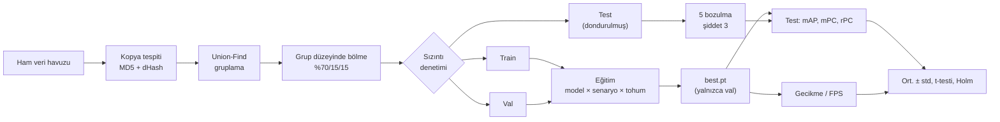
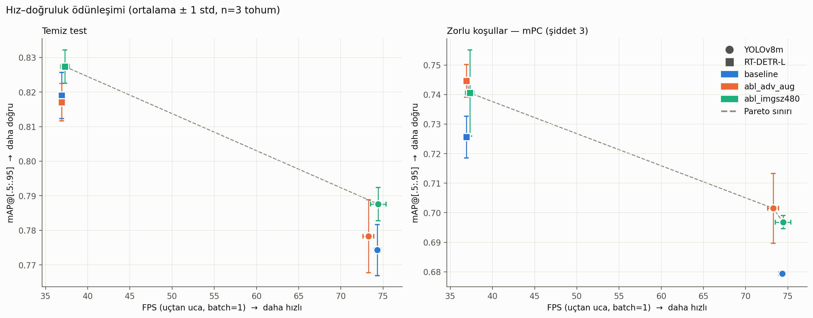
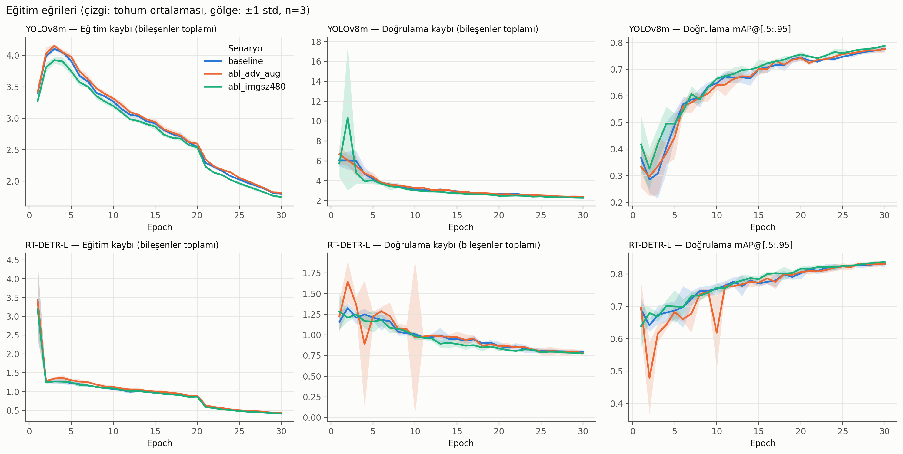
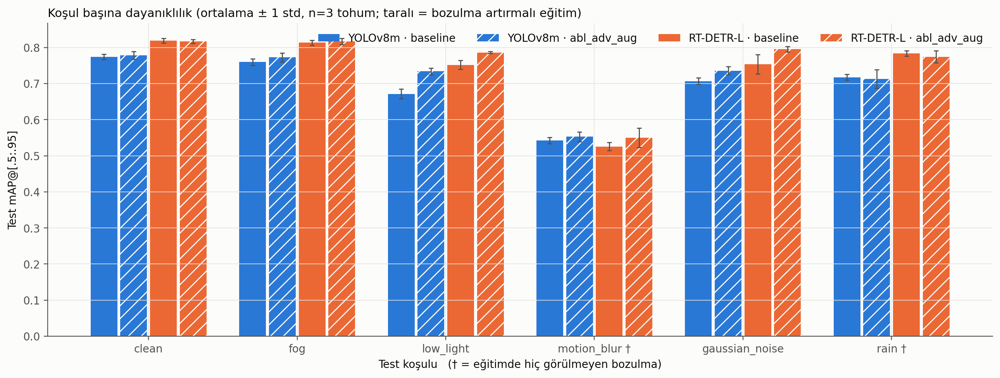
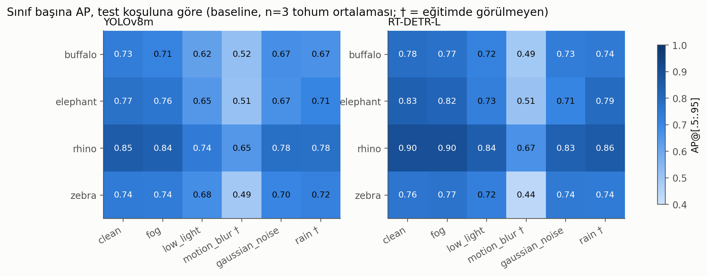
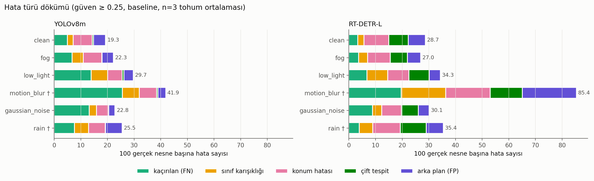
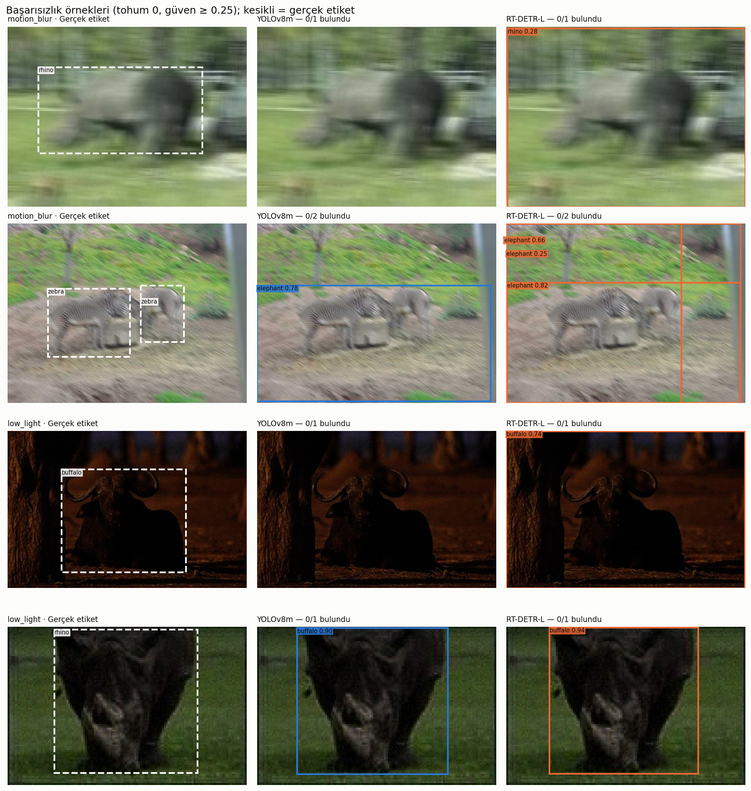

# Zorlu Görüntüleme Koşullarında YOLOv8 ve RT-DETR'nin Hız–Doğruluk Ödünleşimi

| | |
|---|---|
| **Ders** | BİL458 — [Ders adı] |
| **Ekip** | [Ad Soyad] ([Öğrenci no]) · [Ad Soyad] ([Öğrenci no]) · [Ad Soyad] ([Öğrenci no]) · [Ad Soyad] ([Öğrenci no]) |
| **Teslim tarihi** | [GG.AA.YYYY] |

# Özet

Gerçek zamanlı nesne tespit sistemleri, yaban hayatı izleme ve otonom sürüş gibi uygulamalarda düşük ışık, sis, yağmur ve hareket bulanıklığı gibi zorlu görüntüleme koşullarıyla karşılaşır. Bu çalışmada evrişimsel tek aşamalı YOLOv8m ile transformer tabanlı uçtan uca RT-DETR-L, dört hayvan sınıfı içeren African Wildlife veri setinde, bu koşullardaki hız–doğruluk ödünleşimi açısından karşılaştırılmıştır. Veri sızıntısını önlemek için birebir ve yakın kopyalar MD5 ve algısal özetle (dHash) tespit edilmiş, ayrım grup düzeyinde yapılıp dondurulmuş ve otomatik denetimlerle doğrulanmıştır. Temiz test kümesinden fiziksel ve istatistiksel modellere dayalı beş bozulma türetilmiş; modeller baseline, bozulma artırmalı eğitim ve düşük çözünürlük senaryolarında üçer tohumla 30 epoch eğitilmiştir. Sonuçlar ortalama ± standart sapma, eşleştirilmiş t-testleri ve Holm düzeltmesiyle raporlanmıştır. NVIDIA L4 üzerinde YOLOv8m 2,0 kat daha hızlıdır (74,3 ± 0,4 FPS). RT-DETR-L ise temiz testte (0,819 ± 0,007 mAP@[.5:.95]) ve bozulmalar altında (mPC 0,726 ± 0,007) yaklaşık 4,5 puan daha doğrudur, ancak göreli dayanıklılıkları aynıdır (rPC 0,886 ve 0,878). Hareket bulanıklığı en zor koşuldur: YOLOv8m nesneleri kaçırırken RT-DETR-L sahneyi kaplayan hatalı kutular üretmektedir. Düşük ışıkta iki model de gergedanı yüksek güvenle bufalo olarak sınıflandırmaktadır. Sınıf başına AP ve hata türü dökümüyle yapılan başarısızlık analizi, hareket bulanıklığında en kırılgan sınıfın çizgili deseni silinen zebra olduğunu göstermiştir. Bozulma artırmasının kazancı eğitimde görülen bozulmalarla sınırlı kalmıştır. Bulgular, gecikme bütçesine göre mimari seçimi için nicel bir çerçeve sunmaktadır.

**Anahtar Kelimeler** — Nesne tespiti, YOLO, DETR, dayanıklılık, görüntü bozulmaları, veri sızıntısı.

---

# 1. Giriş

Nesne tespiti, bir görüntüdeki nesnelerin sınıfını ve konumunu birlikte belirleme görevidir ve pek çok otonom sistemin algı katmanını oluşturur. Bu çalışmanın motive edici uygulaması **yaban hayatı izlemedir**. Koruma alanlarındaki kamera tuzakları çok sayıda görüntü üretir; bu görüntülerin elle etiketlenmesi ekolojik araştırmaların temel darboğazıdır ve derin öğrenme tabanlı otomatik tanımanın bu yükü büyük ölçüde azaltabildiği gösterilmiştir [1]. Kaçak avcılıkla mücadelede kullanılan insansız hava araçlarında ise tespitin **cihaz üzerinde ve gerçek zamanlı** yapılması gerekir; bu sistemlerde gecikme bütçesi doğruluk kadar belirleyicidir.

Bu uygulamalar kontrollü veri setlerinden çok farklı koşullarda çalışır. Kamera tuzakları sıklıkla gece ya da düşük ışıkta görüntü alır; sis, yağmur ve hareket bulanıklığı olağandır. Kamera tuzağı görüntüleriyle eğitilen modellerin yeni konum ve koşullara genellemede ciddi biçimde başarısız olduğu gösterilmiştir [2]. Otonom sürüş için yapılan dayanıklılık değerlendirmelerinde de yaygın dedektörlerin performansının sentetik bozulmalar altında temiz koşuldaki değerinin yaklaşık yarısına kadar düşebildiği raporlanmıştır [3].

**Literatürde nasıl çözüldüğü.** Gerçek zamanlı tespitte uzun süre baskın paradigma, YOLO ailesinin temsil ettiği tek aşamalı evrişimsel dedektörler olmuştur [4]. Bu modeller yoğun bir aday kutu ızgarası tahmin eder ve yinelenen tespitleri Maksimum Olmayanı Bastırma (NMS) ile eler; YOLOv8, çapasız başlık ve görev hizalı etiket atamasıyla güncel bir referans noktasıdır [5]. DETR [6] ise tespiti bir **küme tahmini** problemi olarak ele alır ve Macar eşlemesiyle NMS'siz, uçtan uca eğitilir; ancak yavaş yakınsaması gerçek zamanlı kullanımını sınırlamıştır. RT-DETR [7], verimli bir hibrit kodlayıcıyla bu sınırlamayı aşmayı hedeflemiş ve gerçek zamanlı ölçekte YOLO modellerini geçtiğini raporlamıştır. Bozulmalara karşı dayanıklılığın ölçümü için sınıflandırmada ImageNet-C [8], tespitte Michaelis ve arkadaşlarının protokolü [3] önerilmiştir; düşük ışık için ExDark gibi gerçek veri setleri de mevcuttur [9]. Bu karşılaştırmalarda iki metodolojik sorun sıkça göz ardı edilir: sonuçlar genellikle tek bir eğitim çalıştırmasından raporlanır ve **veri sızıntısı**, yani değerlendirmede kullanılmaması gereken bilginin eğitime karışması [10], raporlanan başarımı sistematik olarak şişirir. Sızıntının makine öğrenmesine dayalı bilimde yaygın bir tekrarlanabilirlik sorunu olduğu [11] ve yaygın kıyaslama veri setlerinde bile test görüntülerinin eğitim kümesinde yakın kopyalarının bulunabildiği [13] gösterilmiştir. Modellerin çoğunun COCO [12] üzerinde ön-eğitilmesi, ön-eğitim verisiyle test verisinin örtüşmesi riskini de beraberinde getirir.

**Yöntemin seçilme gerekçesi.** İki mimari, tümevarımsal yanlılık bakımından iki uç temsil eder: YOLO'nun evrişimleri yerel dokuya, RT-DETR'nin öz-dikkati küresel bağlama dayanır. Bu fark, bozulmalara karşı farklı davranış beklentisi doğurur. Orijinal DETR yerine RT-DETR seçilmiştir, çünkü DETR'nin yüzlerce epoch'luk yakınsama süresi ders kapsamında uygulanabilir değildir ve RT-DETR gerçek zamanlı ölçekte doğrudan YOLO ile karşılaştırılabilir. Modeller kapasite olarak yakın seçilmiştir (YOLOv8m ≈ 26M, RT-DETR-L ≈ 33M parametre) ve aynı eğitim–değerlendirme hattında çalıştırılmıştır.

**Araştırma sorusu ve hipotezler.** *Aynı veri, aynı ayrım ve aynı protokol altında, YOLOv8m ve RT-DETR-L'nin zorlu koşullardaki hız–doğruluk ödünleşimi nasıldır?*

- **H1:** YOLOv8m daha yüksek FPS, RT-DETR-L daha yüksek mAP sağlar; iki model de Pareto sınırında yer alır.
- **H2:** Küresel bağlam kullanan RT-DETR-L, bozulmalar altında temiz performansının daha büyük bir kısmını korur (daha yüksek rPC).
- **H3:** Sentetik bozulma artırmasıyla eğitim, mPC'yi artırır; ancak eğitimde görülmeyen bozulmalara sınırlı genellenir.

# 2. Yöntem

## 2.1 Genel akış

*Şekil 1. Deneysel akış. Test kümesine yalnızca model seçimi tamamlandıktan sonra erişilir.*

Notasyon olarak $\mathcal{D}=\{(x_n,Y_n)\}$, $Y_n=\{(c_j,b_j)\}_{j=1}^{G_n}$ görüntü başına $G_n$ nesnenin sınıfı ve kutusu, $C=4$ sınıf sayısıdır. Ayrık bölmeler için sızıntısızlık koşulu, $g(\cdot)$ kopya grubu ve $h(\cdot)$ dHash olmak üzere:

$$
g(\mathcal{D}_a)\cap g(\mathcal{D}_b)=\varnothing,\qquad \min_{x\in\mathcal{D}_a,\,x'\in\mathcal{D}_b} d_H\big(h(x),h(x')\big)>\tau=5,\quad a\neq b \tag{1}
$$

## 2.2 Görüntü oluşum ve bozulma modeli

Her bozulma, temiz görüntü $I$, şiddet $\ell\in\{1,\dots,5\}$ ve görüntüye özgü rastgelelik $\omega=\mathrm{MD5}(\text{tohum}\,\|\,\text{dosya}\,\|\,k)$ ile tanımlı bir $T_{k,\ell}(I;\omega)$ operatörüdür. Operatörler geometriyi değiştirmediğinden etiketler korunur. Sis, Koschmieder atmosferik saçılma modeliyle; düşük ışık, gama sıkıştırması ve Poisson–Gauss sensör gürültüsüyle; hareket bulanıklığı, doğrusal nokta yayılım fonksiyonuyla evrişim olarak modellenir:

$$
T_{fog}(I)=I\odot t+A(1-t),\qquad T_{ll}(I)=255\,\mathrm{clip}\big(u+\epsilon_1\sqrt{u}+\epsilon_2\big),\; u=g_\ell(I/255)^{\gamma_\ell},\qquad T_{mb}(I)=I*k_{L_\ell,\phi} \tag{2}
$$

Burada $A=225$ atmosferik ışık, $t$ düşük frekanslı gürültüyle modüle edilen iletim haritası, $\epsilon_{1,2}$ Gauss gürültüleri, $L_\ell\in\{5,\dots,23\}$ bulanıklık uzunluğu ve $\phi\sim\mathcal{U}(0^\circ,180^\circ)$ yöndür. Gauss gürültüsü $I+\mathcal{N}(0,\sigma_\ell^2)$, yağmur ise $0{,}85\,I+180\,(G*R_\ell)$ biçiminde eğik çizgi maskesiyle toplamsal olarak uygulanır.

## 2.3 Kutu benzerlik ölçüleri

$$
\mathrm{IoU}=\frac{\lvert B\cap B^{gt}\rvert}{\lvert B\cup B^{gt}\rvert},\qquad
\mathrm{GIoU}=\mathrm{IoU}-\frac{\lvert C\setminus(B\cup B^{gt})\rvert}{\lvert C\rvert},\qquad
\mathrm{CIoU}=\mathrm{IoU}-\frac{\rho^2(\mathbf b,\mathbf b^{gt})}{c^2}-\alpha v \tag{3}
$$

GIoU [14], örtüşmeyen kutularda da gradyan üretmek için kapsayan kutu $C$'yi; CIoU [15] ise merkez uzaklığı $\rho$ ve en-boy uyumu $v=\tfrac{4}{\pi^2}(\arctan\tfrac{w^{gt}}{h^{gt}}-\arctan\tfrac{w}{h})^2$, $\alpha=v/((1-\mathrm{IoU})+v)$ terimlerini ekler.

## 2.4 YOLOv8: mimari ve kayıp fonksiyonu

YOLOv8, adımları $s\in\{8,16,32\}$ olan üç öznitelik haritasında $N_a=21HW/1024$ noktada (640 px için 8400) tahmin üretir. Pozitif örnekler görev hizalı atamayla (TAL) seçilir: nesne $j$ ve nokta $i$ için $t_{ij}=\hat p_{i,c_j}^{0,5}\cdot\mathrm{IoU}_{ij}^{6}$ ölçütüne göre her nesneye en iyi 10 nokta atanır ve sınıf hedefi $t_{ij}$'den türetilen yumuşak bir skordur. Kutu kenar uzaklıkları 16 kutulu bir ayrık dağılım olarak öğrenilir ve dağılım odak kaybı (DFL) [16] ile eğitilir. $S$ hedef skorların toplamı, $w_i$ pozitif noktanın ağırlığı, $\mathcal P$ pozitif küme ve $B$ yığın boyutu olmak üzere toplam kayıp:

$$
\mathcal L_{\mathrm{YOLO}}=B\Big[\,7{,}5\cdot\tfrac{1}{S}\textstyle\sum_{i\in\mathcal P}w_i(1-\mathrm{CIoU}_i)\;+\;0{,}5\cdot\tfrac{1}{S}\sum_{i,c}\mathrm{BCE}(z_{ic},\hat t_{ic})\;+\;1{,}5\cdot\mathcal L_{\mathrm{DFL}}\Big] \tag{4}
$$

## 2.5 RT-DETR: mimari ve kayıp fonksiyonu

RT-DETR, öz-dikkati yalnızca en kaba ölçekte uygulayan bir hibrit kodlayıcı ve $Q=300$ sorgulu, $D=6$ katmanlı bir kod çözücüden oluşur. Tahmin kümesi ile gerçek küme arasındaki birebir eşleme Macar algoritmasıyla bulunur [6]:

$$
\hat\sigma=\operatorname*{arg\,min}_{\sigma}\sum_{j}\Big[\mathcal C_{cls}(j,\sigma(j))+5\lVert b_j-\hat b_{\sigma(j)}\rVert_1+2\big(-\mathrm{GIoU}(b_j,\hat b_{\sigma(j)})\big)\Big] \tag{5}
$$

Sınıflandırma için, eşleşen sorgunun hedefi kutunun IoU'su $q$ olan Varifocal kayıp (VFL) [17] kullanılır; kayıp her kod çözücü katmanına ve gürültü giderme (denoising) sorgularına ayrıca uygulanır [7]:

$$
\mathrm{VFL}(p,q)=\begin{cases}-q\,[\,q\log p+(1-q)\log(1-p)\,], & q>0\\ -0{,}75\,p^{2}\log(1-p), & q=0\end{cases},\qquad
\mathcal L_{\mathrm{RT\text{-}DETR}}=\sum_{d=0}^{D}\big[\mathcal L_{\mathrm{VFL}}+5\,\mathcal L_{L1}+2\,\mathcal L_{\mathrm{GIoU}}\big]^{(d)} \tag{6}
$$

Birebir eşleme her nesne için tek tahmini ödüllendirdiğinden NMS gerekmez. Denklem (4) ve (6) farklı terim ve ölçeklerden oluştuğu için iki modelin mutlak kayıp değerleri karşılaştırılamaz; modeller arası karşılaştırma mAP üzerinden yapılır.

## 2.6 Optimizasyon

Tohum $r$ için parametreler, tohuma bağlı veri artırma $\mathcal A_r$ altında ampirik riskin minimizasyonuyla bulunur. Kullanılan uygulama, toplam iterasyon $I=\lceil\lvert\mathcal D_{tr}\rvert/64\rceil E\le10^4$ olduğunda AdamW [18] seçer ($\eta_0=0{,}002\cdot5/(4+C)=1{,}25\times10^{-3}$):

$$
m_t=\beta_1m_{t-1}+(1-\beta_1)g_t,\quad v_t=\beta_2v_{t-1}+(1-\beta_2)g_t^2,\quad
\theta_{t+1}=\theta_t-\eta_t\Big(\tfrac{\hat m_t}{\sqrt{\hat v_t}+\epsilon}+\lambda\theta_t\Big) \tag{7}
$$

Öğrenme oranı ilk $\max(3n_b,100)$ iterasyonda doğrusal ısınma ile yükselir, ardından $\eta(e)=\eta_0[(1-e/E)(1-0{,}01)+0{,}01]$ ile doğrusal azalır. Değerlendirmede ağırlıkların üstel hareketli ortalaması kullanılır ve en iyi epoch, yalnızca doğrulama kümesinde $F=0{,}1\,\mathrm{mAP}_{50}+0{,}9\,\mathrm{mAP}_{50:95}$ uygunluğuyla seçilir.

## 2.7 Değerlendirme ölçütleri ve istatistik

$\mathrm{mAP}_{50:95}$, 10 IoU eşiği ve $C$ sınıf üzerinden 101 noktalı enterpolasyonla hesaplanan AP'nin ortalamasıdır. Dayanıklılık [3]:

$$
\mathrm{mPC}=\frac{1}{\lvert\mathcal K\rvert}\sum_{k\in\mathcal K}\mathrm{mAP}^{(k)}_{50:95},\qquad \mathrm{rPC}=\frac{\mathrm{mPC}}{\mathrm{mAP}^{clean}_{50:95}},\qquad
\mathrm{FPS}=\frac{1000}{\mathrm{medyan}(t_1,\dots,t_M)\,[\mathrm{ms}]} \tag{8}
$$

FPS, ön işleme, çıkarım ve son işlemeyi (YOLO için NMS dahil) kapsayan uçtan uca gecikmeden, yığın boyutu 1 ile ölçülür. Her yapılandırma $R=3$ tohumla çalıştırılır ve $\bar m\pm s$ ($s$: örneklem std) olarak raporlanır. Karşılaştırmalar tohum bazında eşleştirilmiş t-testiyle yapılır; çoklu karşılaştırma için Holm–Bonferroni düzeltmesi uygulanır.

## 2.8 Karmaşıklık analizi

| Bileşen | YOLOv8 | RT-DETR |
|---|---|---|
| Omurga ve boyun (çıkarım) | $\Theta(HW)$ | $\Theta(HW)$ |
| Öz-dikkat | — | $O(L_5^2d)$, $L_5=HW/32^2$ (640 px: 400 belirteç) |
| Kod çözücü | — | $D\cdot O(Q^2d+Q\,M_hN_\ell K_p\,d)$ |
| Son işleme | NMS: $O(N'\log N')$, en kötü $O(N'^2)$ | top-$k$: $O(QC)$, sabit |
| Etiket atama (eğitim) | TAL: $O(G\,N_a)$ | Macar: $O(Q\,G^2)$, $D+1$ kez |
| Parametre / GFLOPs (640 px) | 25,9 M / 78,9 | 32,8 M / 110 |

*Tablo 1. Görüntü başına zaman karmaşıklığı. $N'$: güven eşiğini geçen aday, $G$: nesne sayısı, $M_h,N_\ell,K_p$: dikkat başı, ölçek ve örnekleme noktası sayısı.*

İki model de piksel sayısında baskın olarak doğrusal ölçeklenir. YOLO'nun son işleme süresi aday sayısına bağlı, yani **içeriğe bağlıdır**; RT-DETR'ninki sabittir. Sızıntı önleme adımındaki çiftler arası Hamming karşılaştırması $O(N^2)$'dir, ancak yalnızca bir kez çalışır; veri hattının tüm adımlarının karmaşıklığı Ek B'dedir.

## 2.9 Araç tercihleri

İki model de **Ultralytics** [5] kütüphanesiyle eğitilmiştir. Bu seçim, veri yükleme, artırma, değerlendirme ve mAP hesabının iki model için birebir aynı olmasını sağlayarak çatı farkından kaynaklı yanlılığı ortadan kaldırır. Deney hattı, tek bir Jupyter Notebook olarak PyTorch üzerinde yazılmıştır; istatistik için SciPy, görselleştirme için Matplotlib kullanılmıştır. Deneyler, erişilebilir ve tekrarlanabilir bir ortam olduğu için Google Colab'da NVIDIA L4 GPU üzerinde yürütülmüştür; sonuçlar oturum kopmalarına karşı Google Drive'a yazılmıştır. Farklı oturumlarda farklı GPU'lar atanabildiğinden, tüm modellerin FPS'i en son tek bir GPU üzerinde yeniden ölçülmüştür.

# 3. Uygulama

## 3.1 Veri seti

| Özellik | Değer |
|---|---|
| Ad ve kaynak | African Wildlife; Ultralytics tarafından dağıtılan açık veri seti |
| Lisans | **[Veri setinin yayım sayfasından doğrulanıp yazılmalı]** |
| Sınıflar | bufalo, fil, gergedan, zebra ($C=4$) |
| Boyut | **[N]** görüntü, **[M]** nesne kutusu (notebook'taki ayrım hücresinin çıktısından) |
| Etiket biçimi | YOLO formatı: sınıf, normalize merkez, genişlik, yükseklik |
| Ayrım | train / val / test = **[n₁] / [n₂] / [n₃]** görüntü (%70 / %15 / %15); test kümesinde 1191 nesne |

*Tablo 2. Veri seti özellikleri.*

**Ön işleme.** Veri setinin özgün train/val/test ayrımı kullanılmamış, tüm görüntüler tek bir havuzda toplanmıştır. Her görüntü için MD5 özeti ve 64 bitlik dHash hesaplanmış; aynı özete sahip ya da Hamming mesafesi 5 bit veya altında olan görüntüler Union-Find yapısında aynı gruba birleştirilmiştir. Gruplar, `split_seed = 2024` ile karıştırılıp büyükten küçüğe, hedef oranına en uzak bölmeye atanmıştır. Ayrım bir manifest dosyasına yazılarak dondurulmuştur. Eğitim sırasında görüntüler 640 px'e (480 px ablasyonunda 480 px'e) en-boy oranı korunarak yeniden boyutlandırılır ve Ultralytics'in varsayılan artırmaları (mozaik, HSV, ölçekleme, öteleme, yatay çevirme) uygulanır. Bozuk test kümeleri, temiz test kümesinden sabit bir tohumla bir kez üretilir; bozulma artırmalı eğitimde ise her tohum için eğitim görüntülerinin %50'si sis, düşük ışık ya da Gauss gürültüsüyle (şiddet 1–3) bozulur. Hareket bulanıklığı ve yağmur eğitimde hiç kullanılmaz.

## 3.2 Senaryolar ve hiperparametreler

| Senaryo | Değişen faktör |
|---|---|
| `baseline` | — (temiz eğitim, 640 px, varsayılan artırmalar) |
| `abl_adv_aug` | Eğitim görüntülerinin %50'si bozulmuş (küme boyutu sabit) |
| `abl_imgsz480` | Girdi çözünürlüğü 640 → 480 px |

*Tablo 3. Senaryolar. Her ablasyon baseline'dan yalnızca tek bir faktörü değiştirir.*

| Hiperparametre | Değer |
|---|---|
| Profil, epoch, eğitim verisi oranı | `mid`, 30, %100 |
| Senaryolar | baseline, abl_adv_aug, abl_imgsz480 |
| Tohumlar | 0, 1, 2 (veri ayrımı tohumu ayrı: 2024) |
| Optimize edici, $\eta_0$ | AdamW, $1{,}25\times10^{-3}$ |
| Yığın / nominal yığın (biriktirme) | 8 / 64 |
| Ağırlık bozunumu, ısınma, $r_f$ | $5\times10^{-4}$, 3 epoch, 0,01 |
| Mozaiğin kapatıldığı son epoch sayısı | 10 |
| Ön-eğitimli ağırlıklar | yolov8m.pt, rtdetr-l.pt (COCO) |
| Karma hassasiyet, deterministik kip | açık, açık |
| Bozulma artırması | eğitim görüntülerinin %50'si; sis, düşük ışık, Gauss gürültüsü; şiddet 1–3 |
| Test bozulmaları | 5 tür, şiddet 3 |
| FPS ölçümü (ısınma / tekrar) | 10 / 200, yığın 1, FP32 |

*Tablo 4. Hiperparametreler. Değerler, aksi belirtilmedikçe Ultralytics varsayılanlarıdır; iki modelde de aynıdır ve test kümesine bakılarak ayarlanmamıştır.*

## 3.3 Varsayımlar

1. Etiketler doğrudur; etiket gürültüsü iki model için aynı etkiye sahiptir.
2. dHash ile tespit edilen kopyalar dışında görüntüler birbirinden bağımsızdır. Veri seti kamera ya da konum bilgisi içermediği için sahne düzeyinde gruplama yapılamamıştır.
3. Sentetik bozulmalar gerçek zorlu koşulların makul bir yaklaşığıdır.
4. Aynı varsayılan hiperparametreler iki mimari için adil bir karşılaştırma sağlar.
5. Paylaşımlı bulut GPU'sundaki gecikme dalgalanması, aynı mimarinin çalıştırmaları arasındaki FPS farkıyla ölçülebilir düzeydedir (Tablo 6'daki Δ FPS değerleriyle doğrulanmıştır).

## 3.4 Kodun yapısı

Tüm hat tek bir Jupyter Notebook'tadır (`yolo_vs_detr_benchmark.ipynb`). Notebook şu bölümlerden oluşur: yapılandırma ve tekrarlanabilirlik; veri indirme, kopya tespiti ve dondurulmuş ayrım; sızıntı denetimi; bozulma operatörleri; birim testleri; senaryo tanımları; eğitim, değerlendirme ve FPS ölçümü; istatistik; grafikler; başarısızlık analizi. Hücrelerin ayrıntılı dökümü Ek C'dedir. Çalıştırma profili tek bir değişkenle (`PROFILE`) seçilir. Sonuçlar Google Drive'a yazılır; oturum koparsa tamamlanmış çalıştırmalar atlanır. Her çalıştırmanın ölçümleri JSON, özetler CSV olarak saklanır.

# 4. Deneysel Sonuçlar

Tüm sonuçlar `mid` profiliyle (30 epoch, eğitim verisinin tamamı) aynı dondurulmuş test kümesinde elde edilmiştir: 2 model × 3 senaryo × 3 tohum = 18 çalıştırma. FPS ölçümlerinin tamamı aynı GPU'da (NVIDIA L4) yapılmıştır. Eşleştirilmiş t-testleri 21 karşılaştırma üzerinden Holm düzeltmesiyle raporlanmıştır.

## 4.1 Baseline karşılaştırması

| Model | Senaryo | mAP@[.5:.95] temiz | mAP@.5 temiz | mPC | rPC | FPS | Gecikme p95 (ms) |
|---|---|---|---|---|---|---|---|
| YOLOv8m | baseline | 0,774 ± 0,007 | 0,938 ± 0,001 | 0,679 ± 0,001 | 0,878 ± 0,008 | 74,3 ± 0,4 | **14,6 ± 0,1** |
| YOLOv8m | bozulma art. | 0,778 ± 0,011 | 0,941 ± 0,010 | 0,701 ± 0,012 | 0,901 ± 0,003 | 73,3 ± 0,6 | 15,2 ± 0,2 |
| YOLOv8m | 480 px | 0,788 ± 0,005 | 0,943 ± 0,003 | 0,697 ± 0,002 | 0,885 ± 0,003 | **74,4 ± 0,9** | **14,6 ± 0,3** |
| RT-DETR-L | baseline | 0,819 ± 0,007 | 0,952 ± 0,006 | 0,726 ± 0,007 | 0,886 ± 0,002 | 36,9 ± 0,3 | 28,9 ± 0,5 |
| RT-DETR-L | bozulma art. | 0,817 ± 0,005 | 0,952 ± 0,004 | **0,745 ± 0,006** | **0,911 ± 0,013** | 36,9 ± 0,4 | 29,0 ± 0,4 |
| RT-DETR-L | 480 px | **0,827 ± 0,005** | **0,957 ± 0,003** | 0,741 ± 0,015 | 0,895 ± 0,020 | 37,3 ± 0,5 | 28,7 ± 0,4 |

*Tablo 5. Ana sonuçlar (ortalama ± std, n = 3 tohum). mPC: beş bozulma üzerinden ortalama mAP@[.5:.95] (şiddet 3); rPC = mPC / temiz mAP. FPS: uçtan uca, yığın boyutu 1, FP32, NVIDIA L4. Her sütundaki en iyi değer kalındır. Tohum düzeyindeki değerler Ek A'dadır.*

*Şekil 2. Temiz test (sol) ve zorlu koşullar (sağ, mPC) için mAP–FPS ödünleşimi; hata çubukları her iki eksende ±1 std, kesikli çizgi Pareto sınırı. Daire: YOLOv8m, kare: RT-DETR-L.*

YOLOv8m, RT-DETR-L'den **2,0 kat hızlıdır** (74,3'e karşı 36,9 FPS; medyan gecikme 13,5'e karşı 27,1 ms). RT-DETR-L ise temiz testte **4,5 puan** (0,819'a karşı 0,774), zorlu koşullarda **4,6 puan** (mPC 0,726'ya karşı 0,679) daha doğrudur. Temiz mAP ve FPS farkları Holm düzeltmesinden sonra anlamlıdır ($p_{Holm}=0{,}012$ ve $p_{Holm}<0{,}001$). mPC farkının etki büyüklüğü çok büyüktür (eşleştirilmiş $d_z=-7{,}2$), ancak düzeltme sonrası anlamlılık sınırında kalmıştır ($p=0{,}006$, $p_{Holm}=0{,}10$). Bunun nedeni, $n=3$ ile serbestlik derecesinin 2 olması ve 21 testlik düzeltmedir. İki mimari Şekil 2'de iki ayrı bölge oluşturur (~74 FPS / ~0,78 ve ~37 FPS / ~0,82). Hiçbir varyant diğer mimarinin bir varyantına iki eksende birden üstün değildir; Pareto sınırını iki mimarinin 480 px varyantları oluşturur. Aynı mimarinin tohumları arasındaki FPS farkı 1 FPS'in altındadır, yani ölçüm gürültüsü mimari farkının yanında ihmal edilebilir düzeydedir.

## 4.2 Öğrenme eğrileri

*Şekil 3. Eğitim kaybı, doğrulama kaybı ve doğrulama mAP@[.5:.95] (çizgi: tohum ortalaması, gölge: ±1 std, n = 3). İki modelin kayıp fonksiyonları farklı olduğundan (Denklem 4 ve 6) kayıp ölçekleri karşılaştırılamaz.*

Doğrulama mAP'i iki modelde de 30. epoch'ta hâlâ yavaş yükselmektedir (son değerler YOLOv8m için ~0,78, RT-DETR-L için ~0,83). Modeller doygunluğa yaklaşmış, ancak tam yakınsamamıştır. Eğitim kaybındaki 20. epoch sonrası keskin düşüş bir kararsızlık değildir: Ultralytics son 10 epoch'ta mozaik artırmasını kapatır ve eğitim dağılımı doğrulama dağılımına yaklaşır. RT-DETR-L ilk epoch'ta ~0,65–0,70 doğrulama mAP'ine ulaşırken YOLOv8m ~0,35–0,42'den başlar. Transformer'ın yeni sınıflara çok daha az güncellemeyle uyum sağladığını gösteren bu **örnek verimliliği farkı** Bölüm 5.1'de tartışılmıştır. İki geçici sıçrama tek bir tohumdan kaynaklanır: YOLOv8m 480 px'te 2. epoch'taki doğrulama kaybı ve RT-DETR-L bozulma artırmalı varyantta 10. epoch'taki mAP düşüşü. İkisi de sonraki epoch'larda toparlanır ve `best.pt` doğrulama kümesinde seçildiği için sonuçları etkilemez.

## 4.3 Ablasyon çalışması

| Model | Değişiklik | Δ mAP temiz | Δ mPC | Δ FPS | $p_{Holm}$ (mAP / mPC) |
|---|---|---|---|---|---|
| YOLOv8m | + bozulma artırması | +0,004 ± 0,015 | +0,022 ± 0,012 | −1,1 ± 0,4 | 1,00 / 0,83 |
| YOLOv8m | girdi 640 → 480 px | +0,013 ± 0,009 | +0,017 ± 0,003 | +0,1 ± 0,5 | 1,00 / 0,11 |
| RT-DETR-L | + bozulma artırması | −0,002 ± 0,002 | +0,019 ± 0,012 | +0,0 ± 0,7 | 1,00 / 1,00 |
| RT-DETR-L | girdi 640 → 480 px | +0,008 ± 0,011 | +0,015 ± 0,013 | +0,4 ± 0,3 | 1,00 / 1,00 |

*Tablo 6. Ablasyon: tohum bazında eşleştirilmiş farklar (varyant − baseline, ortalama ± std, n = 3).*

Hiçbir ablasyon etkisi Holm düzeltmesinden sonra anlamlı değildir. Ancak yönler tutarlıdır: **bozulma artırması** iki mimaride de mPC'yi artırırken (+2,2 ve +1,9 puan) temiz doğruluğu değiştirmemiştir. **480 px çözünürlük** ise beklenenin aksine **hız kazancı sağlamamıştır** (|Δ FPS| ≤ 0,4). Piksel sayısı %44 azalsa da yığın boyutu 1'de uçtan uca gecikmeye sabit maliyetler (görüntü okuma ve ön işleme, Python yükü, çekirdek başlatma, son işleme) hâkimdir. Bu nedenle Tablo 1'deki $\Theta(HW)$ ölçeklenmesi bu çalışma rejiminde görünmez. Doğruluk hafifçe artmıştır; en büyük kazanç hareket bulanıklığındadır (+5,1 ve +5,8 puan). Olası açıklama, görüntü küçültüldüğünde bulanıklık çekirdeğinin ağın gördüğü piksel cinsinden aynı oranda (×0,75) kısalmasıdır.

## 4.4 Koşul başına sonuçlar

| Model | Senaryo | Temiz | Sis | Düşük ışık | Hareket bul. † | Gauss gür. | Yağmur † |
|---|---|---|---|---|---|---|---|
| YOLOv8m | baseline | 0,774 | 0,760 (%98) | 0,671 (%87) | 0,542 (%70) | 0,707 (%91) | 0,717 (%93) |
| YOLOv8m | bozulma art. | 0,778 | 0,772 (%99) | 0,734 (%94) | 0,553 (%71) | 0,735 (%94) | 0,713 (%92) |
| YOLOv8m | 480 px | 0,788 | 0,768 (%98) | 0,686 (%87) | 0,593 (%75) | 0,728 (%92) | 0,708 (%90) |
| RT-DETR-L | baseline | 0,819 | 0,813 (%99) | 0,752 (%92) | 0,526 (%64) | 0,754 (%92) | 0,784 (%96) |
| RT-DETR-L | bozulma art. | 0,817 | 0,817 (%100) | 0,786 (%96) | 0,550 (%67) | 0,796 (%97) | 0,774 (%95) |
| RT-DETR-L | 480 px | 0,827 | 0,818 (%99) | 0,755 (%91) | 0,584 (%71) | 0,767 (%93) | 0,779 (%94) |

*Tablo 7. Koşul başına test mAP@[.5:.95] (3 tohum ortalaması) ve parantez içinde temiz performansın korunan oranı. † eğitimde hiç görülmeyen bozulma. Standart sapmalar Ek A'dadır.*

*Şekil 4. Koşul başına dayanıklılık (ortalama ± 1 std, n = 3); taralı çubuklar bozulma artırmalı eğitimi gösterir.*

Sis iki model için de neredeyse zararsızdır (≥ %98). **Hareket bulanıklığı** tüm varyantlar için en zor koşuldur (%64–75) ve RT-DETR-L'nin mutlak üstünlüğünün kaybolduğu tek koşuldur (0,526'ya karşı 0,542; $p=0{,}24$). Baseline'lar arasında RT-DETR-L düşük ışıkta (%92'ye karşı %87) ve yağmurda (%96'ya karşı %93) göreli olarak daha dayanıklı, hareket bulanıklığında ise daha kırılgandır (%64'e karşı %70). Bozulma artırmasının kazancı, eğitimde **görülen** bozulmalarda yoğunlaşır: düşük ışıkta +6,3 / +3,4, Gauss gürültüsünde +2,9 / +4,2 puan (YOLOv8m / RT-DETR-L). Eğitimde **hiç görülmeyen** bozulmalarda ise kazanç küçüktür ya da yoktur: hareket bulanıklığında +1,1 / +2,4, yağmurda −0,5 / −0,9 puan.

## 4.5 Sınıf ve hata türü düzeyinde sonuçlar

*Şekil 5. Sınıf başına AP@[.5:.95], test koşuluna göre (baseline, 3 tohum ortalaması).*

*Şekil 6. 100 gerçek nesne başına hata sayısı, hata türüne göre (güven ≥ 0,25, baseline, 3 tohum ortalaması). Hata türlerinin tanımı Bölüm 5.2'dedir.*

Gergedan iki modelde de her koşulda en yüksek AP'ye sahip sınıftır (temizde 0,85 / 0,90). En kırılgan sınıf zebradır. Hareket bulanıklığında zebra AP'si YOLOv8m'de temiz değerinin %66'sına, RT-DETR-L'de %57'sine düşer (0,76 → 0,44); bu, tablodaki en sert göreli düşüştür. Temiz test kümesinde YOLOv8m 100 nesnenin 90,3'ünü, RT-DETR-L 94,6'sını doğru bulur. Hareket bulanıklığında bu oranlar 66,6 ve 71,2'ye iner. Ancak RT-DETR-L'nin toplam hata sayısı YOLOv8m'in iki katıdır (85,4'e karşı 41,9).

# 5. Tartışma

## 5.1 Sonuçların anlamı

**H1 desteklenmiştir.** YOLOv8m 2,0 kat daha hızlı, RT-DETR-L 4,5 puan daha doğrudur ve iki mimari de Pareto sınırındadır; seçim uygulamanın gecikme bütçesine bağlıdır. L4 üzerinde, optimize edilmemiş PyTorch ortamında iki model de 30 FPS eşiğini geçer. Ancak RT-DETR-L'nin payı darıdır: p95 gecikmesi 28,9 ms, yani ~35 FPS'tir. 60 FPS gerektiren bir sistemde ise yalnızca YOLOv8m uygundur.

**H2 desteklenmemiştir.** RT-DETR-L zorlu koşullarda mutlak olarak daha doğrudur (mPC +4,6 puan), ancak temiz performansının korunan oranı YOLOv8m ile aynıdır (rPC 0,886'ya karşı 0,878; $p=0{,}26$, $d_z=-0{,}9$). Yani transformer'ın dayanıklılık üstünlüğü **göreli değil, mutlaktır**: temiz koşuldaki doğruluk farkı bozulmalar altına taşınmaktadır. Koşul düzeyinde tablo karışıktır. Küresel bağlam, yerel dokuyu bozan düşük ışık ve yağmurda yardımcı olur; hareket bulanıklığında ise RT-DETR-L'nin göreli kaybı en büyüktür (Bölüm 5.2). "Öz-dikkat bozulmalara karşı genel olarak daha dayanıklıdır" şeklindeki yaygın beklenti bu veride doğrulanmamıştır.

**H3 kısmen desteklenmiştir.** Bozulma artırması iki mimaride de mPC'yi artırmış ve kazanç beklendiği gibi eğitimde görülen bozulmalarda yoğunlaşmıştır. Görülmeyen yağmurda kazanç yoktur. Etki yönü hipotezle tutarlıdır, ancak $n=3$ ile istatistiksel olarak doğrulanamamıştır.

**Eğitim bütçesinin etkisi.** Aynı hattın 3 epoch ve verinin %25'iyle yapılan ön deneyinde mimariler arasındaki temiz mAP farkı ~40 puandı; 30 epoch ve verinin tamamıyla bu fark 4,5 puana inmiştir. Öğrenme eğrileriyle birlikte bu sonuç, kısa bütçeli karşılaştırmaların mimari farkı değil, büyük ölçüde **örnek verimliliği farkını** ölçtüğünü gösterir. RT-DETR-L önceden eğitilmiş ağırlıklarla yeni sınıflara çok daha hızlı uyum sağlar, ancak yeterli bütçede YOLOv8m aradaki farkın çoğunu kapatır. Bu, kısa eğitimle yapılan mimari karşılaştırmalarına temkinle yaklaşılması gerektiğini gösteren yöntemsel bir bulgudur.

## 5.2 Başarısızlık analizi

**Yöntem.** Başarısızlıklar eğitilmiş ağırlıklarla, tek bir işletim noktasında (güven ≥ 0,25) incelenmiştir. Her test görüntüsünde tahminler önce mAP'teki gibi sınıf içinde, güvene göre azalan sırada eşlenir (IoU ≥ 0,5 → doğru tespit). Kalan tahminler TIDE [19] esinli beş türe ayrılır: **sınıf karışıklığı** (IoU ≥ 0,5, yanlış sınıf), **konum hatası** (doğru sınıf, 0,1 ≤ IoU < 0,5), **çift tespit** (zaten bulunmuş nesneye ikinci tahmin), **arka plan** (IoU < 0,1) ve hiçbir tahminin bulamadığı **kaçırılan** nesneler. Şekil 7, temizde iki modelin de tüm nesneleri bulduğu ama en zor iki bozulmada en çok kaçırdığı test görüntülerini gösterir.

*Şekil 7. Başarısızlık örnekleri (tohum 0, güven ≥ 0,25). Sol: gerçek etiket (kesikli), orta: YOLOv8m, sağ: RT-DETR-L. Satırlar: hareket bulanıklığı (1–2), düşük ışık (3–4).*

**(a) Hareket bulanıklığında iki farklı başarısızlık biçimi.** YOLOv8m bulanıklıkta **susar**: 100 nesnenin 25,6'sını hiç bulamaz, ancak arka plan hatası yalnızca 2,9'dur. RT-DETR-L ise **sahneyi kaplayan kutular üretir** (Şekil 7, 1. ve 2. satır): daha az nesne kaçırır (19,6), ama 20,3 ± 10,6 arka plan, 16,7 sınıf karışıklığı ve 16,7 konum hatası yapar. Olası mekanizma şudur. Bulanıklık yüksek frekanslı kenarları siler; YOLO'nun yerel öznitelikleriyle hesaplanan yoğun skorlar eşiğin altına düşer ve model sessiz kalır. RT-DETR'nin sorguları ise küresel dikkatle kaba bağlamdan (renk kütlesi, sahne) "burada bir hayvan var" çıkarımını sürdürür, ancak sınırı belirleyemediği için kutuyu sahneye yayar. Lokalizasyon kaybı mAP@[.5:.95]/mAP@.5 oranında da görülür: bu oran temizden bulanıklığa YOLOv8m'de 0,83'ten 0,73'e, RT-DETR-L'de 0,86'dan 0,76'ya düşer.

**(b) Çizgiler silinince zebra fil olur.** Zebranın en kırılgan sınıf olması (Şekil 5) galeride doğrudan görülür (Şekil 7, 2. satır): iki model de iki zebrayı tek bir "fil" kutusuyla kapsar. Zebrayı ayırt ettiren çizgili desen, bulanıklığın yok ettiği ince dokudur; geriye kalan gri, dokusuz kütle fil sınıfına benzer.

**(c) Düşük ışıkta gergedan bufalo olur — yüksek güvenle.** Şekil 7'nin 4. satırındaki gergedanı iki model de temiz görüntüde doğru bulur. Düşük ışıkta ise aynı kutuya %90 ve %94 güvenle "bufalo" der. Gergedan (gri) ile bufaloyu (siyah) ayıran başlıca ipucu parlaklık ve renktir; gama sıkıştırması tüm sahneyi karartarak tam da bu ipucunu siler. Sınıf karışıklığı düşük ışıkta 100 nesne başına YOLOv8m'de 2,2'den 6,2'ye, RT-DETR-L'de 2,3'ten 7,8'e çıkar. Bu hata türü özellikle tehlikelidir: güven skoru yüksek olduğundan bir eşikle elenemez. Modellerin bozulma altında **aşırı güvenli** olduğunu, yani kalibrasyonlarının bozulduğunu gösterir. Bu örnek çarpıcıdır ama en sık hata değildir. Tüm koşullar ve tohumlar toplamında iki modelde de en sık karışıklık **bufalo → fil**'dir (YOLOv8m 148, RT-DETR-L 118 tahmin). İki sınıf da büyük gövdeli, koyu renkli ve ayırt edici dokusu az hayvanlardır; karışıklık, bu sınıfları ayıran ipuçlarının (boynuz ve hortum biçimi gibi) bozulmalar altında ilk kaybolan ince ayrıntılar olmasıyla tutarlıdır. RT-DETR-L'de ikinci sırada **gergedan → zebra** (79) gelir; galerideki örnekler, bunun bir kısmının bulanıklıkta sahneyi kaplayan düşük güvenli kutulardan kaynaklandığını düşündürmektedir.

**(d) NMS'siz tasarımın bedeli: çift tespit.** RT-DETR-L temiz görüntüde bile 100 nesnede 7,3 çift tespit yaparken YOLOv8m'de bu sayı 0,5'tir. YOLO tekrarları NMS ile eler. RT-DETR ise tekrarları bastırmayı birebir eşlemeyle öğrenmeye bırakır (Denklem 5); bu bastırma 0,25 eşiğinde tam değildir. Çift tespitler düşük güvenli olduğundan mAP'i az etkiler. Ancak hayvan sayımı gibi tahmin sayısının doğrudan kullanıldığı uygulamalarda sayıyı şişirir. Bu tür kullanımda RT-DETR çıktısına da hafif bir NMS ya da daha yüksek bir güven eşiği uygulanmalıdır.

**Analizin sınırları.** Hata dökümü tek bir güven eşiğine bağlıdır ve TIDE'ın sadeleştirilmiş bir sürümüdür (hatanın mAP'e katkısı ayrıştırılmamıştır). Galeri tek bir tohumdan seçilmiştir ve "en kötü örnekleri" gösterdiği için tipik davranışı temsil etmez. Önerilen mekanizmalar gözleme dayalıdır; dikkat haritası gibi bir nedensellik analiziyle doğrulanmamıştır.

## 5.3 Güçlü ve zayıf yönler

Çalışmanın güçlü yönleri şunlardır: sızıntıyı yapısal olarak önleyen ve denetleyen veri hattı; iki model için birebir aynı eğitim–değerlendirme protokolü; üç tohumlu istatistiksel raporlama ve çoklu karşılaştırma düzeltmesi; ortalama metriğin ötesine geçen sınıf ve hata türü düzeyindeki başarısızlık analizi; olumsuz ve anlamsız sonuçlar dahil tüm sonuçların seçilmeden raporlanması. Zayıf yönleri ise şunlardır: modellerin 30 epoch'ta tam yakınsamamış olması; yalnızca sentetik bozulmaların ve tek bir şiddet düzeyinin kullanılması; $n=3$'ün düşük istatistiksel gücü (ablasyon etkilerinin hiçbiri doğrulanamamıştır); FPS'in optimize edilmemiş bir ortamda (PyTorch FP32, yığın boyutu 1) ölçülmesi.

## 5.4 Alternatif yöntemlerle beklenen fark

- **Orijinal DETR:** Aynı bütçede çok daha düşük doğruluk beklenir; DETR'nin yakınsaması RT-DETR'den belirgin biçimde yavaştır [6], [7].
- **İki aşamalı dedektörler (ör. Faster R-CNN):** İkinci aşamadaki inceltme sayesinde daha iyi lokalizasyon, ancak belirgin biçimde daha yüksek gecikme beklenir.
- **TensorRT FP16 ile dağıtım:** İki modelin de hızının birkaç kat artması beklenir. Sabit maliyetler azalacağı için 480 px çözünürlüğün hız kazancı da ancak bu rejimde görünür hale gelir. Python yükü ve optimize edilmemiş dikkat çekirdekleri transformer'ı daha çok cezalandırdığından iki mimari arasındaki hız farkının da daralması beklenir.
- **Koşula özgü ön işleme:** Düşük ışık iyileştirme, gergedan–bufalo karışıklığının kaynağı olan parlaklık bilgisini kısmen geri kazandırabilir; bulanıklık giderme ise RT-DETR'nin sahneyi kaplayan kutularını azaltabilir. İkisi de ek gecikme getirir.
- **Bulanıklık içeren artırma:** Hareket bulanıklığı eğitimde hiç kullanılmadığı için en büyük kazancın bu bozulmayı eğitime eklemekle elde edilmesi beklenir; bulgularımıza göre artırmanın kazancı büyük ölçüde görülen bozulmalarla sınırlıdır.

# 6. Test Süreçleri ve Etik

**Birim testleri.** Deney hattının yapı taşları, veri setinden bağımsız sentetik verilerle 8 birim testiyle doğrulanmıştır: etiket yolu eşlemesi; dHash'in yeniden boyutlandırılmış + JPEG kopyayı yakalaması ve farklı görüntüleri ayırması; Union-Find geçişkenliği; grup bölmesinin grupları bölmemesi, oranları ±%3 içinde tutması ve deterministik olması; sızıntı denetiminin ortak MD5'i yakalaması ve temiz ayrımda yanlış alarm vermemesi; her bozulmanın boyut/tip korumalı, deterministik ve şiddetle monoton olması; bozulmuş kopyada etiketlerin birebir korunması. Testlerden biri başarısız olursa deney başlamaz. Ayrıca çalıştırma sırasında bölmeler arası ortak MD5, ortak grup ve eşik altı dHash mesafesi `assert` ile denetlenir.

**Veri sızıntısının önlenmesi.**

| Sızıntı türü | Önlem | Durum |
|---|---|---|
| Birebir / yakın kopya | MD5 + dHash, grup düzeyinde bölme | Doğrulandı (0 ortak özet, min $d_H>5$) |
| Ön işleme sızıntısı | Bozulmalar ayrımdan sonra, yalnızca ilgili bölmeden türetilir | Yapısal |
| Test kümesiyle model seçimi | `best.pt` yalnızca val ile seçilir; eğitim yapılandırmasında test yolu yoktur | Yapısal |
| Sahne sızıntısı [2] | Sahne bilgisi olmadığı için uygulanamadı | Kısmen |
| Ön-eğitim (COCO) sızıntısı | COCO'dan türetilmemiş veri seti; görüntü düzeyinde kontrol yapılmadı | Kısmen |

*Tablo 8. Sızıntı türleri ve önlemler [10], [11].*

**Yanlılık.** Görüntüler web kaynaklıdır ve nesnenin büyük, merkezde ve gündüz ışığında çekildiği bir fotoğrafçı yanlılığı taşır; gerçek kamera tuzağı görüntülerinde hayvanlar sıklıkla küçük, kısmen görünür ya da gece çekilmiştir. Bozulmalar sentetiktir. Bu nedenle sonuçlar saha koşullarına doğrudan genellenmemelidir.

**Gizlilik.** Veri seti insan içermez. Ancak **gergedan** gibi kaçak avcılığın hedefindeki türlerin fotoğrafları EXIF meta verisinde GPS konumu taşıyabilir. Hat dosyaları meta veriyi koruyarak kopyaladığından, görüntüler paylaşılmadan önce GPS alanları temizlenmelidir. Aynı teknik hat insan tespiti ve gözetim amacıyla da kullanılabileceğinden, böyle bir kullanım mahremiyet ve orantılılık açısından ayrıca değerlendirilmelidir.

**Veri ve yazılım lisansı.** Ultralytics kütüphanesi ve ön-eğitimli ağırlıklar AGPL-3.0 lisanslıdır; akademik kullanım serbesttir, ancak bu kodu kullanan bir yazılım dağıtılırsa ya da ağ hizmeti olarak sunulursa kaynak kodu AGPL uyumlu lisansla paylaşılmalıdır. Ön-eğitim verisi COCO'nun etiketleri CC BY 4.0, görüntüleri Flickr koşullarına tabidir. African Wildlife veri setinin lisansı **[doğrulanıp yazılmalı]**; web kaynaklı görüntüler ayrı telif haklarına tabi olabileceğinden yeniden dağıtılmamalıdır. Veri setinin belgelenmesi için *Datasheets for Datasets* çerçevesi [20] önerilir.

# 7. Sonuç ve Öneriler

**Katkılar.** Bu çalışmada YOLOv8m ve RT-DETR-L, sızıntısız bir veri ayrımı, beş zorlu koşul, üç senaryo ve üç tohumlu istatistiksel bir protokolle aynı hat üzerinde karşılaştırılmıştır. YOLOv8m 2,0 kat daha hızlı, RT-DETR-L ise temiz ve zorlu koşullarda ~4,5 puan daha doğrudur; iki mimari de Pareto sınırındadır. RT-DETR-L'nin dayanıklılık üstünlüğü mutlaktır, göreli değildir: iki model de temiz performanslarının ~%88'ini korur. Başarısızlık analizi, iki mimarinin aynı bozulmada farklı biçimde başarısız olduğunu göstermiştir: hareket bulanıklığında YOLOv8m nesneleri kaçırırken RT-DETR-L sahneyi kaplayan hatalı kutular üretir. Düşük ışıkta ise renk ipucunun kaybı, yüksek güvenli gergedan–bufalo karışıklığına yol açar. Bozulma artırmasının kazancı eğitimde görülen bozulmalarla sınırlı kalmış, 480 px çözünürlük ise bu ortamda hız kazandırmamıştır. Ayrıca kısa bütçeli ön deneydeki ~40 puanlık farkın 30 epoch'ta 4,5 puana inmesi, mimari karşılaştırmalarında eğitim bütçesinin belirleyici olduğunu göstermiştir.

**Sınırlılıklar.** Modeller 30 epoch'ta tam yakınsamamıştır. Bozulmalar sentetiktir ve tek bir şiddet düzeyinde ölçülmüştür. Sahne ve ön-eğitim sızıntısı tam olarak dışlanamamıştır. $n=3$ ile istatistiksel güç düşüktür ve ablasyon etkileri doğrulanamamıştır. FPS optimize edilmemiş bir ortamda ölçülmüştür.

**Gelecek çalışmalar.** (i) Daha uzun eğitim (`full` profili) ve en az beş tohum; (ii) şiddet 1–5 boyunca dayanıklılık eğrileri; (iii) hareket bulanıklığını da içeren artırma ile görülen–görülmeyen bozulma ayrımının yeniden sınanması; (iv) bozulma altında güven kalibrasyonunun ölçülmesi (ör. beklenen kalibrasyon hatası); (v) ExDark [9] gibi gerçek zorlu koşul verileri ve konum bazında ayrılmış kamera tuzağı verileriyle [2] doğrulama; (vi) TensorRT FP16 ile gömülü GPU üzerinde gecikme ölçümü; (vii) test görüntülerinin COCO ile dHash çapraz kontrolü.

# Kaynakça

[1] M. S. Norouzzadeh, A. Nguyen, M. Kosmala, A. Swanson, M. S. Palmer, C. Packer, and J. Clune, "Automatically identifying, counting, and describing wild animals in camera-trap images with deep learning," *Proc. Nat. Acad. Sci. USA*, vol. 115, no. 25, pp. E5716–E5725, Jun. 2018.

[2] S. Beery, G. Van Horn, and P. Perona, "Recognition in terra incognita," in *Proc. Eur. Conf. Comput. Vis. (ECCV)*, Munich, Germany, 2018, pp. 456–473.

[3] C. Michaelis, B. Mitzkus, R. Geirhos, E. Rusak, O. Bringmann, A. S. Ecker, M. Bethge, and W. Brendel, "Benchmarking robustness in object detection: Autonomous driving when winter is coming," 2019, *arXiv:1907.07484*.

[4] J. Redmon, S. Divvala, R. Girshick, and A. Farhadi, "You only look once: Unified, real-time object detection," in *Proc. IEEE Conf. Comput. Vis. Pattern Recognit. (CVPR)*, Las Vegas, NV, USA, 2016, pp. 779–788.

[5] G. Jocher, A. Chaurasia, and J. Qiu, "Ultralytics YOLOv8," version 8.0.0, 2023. [Online]. Available: https://github.com/ultralytics/ultralytics

[6] N. Carion, F. Massa, G. Synnaeve, N. Usunier, A. Kirillov, and S. Zagoruyko, "End-to-end object detection with transformers," in *Proc. Eur. Conf. Comput. Vis. (ECCV)*, 2020, pp. 213–229.

[7] Y. Zhao, W. Lv, S. Xu, J. Wei, G. Wang, Q. Dang, Y. Liu, and J. Chen, "DETRs beat YOLOs on real-time object detection," in *Proc. IEEE/CVF Conf. Comput. Vis. Pattern Recognit. (CVPR)*, Seattle, WA, USA, 2024, pp. 16965–16974.

[8] D. Hendrycks and T. Dietterich, "Benchmarking neural network robustness to common corruptions and perturbations," in *Proc. Int. Conf. Learn. Represent. (ICLR)*, New Orleans, LA, USA, 2019.

[9] Y. P. Loh and C. S. Chan, "Getting to know low-light images with the Exclusively Dark dataset," *Comput. Vis. Image Understand.*, vol. 178, pp. 30–42, Jan. 2019.

[10] S. Kaufman, S. Rosset, C. Perlich, and O. Stitelman, "Leakage in data mining: Formulation, detection, and avoidance," *ACM Trans. Knowl. Discov. Data*, vol. 6, no. 4, Dec. 2012, Art. no. 15.

[11] S. Kapoor and A. Narayanan, "Leakage and the reproducibility crisis in machine-learning-based science," *Patterns*, vol. 4, no. 9, Sep. 2023, Art. no. 100804.

[12] T.-Y. Lin, M. Maire, S. Belongie, J. Hays, P. Perona, D. Ramanan, P. Dollár, and C. L. Zitnick, "Microsoft COCO: Common objects in context," in *Proc. Eur. Conf. Comput. Vis. (ECCV)*, Zurich, Switzerland, 2014, pp. 740–755.

[13] B. Barz and J. Denzler, "Do we train on test data? Purging CIFAR of near-duplicates," *J. Imaging*, vol. 6, no. 6, Jun. 2020, Art. no. 41.

[14] H. Rezatofighi, N. Tsoi, J. Gwak, A. Sadeghian, I. Reid, and S. Savarese, "Generalized intersection over union: A metric and a loss for bounding box regression," in *Proc. IEEE/CVF Conf. Comput. Vis. Pattern Recognit. (CVPR)*, Long Beach, CA, USA, 2019, pp. 658–666.

[15] Z. Zheng, P. Wang, W. Liu, J. Li, R. Ye, and D. Ren, "Distance-IoU loss: Faster and better learning for bounding box regression," in *Proc. AAAI Conf. Artif. Intell.*, vol. 34, no. 7, 2020, pp. 12993–13000.

[16] X. Li, W. Wang, L. Wu, S. Chen, X. Hu, J. Li, J. Tang, and J. Yang, "Generalized focal loss: Learning qualified and distributed bounding boxes for dense object detection," in *Proc. Adv. Neural Inf. Process. Syst. (NeurIPS)*, vol. 33, 2020, pp. 21002–21012.

[17] H. Zhang, Y. Wang, F. Dayoub, and N. Sünderhauf, "VarifocalNet: An IoU-aware dense object detector," in *Proc. IEEE/CVF Conf. Comput. Vis. Pattern Recognit. (CVPR)*, 2021, pp. 8514–8523.

[18] I. Loshchilov and F. Hutter, "Decoupled weight decay regularization," in *Proc. Int. Conf. Learn. Represent. (ICLR)*, New Orleans, LA, USA, 2019.

[19] D. Bolya, S. Foley, J. Hays, and J. Hoffman, "TIDE: A general toolbox for identifying object detection errors," in *Proc. Eur. Conf. Comput. Vis. (ECCV)*, 2020, pp. 558–573.

[20] T. Gebru, J. Morgenstern, B. Vecchione, J. W. Vaughan, H. Wallach, H. Daumé III, and K. Crawford, "Datasheets for datasets," *Commun. ACM*, vol. 64, no. 12, pp. 86–92, Dec. 2021.

# Ekler

## Ek A. Tohum düzeyinde sonuçlar

| Model | Senaryo | mAP@[.5:.95] | mAP@.5 | mPC | rPC | FPS |
|---|---|---|---|---|---|---|
| YOLOv8m | baseline | 0,781 / 0,775 / 0,767 | 0,939 / 0,937 / 0,938 | 0,680 / 0,679 / 0,679 | 0,871 / 0,876 / 0,886 | 74,7 / 73,9 / 74,3 |
| YOLOv8m | bozulma art. | 0,782 / 0,766 / 0,787 | 0,937 / 0,933 / 0,952 | 0,704 / 0,689 / 0,712 | 0,900 / 0,899 / 0,905 | 73,5 / 72,5 / 73,8 |
| YOLOv8m | 480 px | 0,784 / 0,793 / 0,786 | 0,947 / 0,942 / 0,941 | 0,696 / 0,699 / 0,695 | 0,888 / 0,882 / 0,885 | 75,5 / 73,7 / 74,2 |
| RT-DETR-L | baseline | 0,826 / 0,817 / 0,813 | 0,959 / 0,948 / 0,949 | 0,733 / 0,725 / 0,719 | 0,887 / 0,887 / 0,884 | 37,2 / 36,6 / 36,9 |
| RT-DETR-L | bozulma art. | 0,823 / 0,814 / 0,813 | 0,949 / 0,949 / 0,957 | 0,738 / 0,747 / 0,749 | 0,897 / 0,917 / 0,920 | 36,8 / 37,4 / 36,6 |
| RT-DETR-L | 480 px | 0,822 / 0,829 / 0,832 | 0,954 / 0,956 / 0,960 | 0,741 / 0,755 / 0,726 | 0,901 / 0,911 / 0,873 | 37,9 / 37,0 / 37,1 |

*Tablo A1. Tohum düzeyinde sonuçlar (tohum 0 / 1 / 2).*

| Model | Senaryo | Sis | Düşük ışık | Hareket bul. | Gauss gür. | Yağmur |
|---|---|---|---|---|---|---|
| YOLOv8m | baseline | 0,760 ± 0,009 | 0,671 ± 0,013 | 0,542 ± 0,009 | 0,707 ± 0,009 | 0,717 ± 0,008 |
| YOLOv8m | bozulma art. | 0,772 ± 0,012 | 0,734 ± 0,009 | 0,553 ± 0,013 | 0,735 ± 0,011 | 0,713 ± 0,026 |
| YOLOv8m | 480 px | 0,768 ± 0,010 | 0,686 ± 0,008 | 0,593 ± 0,009 | 0,728 ± 0,010 | 0,708 ± 0,019 |
| RT-DETR-L | baseline | 0,813 ± 0,007 | 0,752 ± 0,013 | 0,526 ± 0,011 | 0,754 ± 0,026 | 0,784 ± 0,007 |
| RT-DETR-L | bozulma art. | 0,817 ± 0,009 | 0,786 ± 0,003 | 0,550 ± 0,027 | 0,796 ± 0,008 | 0,774 ± 0,017 |
| RT-DETR-L | 480 px | 0,818 ± 0,006 | 0,755 ± 0,010 | 0,584 ± 0,067 | 0,767 ± 0,011 | 0,779 ± 0,011 |

*Tablo A2. Koşul başına mAP@[.5:.95] (ortalama ± std, n = 3). RT-DETR-L 480 px'in hareket bulanıklığındaki yüksek std'si tek bir tohumdan kaynaklanır (0,609 / 0,635 / 0,507).*

## Ek B. Veri hattının karmaşıklığı

| Adım | Zaman | Bellek |
|---|---|---|
| MD5 özetleri | $O(\sum_n \lvert x_n\rvert)$ bayt | $O(N)$ |
| dHash | $O(\sum_n H_nW_n)$ | $O(N)$ |
| Çiftler arası Hamming | $O(N^2)$ XOR + popcount | $O(bN)$, $b=256$ |
| Union-Find | $O((N+P)\,\alpha(N))$, $P$: kopya çifti | $O(N)$ |
| Grup düzeyinde bölme | $O(N_g\log N_g)$ | $O(N_g)$ |
| Sis, düşük ışık, gürültü | $O(HW)$ / görüntü | $O(HW)$ |
| Hareket bulanıklığı | $O(HW\,L_\ell^2)$ | $O(HW)$ |
| Yağmur | $O(n_d\,\ell_d+HW)$ | $O(HW)$ |
| Toplam deney | $\lvert\mathcal M\rvert\lvert\mathcal S\rvert R\,[E\lvert\mathcal D_{tr}\rvert c^{tr}+(1+\lvert\mathcal K\rvert)\lvert\mathcal D_{te}\rvert c^{inf}]$ | — |

*Tablo B1. $N\approx1500$ için $N^2$ terimi yaklaşık $2{,}25\times10^6$ 64 bitlik karşılaştırmadır ve saniyeler mertebesindedir; maliyeti eğitim terimi belirler.*

## Ek C. Notebook yapısı

| Bölüm | İçerik |
|---|---|
| 0–1 | Kurulum; `PROFILE` seçimi; Drive bağlantısı; `CFG`; tohum sabitleme; Unicode yol destekli okuma/yazma; ortam kaydı |
| 2 | Veri indirme; MD5, dHash, Union-Find; grup düzeyinde bölme; dondurulmuş manifest; sızıntı denetimi; sınıf dağılımı |
| 3 | Beş bozulma operatörü; bozuk test kümeleri; görsel sağlama; **birim testleri** |
| 4 | Senaryo tanımları; YAML üretimi (eğitim YAML'ında test yolu yoktur) |
| 5 | `run_experiment`: eğitim, `best.pt` ile 6 koşulda test, FPS ölçümü; ana döngü (biten çalıştırmalar atlanır) |
| 6 | Ortalama ± std, %95 GA; eşleştirilmiş t-testleri ve Holm düzeltmesi |
| 7 | Grafikler: öğrenme eğrileri, mAP–FPS Pareto, koşul başına dayanıklılık |
| 8 | Başarısızlık analizi: sınıf başına AP, hata türü dökümü, başarısızlık galerisi; rapor paketi |

*Tablo C1. Kod: `yolo_vs_detr_benchmark.ipynb`.*
