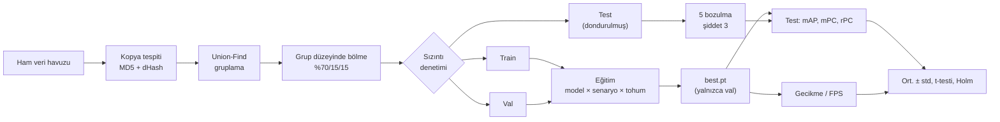

# Zorlu Görüntüleme Koşullarında YOLOv8 ve RT-DETR'nin Hız–Doğruluk Ödünleşimi

| | |
|---|---|
| **Ders** | BİL458 — [Ders adı] |
| **Ekip** | [Ad Soyad] ([Öğrenci no]) · [Ad Soyad] ([Öğrenci no]) · [Ad Soyad] ([Öğrenci no]) · [Ad Soyad] ([Öğrenci no]) |
| **Teslim tarihi** | [GG.AA.YYYY] |

# Özet

Gerçek zamanlı nesne tespit sistemleri, yaban hayatı izleme ve otonom sürüş gibi uygulamalarda sıklıkla düşük ışık, sis, yağmur ve hareket bulanıklığı gibi zorlu görüntüleme koşullarıyla karşılaşmaktadır. Bu çalışmada, evrişimsel tek aşamalı bir dedektör olan YOLOv8m ile transformer tabanlı uçtan uca bir dedektör olan RT-DETR-L, bu koşullardaki hız–doğruluk ödünleşimi açısından karşılaştırılmıştır. Deneylerde dört hayvan sınıfı içeren African Wildlife veri seti kullanılmıştır. Veri sızıntısını önlemek için birebir ve yakın kopyalar MD5 ve algısal özet (dHash) ile tespit edilmiş, ayrım grup düzeyinde yapılarak dondurulmuş ve otomatik denetimlerle doğrulanmıştır. Temiz test kümesinden fiziksel ve istatistiksel modellere dayalı beş bozulma türetilmiş; modeller baseline ve ablasyon senaryolarında üç farklı rastgele tohumla eğitilmiştir. Sonuçlar ortalama ± standart sapma, eşleştirilmiş t-testleri ve Holm düzeltmesiyle raporlanmıştır. Kısa eğitim bütçeli ön deneylerde YOLOv8m, Tesla T4 üzerinde 2,2 kat daha yüksek hız (49,4 ± 0,6 FPS) sunarken, RT-DETR-L temiz test kümesinde (0,704 ± 0,051 mAP@[.5:.95]) ve bozulmalar altında (mPC 0,612 ± 0,049) belirgin biçimde daha doğru ve göreli olarak daha dayanıklı bulunmuştur. Hareket bulanıklığı her iki mimari için en zor koşul olmuş, düşük ışık ise YOLOv8m'in performansını yarıya indirmiştir. Sentetik bozulma artırması dayanıklılığı iyileştirmemiştir. Doğruluk farkının büyüklüğünün kısmen kısa eğitim bütçesinden kaynaklandığı tartışılmış ve tam bütçeli doğrulama için tekrarlanabilir bir deney hattı sunulmuştur. Elde edilen bulgular, gecikme bütçesine göre mimari seçimi için nicel bir çerçeve sunmaktadır.

**Anahtar Kelimeler** — Nesne tespiti, YOLO, DETR, dayanıklılık, görüntü bozulmaları, veri sızıntısı.

# 1. Giriş

Nesne tespiti, bir görüntüdeki nesnelerin sınıfını ve konumunu birlikte belirleme görevidir ve pek çok otonom sistemin algı katmanını oluşturur. Bu çalışmanın motive edici uygulaması **yaban hayatı izlemedir**. Koruma alanlarındaki kamera tuzakları çok sayıda görüntü üretir; bu görüntülerin elle etiketlenmesi ekolojik araştırmaların temel darboğazıdır ve derin öğrenme tabanlı otomatik tanımanın bu yükü büyük ölçüde azaltabildiği gösterilmiştir [1]. Kaçak avcılıkla mücadelede kullanılan insansız hava araçlarında ise tespitin **cihaz üzerinde ve gerçek zamanlı** yapılması gerekir; bu sistemlerde gecikme bütçesi doğruluk kadar belirleyicidir.

Bu uygulamalar kontrollü veri setlerinden çok farklı koşullarda çalışır. Kamera tuzakları sıklıkla gece ya da düşük ışıkta görüntü alır; sis, yağmur ve hareket bulanıklığı olağandır. Kamera tuzağı görüntüleriyle eğitilen modellerin yeni konum ve koşullara genellemede ciddi biçimde başarısız olduğu gösterilmiştir [2]. Otonom sürüş için yapılan dayanıklılık değerlendirmelerinde de yaygın dedektörlerin performansının sentetik bozulmalar altında temiz koşuldaki değerinin yaklaşık yarısına kadar düşebildiği raporlanmıştır [3].

**Literatürde nasıl çözüldüğü.** Gerçek zamanlı tespitte uzun süre baskın paradigma, YOLO ailesinin temsil ettiği tek aşamalı evrişimsel dedektörler olmuştur [4]. Bu modeller yoğun bir aday kutu ızgarası tahmin eder ve yinelenen tespitleri Maksimum Olmayanı Bastırma (NMS) ile eler; YOLOv8, çapasız başlık ve görev hizalı etiket atamasıyla güncel bir referans noktasıdır [5]. DETR [6] ise tespiti bir **küme tahmini** problemi olarak ele alır ve Macar eşlemesiyle NMS'siz, uçtan uca eğitilir; ancak yavaş yakınsaması gerçek zamanlı kullanımını sınırlamıştır. RT-DETR [7], verimli bir hibrit kodlayıcıyla bu sınırlamayı aşmayı hedeflemiş ve gerçek zamanlı ölçekte YOLO modellerini geçtiğini raporlamıştır. Bozulmalara karşı dayanıklılığın ölçümü için sınıflandırmada ImageNet-C [8], tespitte Michaelis ve arkadaşlarının protokolü [3] önerilmiştir; düşük ışık için ExDark gibi gerçek veri setleri de mevcuttur [9]. Bu karşılaştırmalarda iki metodolojik sorun sıkça göz ardı edilir: sonuçlar genellikle tek bir eğitim çalıştırmasından raporlanır ve **veri sızıntısı**, yani değerlendirmede kullanılmaması gereken bilginin eğitime karışması [10], raporlanan başarımı sistematik olarak şişirir. Sızıntının makine öğrenmesine dayalı bilimde yaygın bir tekrarlanabilirlik sorunu olduğu [11] ve yaygın kıyaslama veri setlerinde bile test görüntülerinin eğitim kümesinde yakın kopyalarının bulunabildiği [13] gösterilmiştir. Modellerin çoğunun COCO [12] üzerinde ön-eğitilmesi, ön-eğitim verisiyle test verisinin örtüşmesi riskini de beraberinde getirir.

**Yöntemin seçilme gerekçesi.** İki mimari, tümevarımsal yanlılık bakımından iki uç temsil eder: YOLO'nun evrişimleri yerel dokuya, RT-DETR'nin öz-dikkati küresel bağlama dayanır. Bu fark, bozulmalara karşı farklı davranış beklentisi doğurur. Orijinal DETR yerine RT-DETR seçilmiştir, çünkü DETR'nin yüzlerce epoch'luk yakınsama süresi ders kapsamında uygulanabilir değildir ve RT-DETR gerçek zamanlı ölçekte doğrudan YOLO ile karşılaştırılabilir. Modeller kapasite olarak yakın seçilmiştir (YOLOv8m ≈ 26M, RT-DETR-L ≈ 33M parametre) ve aynı eğitim–değerlendirme hattında çalıştırılmıştır.

**Araştırma sorusu ve hipotezler.** *Aynı veri, aynı ayrım ve aynı protokol altında, YOLOv8m ve RT-DETR-L'nin zorlu koşullardaki hız–doğruluk ödünleşimi nasıldır?*

- **H1:** YOLOv8m daha yüksek FPS, RT-DETR-L daha yüksek mAP sağlar; iki model de Pareto sınırında yer alır.
- **H2:** Küresel bağlam kullanan RT-DETR-L, bozulmalar altında temiz performansının daha büyük bir kısmını korur (daha yüksek rPC).
- **H3:** Sentetik bozulma artırmasıyla eğitim, mPC'yi artırır; ancak eğitimde görülmeyen bozulmalara sınırlı genellenir.

# 2. Yöntem

## 2.1 Genel akış

*Şekil 1. Deneysel akış. Test kümesine yalnızca model seçimi tamamlandıktan sonra erişilir.*

Notasyon olarak $\mathcal{D}=\{(x_n,Y_n)\}$, $Y_n=\{(c_j,b_j)\}_{j=1}^{G_n}$ görüntü başına $G_n$ nesnenin sınıfı ve kutusu, $C=4$ sınıf sayısıdır. Ayrık bölmeler için sızıntısızlık koşulu, $g(\cdot)$ kopya grubu ve $h(\cdot)$ dHash olmak üzere:

$$
g(\mathcal{D}_a)\cap g(\mathcal{D}_b)=\varnothing,\qquad \min_{x\in\mathcal{D}_a,\,x'\in\mathcal{D}_b} d_H\big(h(x),h(x')\big)>\tau=5,\quad a\neq b \tag{1}
$$

## 2.2 Görüntü oluşum ve bozulma modeli

Her bozulma, temiz görüntü $I$, şiddet $\ell\in\{1,\dots,5\}$ ve görüntüye özgü rastgelelik $\omega=\mathrm{MD5}(\text{tohum}\,\|\,\text{dosya}\,\|\,k)$ ile tanımlı bir $T_{k,\ell}(I;\omega)$ operatörüdür. Operatörler geometriyi değiştirmediğinden etiketler korunur. Sis, Koschmieder atmosferik saçılma modeliyle; düşük ışık, gama sıkıştırması ve Poisson–Gauss sensör gürültüsüyle; hareket bulanıklığı, doğrusal nokta yayılım fonksiyonuyla evrişim olarak modellenir:

$$
T_{fog}(I)=I\odot t+A(1-t),\qquad T_{ll}(I)=255\,\mathrm{clip}\big(u+\epsilon_1\sqrt{u}+\epsilon_2\big),\; u=g_\ell(I/255)^{\gamma_\ell},\qquad T_{mb}(I)=I*k_{L_\ell,\phi} \tag{2}
$$

Burada $A=225$ atmosferik ışık, $t$ düşük frekanslı gürültüyle modüle edilen iletim haritası, $\epsilon_{1,2}$ Gauss gürültüleri, $L_\ell\in\{5,\dots,23\}$ bulanıklık uzunluğu ve $\phi\sim\mathcal{U}(0^\circ,180^\circ)$ yöndür. Gauss gürültüsü $I+\mathcal{N}(0,\sigma_\ell^2)$, yağmur ise $0{,}85\,I+180\,(G*R_\ell)$ biçiminde eğik çizgi maskesiyle toplamsal olarak uygulanır.

## 2.3 Kutu benzerlik ölçüleri

$$
\mathrm{IoU}=\frac{\lvert B\cap B^{gt}\rvert}{\lvert B\cup B^{gt}\rvert},\qquad
\mathrm{GIoU}=\mathrm{IoU}-\frac{\lvert C\setminus(B\cup B^{gt})\rvert}{\lvert C\rvert},\qquad
\mathrm{CIoU}=\mathrm{IoU}-\frac{\rho^2(\mathbf b,\mathbf b^{gt})}{c^2}-\alpha v \tag{3}
$$

GIoU [14], örtüşmeyen kutularda da gradyan üretmek için kapsayan kutu $C$'yi; CIoU [15] ise merkez uzaklığı $\rho$ ve en-boy uyumu $v=\tfrac{4}{\pi^2}(\arctan\tfrac{w^{gt}}{h^{gt}}-\arctan\tfrac{w}{h})^2$, $\alpha=v/((1-\mathrm{IoU})+v)$ terimlerini ekler.

## 2.4 YOLOv8: mimari ve kayıp fonksiyonu

YOLOv8, adımları $s\in\{8,16,32\}$ olan üç öznitelik haritasında $N_a=21HW/1024$ noktada (640 px için 8400) tahmin üretir. Pozitif örnekler görev hizalı atamayla (TAL) seçilir: nesne $j$ ve nokta $i$ için $t_{ij}=\hat p_{i,c_j}^{0,5}\cdot\mathrm{IoU}_{ij}^{6}$ ölçütüne göre her nesneye en iyi 10 nokta atanır ve sınıf hedefi $t_{ij}$'den türetilen yumuşak bir skordur. Kutu kenar uzaklıkları 16 kutulu bir ayrık dağılım olarak öğrenilir ve dağılım odak kaybı (DFL) [16] ile eğitilir. $S$ hedef skorların toplamı, $w_i$ pozitif noktanın ağırlığı, $\mathcal P$ pozitif küme ve $B$ yığın boyutu olmak üzere toplam kayıp:

$$
\mathcal L_{\mathrm{YOLO}}=B\Big[\,7{,}5\cdot\tfrac{1}{S}\textstyle\sum_{i\in\mathcal P}w_i(1-\mathrm{CIoU}_i)\;+\;0{,}5\cdot\tfrac{1}{S}\sum_{i,c}\mathrm{BCE}(z_{ic},\hat t_{ic})\;+\;1{,}5\cdot\mathcal L_{\mathrm{DFL}}\Big] \tag{4}
$$

## 2.5 RT-DETR: mimari ve kayıp fonksiyonu

RT-DETR, öz-dikkati yalnızca en kaba ölçekte uygulayan bir hibrit kodlayıcı ve $Q=300$ sorgulu, $D=6$ katmanlı bir kod çözücüden oluşur. Tahmin kümesi ile gerçek küme arasındaki birebir eşleme Macar algoritmasıyla bulunur [6]:

$$
\hat\sigma=\operatorname*{arg\,min}_{\sigma}\sum_{j}\Big[\mathcal C_{cls}(j,\sigma(j))+5\lVert b_j-\hat b_{\sigma(j)}\rVert_1+2\big(-\mathrm{GIoU}(b_j,\hat b_{\sigma(j)})\big)\Big] \tag{5}
$$

Sınıflandırma için, eşleşen sorgunun hedefi kutunun IoU'su $q$ olan Varifocal kayıp (VFL) [17] kullanılır; kayıp her kod çözücü katmanına ve gürültü giderme (denoising) sorgularına ayrıca uygulanır [7]:

$$
\mathrm{VFL}(p,q)=\begin{cases}-q\,[\,q\log p+(1-q)\log(1-p)\,], & q>0\\ -0{,}75\,p^{2}\log(1-p), & q=0\end{cases},\qquad
\mathcal L_{\mathrm{RT\text{-}DETR}}=\sum_{d=0}^{D}\big[\mathcal L_{\mathrm{VFL}}+5\,\mathcal L_{L1}+2\,\mathcal L_{\mathrm{GIoU}}\big]^{(d)} \tag{6}
$$

Birebir eşleme her nesne için tek tahmini ödüllendirdiğinden NMS gerekmez. Denklem (4) ve (6) farklı terim ve ölçeklerden oluştuğu için iki modelin mutlak kayıp değerleri karşılaştırılamaz; modeller arası karşılaştırma mAP üzerinden yapılır.

## 2.6 Optimizasyon

Tohum $r$ için parametreler, tohuma bağlı veri artırma $\mathcal A_r$ altında ampirik riskin minimizasyonuyla bulunur. Kullanılan uygulama, toplam iterasyon $I=\lceil\lvert\mathcal D_{tr}\rvert/64\rceil E\le10^4$ olduğunda AdamW [18] seçer ($\eta_0=0{,}002\cdot5/(4+C)=1{,}25\times10^{-3}$):

$$
m_t=\beta_1m_{t-1}+(1-\beta_1)g_t,\quad v_t=\beta_2v_{t-1}+(1-\beta_2)g_t^2,\quad
\theta_{t+1}=\theta_t-\eta_t\Big(\tfrac{\hat m_t}{\sqrt{\hat v_t}+\epsilon}+\lambda\theta_t\Big) \tag{7}
$$

Öğrenme oranı ilk $\max(3n_b,100)$ iterasyonda doğrusal ısınma ile yükselir, ardından $\eta(e)=\eta_0[(1-e/E)(1-0{,}01)+0{,}01]$ ile doğrusal azalır. Değerlendirmede ağırlıkların üstel hareketli ortalaması kullanılır ve en iyi epoch, yalnızca doğrulama kümesinde $F=0{,}1\,\mathrm{mAP}_{50}+0{,}9\,\mathrm{mAP}_{50:95}$ uygunluğuyla seçilir.

## 2.7 Değerlendirme ölçütleri ve istatistik

$\mathrm{mAP}_{50:95}$, 10 IoU eşiği ve $C$ sınıf üzerinden 101 noktalı enterpolasyonla hesaplanan AP'nin ortalamasıdır. Dayanıklılık [3]:

$$
\mathrm{mPC}=\frac{1}{\lvert\mathcal K\rvert}\sum_{k\in\mathcal K}\mathrm{mAP}^{(k)}_{50:95},\qquad \mathrm{rPC}=\frac{\mathrm{mPC}}{\mathrm{mAP}^{clean}_{50:95}},\qquad
\mathrm{FPS}=\frac{1000}{\mathrm{medyan}(t_1,\dots,t_M)\,[\mathrm{ms}]} \tag{8}
$$

FPS, ön işleme, çıkarım ve son işlemeyi (YOLO için NMS dahil) kapsayan uçtan uca gecikmeden, yığın boyutu 1 ile ölçülür. Her yapılandırma $R=3$ tohumla çalıştırılır ve $\bar m\pm s$ ($s$: örneklem std) olarak raporlanır. Karşılaştırmalar tohum bazında eşleştirilmiş t-testiyle yapılır; çoklu karşılaştırma için Holm–Bonferroni düzeltmesi uygulanır.

## 2.8 Karmaşıklık analizi

| Bileşen | YOLOv8 | RT-DETR |
|---|---|---|
| Omurga ve boyun (çıkarım) | $\Theta(HW)$ | $\Theta(HW)$ |
| Öz-dikkat | — | $O(L_5^2d)$, $L_5=HW/32^2$ (640 px: 400 belirteç) |
| Kod çözücü | — | $D\cdot O(Q^2d+Q\,M_hN_\ell K_p\,d)$ |
| Son işleme | NMS: $O(N'\log N')$, en kötü $O(N'^2)$ | top-$k$: $O(QC)$, sabit |
| Etiket atama (eğitim) | TAL: $O(G\,N_a)$ | Macar: $O(Q\,G^2)$, $D+1$ kez |
| Parametre / GFLOPs (640 px) | 25,9 M / 78,9 | 32,8 M / 110 |

*Tablo 1. Görüntü başına zaman karmaşıklığı. $N'$: güven eşiğini geçen aday, $G$: nesne sayısı, $M_h,N_\ell,K_p$: dikkat başı, ölçek ve örnekleme noktası sayısı.*

İki model de piksel sayısında baskın olarak doğrusal ölçeklenir. YOLO'nun son işleme süresi aday sayısına bağlı, yani **içeriğe bağlıdır**; RT-DETR'ninki sabittir. Sızıntı önleme adımındaki çiftler arası Hamming karşılaştırması $O(N^2)$'dir, ancak yalnızca bir kez çalışır; veri hattının tüm adımlarının karmaşıklığı Ek B'dedir.

## 2.9 Araç tercihleri

İki model de **Ultralytics** [5] kütüphanesiyle eğitilmiştir. Bu seçim, veri yükleme, artırma, değerlendirme ve mAP hesabının iki model için birebir aynı olmasını sağlayarak çatı farkından kaynaklı yanlılığı ortadan kaldırır. Deney hattı, tek bir Jupyter Notebook olarak PyTorch üzerinde yazılmıştır; istatistik için SciPy, görselleştirme için Matplotlib kullanılmıştır. Deneyler, erişilebilir ve tekrarlanabilir bir ortam olduğu için Google Colab'daki Tesla T4 GPU üzerinde yürütülmüştür.

# 3. Uygulama

## 3.1 Veri seti

| Özellik | Değer |
|---|---|
| Ad ve kaynak | African Wildlife; Ultralytics tarafından dağıtılan açık veri seti |
| Lisans | **[Veri setinin yayım sayfasından doğrulanıp yazılmalı]** |
| Sınıflar | bufalo, fil, gergedan, zebra ($C=4$) |
| Boyut | **[N]** görüntü, **[M]** nesne kutusu (notebook'taki ayrım hücresinin çıktısından) |
| Etiket biçimi | YOLO formatı: sınıf, normalize merkez, genişlik, yükseklik |
| Ayrım | train / val / test = **[n₁] / [n₂] / [n₃]** görüntü (%70 / %15 / %15) |

*Tablo 2. Veri seti özellikleri.*

**Ön işleme.** Veri setinin özgün train/val/test ayrımı kullanılmamış, tüm görüntüler tek bir havuzda toplanmıştır. Her görüntü için MD5 özeti ve 64 bitlik dHash hesaplanmış; aynı özete sahip ya da Hamming mesafesi 5 bit veya altında olan görüntüler Union-Find yapısında aynı gruba birleştirilmiştir. Gruplar, `split_seed = 2024` ile karıştırılıp büyükten küçüğe, hedef oranına en uzak bölmeye atanmıştır. Ayrım bir manifest dosyasına yazılarak dondurulmuştur. Eğitim sırasında görüntüler 640 px'e (480 px ablasyonunda 480 px'e) en-boy oranı korunarak yeniden boyutlandırılır ve Ultralytics'in varsayılan artırmaları (mozaik, HSV, ölçekleme, öteleme, yatay çevirme) uygulanır. Bozuk test kümeleri, temiz test kümesinden sabit bir tohumla bir kez üretilir; bozulma artırmalı eğitimde ise her tohum için eğitim görüntülerinin %50'si sis, düşük ışık ya da Gauss gürültüsüyle (şiddet 1–3) bozulur. Hareket bulanıklığı ve yağmur eğitimde hiç kullanılmaz.

## 3.2 Senaryolar ve hiperparametreler

| Senaryo | Değişen faktör |
|---|---|
| `baseline` | — (temiz eğitim, 640 px, varsayılan artırmalar) |
| `abl_adv_aug` | Eğitim görüntülerinin %50'si bozulmuş (küme boyutu sabit) |
| `abl_imgsz480` | Girdi çözünürlüğü 640 → 480 px |

*Tablo 3. Senaryolar. Her ablasyon baseline'dan yalnızca tek bir faktörü değiştirir.*

| Hiperparametre | Bu rapordaki sonuçlar (`quick`) | Nihai deney (`mid`) |
|---|---|---|
| Epoch / eğitim verisi oranı | 3 / %25 | 30 / %100 |
| Senaryolar | baseline, abl_adv_aug | + abl_imgsz480 |
| Tohumlar | 0, 1, 2 | 0, 1, 2 |
| Optimize edici, $\eta_0$ | AdamW, $1{,}25\times10^{-3}$ | AdamW, $1{,}25\times10^{-3}$ |
| Yığın / nominal yığın (biriktirme) | 8 / 64 | 8 / 64 |
| Ağırlık bozunumu, ısınma, $r_f$ | $5\times10^{-4}$, 3 epoch, 0,01 | aynı |
| Mozaiğin kapatıldığı son epoch sayısı | 10 | 10 |
| Ön-eğitimli ağırlıklar | yolov8m.pt, rtdetr-l.pt (COCO) | aynı |
| Karma hassasiyet, deterministik kip | açık, açık | açık, açık |
| FPS ölçümü (ısınma / tekrar) | 10 / 30 | 10 / 200 |

*Tablo 4. Hiperparametreler. Değerler, aksi belirtilmedikçe Ultralytics varsayılanlarıdır; iki modelde de aynıdır ve test kümesine bakılarak ayarlanmamıştır.*

## 3.3 Varsayımlar

1. Etiketler doğrudur; etiket gürültüsü iki model için aynı etkiye sahiptir.
2. dHash ile tespit edilen kopyalar dışında görüntüler birbirinden bağımsızdır. Veri seti kamera ya da konum bilgisi içermediği için sahne düzeyinde gruplama yapılamamıştır.
3. Sentetik bozulmalar gerçek zorlu koşulların makul bir yaklaşığıdır.
4. Aynı varsayılan hiperparametreler iki mimari için adil bir karşılaştırma sağlar.
5. Paylaşımlı bulut GPU'sundaki gecikme dalgalanması, aynı mimarinin çalıştırmaları arasındaki FPS farkıyla ölçülebilir düzeydedir (Tablo 6'daki Δ FPS değerleriyle doğrulanmıştır).

## 3.4 Kodun yapısı

Tüm hat tek bir Jupyter Notebook'tadır (`yolo_vs_detr_benchmark.ipynb`). Notebook şu bölümlerden oluşur: yapılandırma ve tekrarlanabilirlik; veri indirme, kopya tespiti ve dondurulmuş ayrım; sızıntı denetimi; bozulma operatörleri; birim testleri; senaryo tanımları; eğitim, değerlendirme ve FPS ölçümü; istatistik; grafikler. Hücrelerin ayrıntılı dökümü Ek C'dedir. Çalıştırma profili tek bir değişkenle (`PROFILE`) seçilir. Sonuçlar Google Drive'a yazılır; oturum koparsa tamamlanmış çalıştırmalar atlanır. Her çalıştırmanın ölçümleri JSON, özetler CSV olarak saklanır.

# 4. Deneysel Sonuçlar

> **Not.** Bu bölümdeki değerler `quick` profiliyle (3 epoch, eğitim verisinin %25'i) elde edilmiş **ön deney** sonuçlarıdır. Nihai `mid` profil sonuçları alındığında bu bölüm, Bölüm 5 ve Özet güncellenecektir.

## 4.1 Baseline karşılaştırması

| Model | Senaryo | mAP@[.5:.95] temiz | mAP@.5 temiz | mPC | rPC | FPS | Gecikme p95 (ms) |
|---|---|---|---|---|---|---|---|
| YOLOv8m | baseline | 0,299 ± 0,039 | 0,480 ± 0,044 | 0,218 ± 0,020 | 0,733 ± 0,047 | **49,4 ± 0,6** | 24,5 ± 2,3 |
| YOLOv8m | bozulma art. | 0,194 ± 0,105 | 0,346 ± 0,159 | 0,150 ± 0,058 | 0,830 ± 0,194 | 47,5 ± 1,5 | 24,8 ± 2,2 |
| RT-DETR-L | baseline | **0,704 ± 0,051** | **0,865 ± 0,037** | **0,612 ± 0,049** | **0,868 ± 0,007** | 22,3 ± 1,6 | 48,7 ± 5,9 |
| RT-DETR-L | bozulma art. | 0,649 ± 0,018 | 0,811 ± 0,035 | 0,563 ± 0,019 | 0,868 ± 0,017 | 21,6 ± 1,2 | 50,4 ± 4,4 |

*Tablo 5. Ana sonuçlar (ortalama ± std, n = 3 tohum). FPS: uçtan uca, yığın boyutu 1, FP32, Tesla T4. Tohum düzeyindeki değerler Ek A'dadır.*

*Şekil 2. Temiz test (sol) ve zorlu koşullar (sağ) için mAP–FPS ödünleşimi; hata çubukları ±1 std, kesikli çizgi Pareto sınırı.*

YOLOv8m, RT-DETR-L'den 2,2 kat hızlıdır (49,4'e karşı 22,3 FPS); RT-DETR-L ise temiz testte 0,405, zorlu koşullarda 0,393 mAP puanı yüksektir. Bu farklar çok büyük etki büyüklüğüne sahiptir (temiz mAP için eşleştirilmiş $d_z=-7{,}0$; FPS için $d_z=13{,}7$). Holm düzeltmesi sonrasında FPS farkı anlamlıdır ($p_{Holm}=0{,}020$), mAP farkı ise sınırda kalmıştır ($p_{Holm}=0{,}060$); bunun nedeni $n=3$ ile serbestlik derecesinin 2 olması ve 12 testlik düzeltmedir. İki baseline model de Pareto sınırındadır.

## 4.2 Öğrenme eğrileri

*Şekil 3. Eğitim kaybı, doğrulama kaybı ve doğrulama mAP'i (ortalama ± 1 std, n = 3). İki modelin kayıp ölçekleri karşılaştırılamaz.*

Doğrulama mAP'i iki modelde de son epoch'ta hâlâ yükselmektedir (YOLOv8m: 0,09 → 0,30; RT-DETR-L: 0,47 → 0,70); yani modeller bu bütçede yakınsamamıştır. YOLOv8m'in eğitim kaybı 2. epoch'ta geçici olarak artmıştır (4,88 → 5,22).

## 4.3 Ablasyon çalışması

| Model | Değişiklik | Δ mAP temiz | Δ mPC | Δ FPS | $p_{Holm}$ (mAP / mPC) |
|---|---|---|---|---|---|
| YOLOv8m | + bozulma artırması | −0,106 ± 0,102 | −0,069 ± 0,061 | −1,9 ± 1,6 | 0,909 / 0,909 |
| RT-DETR-L | + bozulma artırması | −0,055 ± 0,051 | −0,049 ± 0,037 | −0,7 ± 1,6 | 0,909 / 0,909 |
| İkisi de | girdi 640 → 480 px | `mid` profilinde | | | |

*Tablo 6. Ablasyon: tohum bazında eşleştirilmiş farklar (varyant − baseline, ortalama ± std).*

## 4.4 Koşul başına sonuçlar

| Model | Senaryo | Temiz | Sis | Düşük ışık | Hareket bul. † | Gauss gür. | Yağmur † |
|---|---|---|---|---|---|---|---|
| YOLOv8m | baseline | 0,299 | 0,291 (%97) | 0,155 (%52) | 0,144 (%48) | 0,240 (%80) | 0,262 (%88) |
| YOLOv8m | bozulma art. | 0,194 | 0,184 (%95) | 0,126 (%65) | 0,093 (%48) | 0,165 (%85) | 0,181 (%93) |
| RT-DETR-L | baseline | 0,704 | 0,683 (%97) | 0,606 (%86) | 0,500 (%71) | 0,628 (%89) | 0,641 (%91) |
| RT-DETR-L | bozulma art. | 0,649 | 0,640 (%99) | 0,590 (%91) | 0,415 (%64) | 0,590 (%91) | 0,581 (%90) |

*Tablo 7. Koşul başına test mAP@[.5:.95] (3 tohum ortalaması) ve parantez içinde temiz performansın korunan oranı. † eğitimde hiç görülmeyen bozulma. Standart sapmalar Ek A'dadır.*

*Şekil 4. Koşul başına dayanıklılık; taralı çubuklar bozulma artırmalı eğitimi gösterir.*

# 5. Tartışma

## 5.1 Sonuçların anlamı

**H1 desteklenmiştir:** iki model de Pareto sınırındadır; seçim, uygulamanın gecikme bütçesine bağlıdır. Örneğin 30 FPS'in altına inilemeyen bir sistemde, bu donanımda ve optimize edilmemiş PyTorch ortamında yalnızca YOLOv8m uygundur. **H2 desteklenmiştir:** RT-DETR-L temiz performansının %86,8'ini korurken YOLOv8m %73,3'ünü korumaktadır; fark en çok düşük ışıkta belirgindir (%86'ya karşı %52). Bu, küresel öz-dikkatin yerel doku kaybını bağlamla telafi edebildiği hipoteziyle uyumludur. **H3 desteklenmemiştir:** bozulma artırması iki modelde de mPC'yi artırmamış, aksine düşürmüştür.

Bu yorumların en önemli kısıtı eğitim bütçesidir. Eğitim verisinin %25'i yaklaşık 260 görüntüdür; yığın boyutu 8 ile 3 epoch, YOLOv8m için yaklaşık 99 iterasyon eder. Isınma süresi $\max(3n_b,100)=100$ iterasyon olduğundan öğrenme oranı hedef değerine hiç ulaşmamıştır. Yakınsamış modeller arasında literatürde bildirilen fark birkaç mAP puanı mertebesindeyken burada gözlenen ~40 puanlık fark, büyük ölçüde **örnek verimliliği farkını** yansıtmaktadır: RT-DETR-L, çok az güncellemeyle yeni sınıflara çok daha hızlı uyum sağlamıştır.

## 5.2 Başarısızlık analizi

**Düşük ışık (YOLOv8m).** YOLOv8m düşük ışıkta temiz performansının yalnızca %52'sini korur ve mAP@.5'i de %39 düşer (0,480 → 0,293). Başarısızlık yalnızca kutu hassasiyetinde değil, **tespitin kendisindedir**: nesneler bulunamamakta ya da yanlış sınıflandırılmaktadır. Gama sıkıştırması ve sinyale bağlı gürültü, sınıfları ayırt ettiren doku desenlerini (ör. zebra çizgileri) bastırmaktadır; hangi sınıfların karıştığını doğrulamak için sınıf başına AP gerekir.

**Hareket bulanıklığı (iki model).** İki model için de en zor koşuldur (RT-DETR-L: %71). Lokalizasyon kalitesini gösteren mAP@[.5:.95]/mAP@.5 oranı temiz koşula göre iki modelde de ~0,07 düşer (YOLO: 0,62 → 0,55; RT-DETR: 0,81 → 0,74). Model nesneyi bulmakta, ancak bulanıklık yönünde yayılan kenarlar nedeniyle **kutu sınırlarını yanlış yerleştirmektedir**; bu hata yüksek IoU eşiklerinde cezalandırılır.

**Bozulma artırması.** Artırma, eğitimde görülen düşük ışıkta RT-DETR-L'nin korunma oranını artırmış (%86 → %91), ancak hiç görülmeyen hareket bulanıklığında düşürmüştür (%71 → %64). Bu örüntü, artırmanın türe özgü kaldığını ve görülmeyen bozulmalara genellenmediğini düşündürür; $n=3$ ile istatistiksel olarak doğrulanamaz. Mutlak düşüşün olası nedeni, küme boyutu sabit tutulduğu için modelin yarı yarıya daha az temiz görüntü görmesidir. Ayrıca YOLOv8m'in rPC değerinin 0,73'ten 0,83'e yükselmesi bir **metrik yanılgısıdır**: payda olan temiz mAP daha çok düşmüştür; tohum 0'da temiz mAP 0,105'e düşerken rPC 1,05'e çıkmıştır. Bu nedenle mutlak dayanıklılık ölçütü olarak mPC esas alınmıştır.

**Kararsızlık.** YOLOv8m'in artırmalı varyantında tohumlar arası değişim katsayısı %54'tür (RT-DETR-L: %2,7); kısa bütçede bu modelin eğitimi henüz kararlı bir rejime girmemiştir.

**Yapılamayan analizler.** Değerlendirme nesne boyutuna göre AP (AP$_S$/AP$_M$/AP$_L$), sınıf başına AP ve TIDE [19] hata ayrıştırması üretmediğinden küçük nesne ya da sınıf düzeyindeki hatalar hakkında iddiada bulunulmamıştır.

## 5.3 Güçlü ve zayıf yönler

Çalışmanın güçlü yönleri, sızıntıyı yapısal olarak önleyen ve denetleyen veri hattı, iki model için birebir aynı eğitim–değerlendirme protokolü, üç tohumlu istatistiksel raporlama ve tüm sonuçların (olumsuz olanlar dahil) seçilmeden raporlanmasıdır. Zayıf yönleri ise kısa eğitim bütçesi, yalnızca sentetik bozulmaların kullanılması, $n=3$'ün düşük istatistiksel gücü ve FPS'in optimize edilmemiş bir ortamda (PyTorch FP32) ölçülmesidir.

## 5.4 Alternatif yöntemlerle beklenen fark

- **Orijinal DETR:** Aynı bütçede çok daha düşük doğruluk beklenir; DETR'nin yakınsaması RT-DETR'den belirgin biçimde yavaştır [6], [7].
- **İki aşamalı dedektörler (ör. Faster R-CNN):** Bölge önerisi ve ikinci aşama inceltmesi nedeniyle daha iyi lokalizasyon, ancak belirgin biçimde daha yüksek gecikme beklenir.
- **TensorRT FP16 ile dağıtım:** İki modelin de hızının birkaç kat artması beklenir. PyTorch ortamındaki Python yükü ve optimize edilmemiş dikkat çekirdekleri transformer'ı daha çok cezalandırdığından aradaki hız farkının daralması beklenir.
- **Koşula özgü ön işleme (ör. düşük ışık iyileştirme):** YOLOv8m'in en zayıf olduğu düşük ışık koşulunda kazanç sağlayabilir, ancak ek gecikme getirir.

# 6. Test Süreçleri ve Etik

**Birim testleri.** Deney hattının yapı taşları, veri setinden bağımsız sentetik verilerle 8 birim testiyle doğrulanmıştır: etiket yolu eşlemesi; dHash'in yeniden boyutlandırılmış + JPEG kopyayı yakalaması ve farklı görüntüleri ayırması; Union-Find geçişkenliği; grup bölmesinin grupları bölmemesi, oranları ±%3 içinde tutması ve deterministik olması; sızıntı denetiminin ortak MD5'i yakalaması ve temiz ayrımda yanlış alarm vermemesi; her bozulmanın boyut/tip korumalı, deterministik ve şiddetle monoton olması; bozulmuş kopyada etiketlerin birebir korunması. Testlerden biri başarısız olursa deney başlamaz. Ayrıca çalıştırma sırasında bölmeler arası ortak MD5, ortak grup ve eşik altı dHash mesafesi `assert` ile denetlenir.

**Veri sızıntısının önlenmesi.**

| Sızıntı türü | Önlem | Durum |
|---|---|---|
| Birebir / yakın kopya | MD5 + dHash, grup düzeyinde bölme | Doğrulandı (0 ortak özet, min $d_H>5$) |
| Ön işleme sızıntısı | Bozulmalar ayrımdan sonra, yalnızca ilgili bölmeden türetilir | Yapısal |
| Test kümesiyle model seçimi | `best.pt` yalnızca val ile seçilir; eğitim yapılandırmasında test yolu yoktur | Yapısal |
| Sahne sızıntısı [2] | Sahne bilgisi olmadığı için uygulanamadı | Kısmen |
| Ön-eğitim (COCO) sızıntısı | COCO'dan türetilmemiş veri seti; görüntü düzeyinde kontrol yapılmadı | Kısmen |

*Tablo 8. Sızıntı türleri ve önlemler [10], [11].*

**Yanlılık.** Görüntüler web kaynaklıdır ve nesnenin büyük, merkezde ve gündüz ışığında çekildiği bir fotoğrafçı yanlılığı taşır; gerçek kamera tuzağı görüntülerinde hayvanlar sıklıkla küçük, kısmen görünür ya da gece çekilmiştir. Bozulmalar sentetiktir. Bu nedenle sonuçlar saha koşullarına doğrudan genellenmemelidir.

**Gizlilik.** Veri seti insan içermez. Ancak **gergedan** gibi kaçak avcılığın hedefindeki türlerin fotoğrafları EXIF meta verisinde GPS konumu taşıyabilir. Hat dosyaları meta veriyi koruyarak kopyaladığından, görüntüler paylaşılmadan önce GPS alanları temizlenmelidir. Aynı teknik hat insan tespiti ve gözetim amacıyla da kullanılabileceğinden, böyle bir kullanım mahremiyet ve orantılılık açısından ayrıca değerlendirilmelidir.

**Veri ve yazılım lisansı.** Ultralytics kütüphanesi ve ön-eğitimli ağırlıklar AGPL-3.0 lisanslıdır; akademik kullanım serbesttir, ancak bu kodu kullanan bir yazılım dağıtılırsa ya da ağ hizmeti olarak sunulursa kaynak kodu AGPL uyumlu lisansla paylaşılmalıdır. Ön-eğitim verisi COCO'nun etiketleri CC BY 4.0, görüntüleri Flickr koşullarına tabidir. African Wildlife veri setinin lisansı **[doğrulanıp yazılmalı]**; web kaynaklı görüntüler ayrı telif haklarına tabi olabileceğinden yeniden dağıtılmamalıdır. Veri setinin belgelenmesi için *Datasheets for Datasets* çerçevesi [20] önerilir.

# 7. Sonuç ve Öneriler

**Katkılar.** Bu çalışmada YOLOv8m ve RT-DETR-L, sızıntısız bir veri ayrımı, beş zorlu koşul ve üç tohumlu istatistiksel bir protokolle aynı hat üzerinde karşılaştırılmıştır. Ön deneylerde YOLOv8m ~2,2 kat daha hızlı, RT-DETR-L ise tüm tohumlarda ve tüm koşullarda daha doğru ve göreli olarak daha dayanıklı bulunmuştur; iki model de Pareto sınırındadır. Hareket bulanıklığı iki mimari için en zor koşuldur ve başarısızlık ağırlıklı olarak kutu sınırlarının yanlış yerleştirilmesi biçimindedir. Sentetik bozulma artırması dayanıklılığı iyileştirmemiştir.

**Sınırlılıklar.** Sonuçlar kısa eğitim bütçeli ön deneylere dayanır ve doğruluk farkının büyüklüğü kısmen yetersiz eğitimden kaynaklanır. Bozulmalar sentetiktir; sahne ve ön-eğitim sızıntısı tam olarak dışlanamamıştır; $n=3$ ile istatistiksel güç düşüktür; FPS optimize edilmemiş bir ortamda ölçülmüştür.

**Gelecek çalışmalar.** (i) `mid`/`full` profiliyle tam bütçeli eğitim ve en az beş tohum; (ii) nesne boyutuna ve sınıfa göre AP, karışıklık matrisi ve TIDE [19] hata ayrıştırması; (iii) ExDark [9] gibi gerçek zorlu koşul verileri ve konum bazında ayrılmış kamera tuzağı verileriyle [2] doğrulama; (iv) şiddet 1–5 boyunca dayanıklılık eğrileri; (v) TensorRT FP16 ile gömülü GPU üzerinde gecikme ölçümü; (vi) test görüntülerinin COCO ile dHash çapraz kontrolü.

# Kaynakça

[1] M. S. Norouzzadeh, A. Nguyen, M. Kosmala, A. Swanson, M. S. Palmer, C. Packer, and J. Clune, "Automatically identifying, counting, and describing wild animals in camera-trap images with deep learning," *Proc. Nat. Acad. Sci. USA*, vol. 115, no. 25, pp. E5716–E5725, Jun. 2018.

[2] S. Beery, G. Van Horn, and P. Perona, "Recognition in terra incognita," in *Proc. Eur. Conf. Comput. Vis. (ECCV)*, Munich, Germany, 2018, pp. 456–473.

[3] C. Michaelis, B. Mitzkus, R. Geirhos, E. Rusak, O. Bringmann, A. S. Ecker, M. Bethge, and W. Brendel, "Benchmarking robustness in object detection: Autonomous driving when winter is coming," 2019, *arXiv:1907.07484*.

[4] J. Redmon, S. Divvala, R. Girshick, and A. Farhadi, "You only look once: Unified, real-time object detection," in *Proc. IEEE Conf. Comput. Vis. Pattern Recognit. (CVPR)*, Las Vegas, NV, USA, 2016, pp. 779–788.

[5] G. Jocher, A. Chaurasia, and J. Qiu, "Ultralytics YOLOv8," version 8.0.0, 2023. [Online]. Available: https://github.com/ultralytics/ultralytics

[6] N. Carion, F. Massa, G. Synnaeve, N. Usunier, A. Kirillov, and S. Zagoruyko, "End-to-end object detection with transformers," in *Proc. Eur. Conf. Comput. Vis. (ECCV)*, 2020, pp. 213–229.

[7] Y. Zhao, W. Lv, S. Xu, J. Wei, G. Wang, Q. Dang, Y. Liu, and J. Chen, "DETRs beat YOLOs on real-time object detection," in *Proc. IEEE/CVF Conf. Comput. Vis. Pattern Recognit. (CVPR)*, Seattle, WA, USA, 2024, pp. 16965–16974.

[8] D. Hendrycks and T. Dietterich, "Benchmarking neural network robustness to common corruptions and perturbations," in *Proc. Int. Conf. Learn. Represent. (ICLR)*, New Orleans, LA, USA, 2019.

[9] Y. P. Loh and C. S. Chan, "Getting to know low-light images with the Exclusively Dark dataset," *Comput. Vis. Image Understand.*, vol. 178, pp. 30–42, Jan. 2019.

[10] S. Kaufman, S. Rosset, C. Perlich, and O. Stitelman, "Leakage in data mining: Formulation, detection, and avoidance," *ACM Trans. Knowl. Discov. Data*, vol. 6, no. 4, Dec. 2012, Art. no. 15.

[11] S. Kapoor and A. Narayanan, "Leakage and the reproducibility crisis in machine-learning-based science," *Patterns*, vol. 4, no. 9, Sep. 2023, Art. no. 100804.

[12] T.-Y. Lin, M. Maire, S. Belongie, J. Hays, P. Perona, D. Ramanan, P. Dollár, and C. L. Zitnick, "Microsoft COCO: Common objects in context," in *Proc. Eur. Conf. Comput. Vis. (ECCV)*, Zurich, Switzerland, 2014, pp. 740–755.

[13] B. Barz and J. Denzler, "Do we train on test data? Purging CIFAR of near-duplicates," *J. Imaging*, vol. 6, no. 6, Jun. 2020, Art. no. 41.

[14] H. Rezatofighi, N. Tsoi, J. Gwak, A. Sadeghian, I. Reid, and S. Savarese, "Generalized intersection over union: A metric and a loss for bounding box regression," in *Proc. IEEE/CVF Conf. Comput. Vis. Pattern Recognit. (CVPR)*, Long Beach, CA, USA, 2019, pp. 658–666.

[15] Z. Zheng, P. Wang, W. Liu, J. Li, R. Ye, and D. Ren, "Distance-IoU loss: Faster and better learning for bounding box regression," in *Proc. AAAI Conf. Artif. Intell.*, vol. 34, no. 7, 2020, pp. 12993–13000.

[16] X. Li, W. Wang, L. Wu, S. Chen, X. Hu, J. Li, J. Tang, and J. Yang, "Generalized focal loss: Learning qualified and distributed bounding boxes for dense object detection," in *Proc. Adv. Neural Inf. Process. Syst. (NeurIPS)*, vol. 33, 2020, pp. 21002–21012.

[17] H. Zhang, Y. Wang, F. Dayoub, and N. Sünderhauf, "VarifocalNet: An IoU-aware dense object detector," in *Proc. IEEE/CVF Conf. Comput. Vis. Pattern Recognit. (CVPR)*, 2021, pp. 8514–8523.

[18] I. Loshchilov and F. Hutter, "Decoupled weight decay regularization," in *Proc. Int. Conf. Learn. Represent. (ICLR)*, New Orleans, LA, USA, 2019.

[19] D. Bolya, S. Foley, J. Hays, and J. Hoffman, "TIDE: A general toolbox for identifying object detection errors," in *Proc. Eur. Conf. Comput. Vis. (ECCV)*, 2020, pp. 558–573.

[20] T. Gebru, J. Morgenstern, B. Vecchione, J. W. Vaughan, H. Wallach, H. Daumé III, and K. Crawford, "Datasheets for datasets," *Commun. ACM*, vol. 64, no. 12, pp. 86–92, Dec. 2021.

# Ekler

## Ek A. Tohum düzeyinde sonuçlar

| Model | Senaryo | Tohum | mAP@[.5:.95] | mAP@.5 | mPC | rPC | FPS |
|---|---|---|---|---|---|---|---|
| YOLOv8m | baseline | 0 / 1 / 2 | 0,321 / 0,254 / 0,323 | 0,516 / 0,431 / 0,493 | 0,237 / 0,197 / 0,221 | 0,740 / 0,776 / 0,684 | 49,8 / 48,8 / 49,8 |
| YOLOv8m | bozulma art. | 0 / 1 / 2 | 0,105 / 0,166 / 0,310 | 0,200 / 0,323 / 0,516 | 0,111 / 0,122 / 0,217 | 1,054 / 0,738 / 0,699 | 49,2 / 47,2 / 46,1 |
| RT-DETR-L | baseline | 0 / 1 / 2 | 0,660 / 0,694 / 0,760 | 0,830 / 0,862 / 0,904 | 0,570 / 0,600 / 0,666 | 0,864 / 0,864 / 0,876 | 23,1 / 23,3 / 20,4 |
| RT-DETR-L | bozulma art. | 0 / 1 / 2 | 0,659 / 0,629 / 0,659 | 0,848 / 0,780 / 0,805 | 0,561 / 0,545 / 0,583 | 0,851 / 0,867 / 0,885 | 22,9 / 20,7 / 21,0 |

*Tablo A1. Tohum düzeyinde sonuçlar.*

| Model | Senaryo | Sis | Düşük ışık | Hareket bul. | Gauss gür. | Yağmur |
|---|---|---|---|---|---|---|
| YOLOv8m | baseline | 0,291 ± 0,032 | 0,155 ± 0,029 | 0,144 ± 0,010 | 0,240 ± 0,016 | 0,262 ± 0,031 |
| YOLOv8m | bozulma art. | 0,184 ± 0,072 | 0,126 ± 0,027 | 0,093 ± 0,039 | 0,165 ± 0,077 | 0,181 ± 0,078 |
| RT-DETR-L | baseline | 0,683 ± 0,059 | 0,606 ± 0,067 | 0,500 ± 0,066 | 0,628 ± 0,047 | 0,641 ± 0,050 |
| RT-DETR-L | bozulma art. | 0,640 ± 0,043 | 0,590 ± 0,044 | 0,415 ± 0,025 | 0,590 ± 0,008 | 0,581 ± 0,013 |

*Tablo A2. Koşul başına mAP@[.5:.95] (ortalama ± std).*

## Ek B. Veri hattının karmaşıklığı

| Adım | Zaman | Bellek |
|---|---|---|
| MD5 özetleri | $O(\sum_n \lvert x_n\rvert)$ bayt | $O(N)$ |
| dHash | $O(\sum_n H_nW_n)$ | $O(N)$ |
| Çiftler arası Hamming | $O(N^2)$ XOR + popcount | $O(bN)$, $b=256$ |
| Union-Find | $O((N+P)\,\alpha(N))$, $P$: kopya çifti | $O(N)$ |
| Grup düzeyinde bölme | $O(N_g\log N_g)$ | $O(N_g)$ |
| Sis, düşük ışık, gürültü | $O(HW)$ / görüntü | $O(HW)$ |
| Hareket bulanıklığı | $O(HW\,L_\ell^2)$ | $O(HW)$ |
| Yağmur | $O(n_d\,\ell_d+HW)$ | $O(HW)$ |
| Toplam deney | $\lvert\mathcal M\rvert\lvert\mathcal S\rvert R\,[E\lvert\mathcal D_{tr}\rvert c^{tr}+(1+\lvert\mathcal K\rvert)\lvert\mathcal D_{te}\rvert c^{inf}]$ | — |

*Tablo B1. $N\approx1500$ için $N^2$ terimi yaklaşık $2{,}25\times10^6$ 64 bitlik karşılaştırmadır ve saniyeler mertebesindedir; maliyeti eğitim terimi belirler.*

## Ek C. Notebook yapısı

| Bölüm | İçerik |
|---|---|
| 0–1 | Kurulum; `PROFILE` seçimi; Drive bağlantısı; `CFG`; tohum sabitleme; Unicode yol destekli okuma/yazma; ortam kaydı |
| 2 | Veri indirme; MD5, dHash, Union-Find; grup düzeyinde bölme; dondurulmuş manifest; sızıntı denetimi; sınıf dağılımı |
| 3 | Beş bozulma operatörü; bozuk test kümeleri; görsel sağlama; **birim testleri** |
| 4 | Senaryo tanımları; YAML üretimi (eğitim YAML'ında test yolu yoktur) |
| 5 | `run_experiment`: eğitim, `best.pt` ile 6 koşulda test, FPS ölçümü; ana döngü (biten çalıştırmalar atlanır) |
| 6 | Ortalama ± std, %95 GA; eşleştirilmiş t-testleri ve Holm düzeltmesi |
| 7 | Grafikler: öğrenme eğrileri, mAP–FPS Pareto, koşul başına dayanıklılık |

*Tablo C1. Kod: `yolo_vs_detr_benchmark.ipynb`.*
