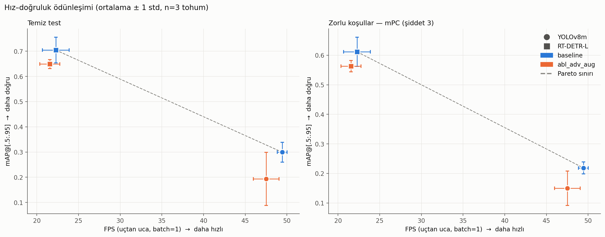
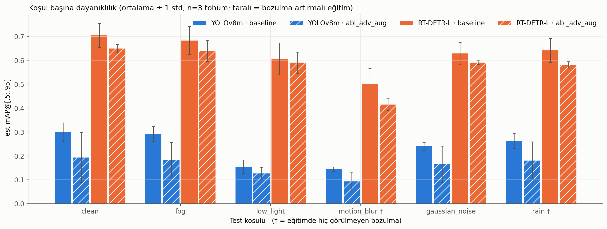
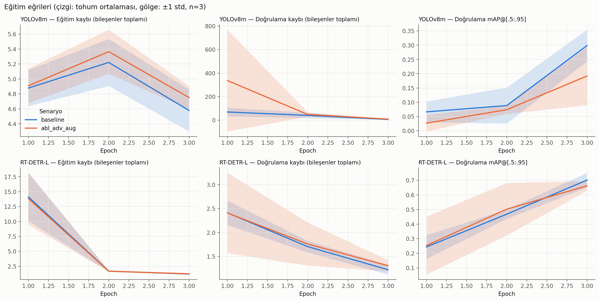

# 4. Deneysel Sonuçlar ve Tartışma

Bu bölümde, Bölüm 3'te tanımlanan protokolle elde edilen sonuçlar sunulmaktadır. Tüm değerler, aynı dondurulmuş test kümesi üzerinde üç bağımsız eğitim tohumunun ($r\in\{0,1,2\}$) **ortalama ± örneklem standart sapması** olarak verilmiştir. Deneyler tek bir NVIDIA Tesla T4 GPU üzerinde (PyTorch 2.14.1, CUDA 13.0, Ultralytics 8.4.215) yürütülmüştür.

> **Deney bütçesine ilişkin önemli not.** Bu sonuçlar *hızlı doğrulama kipinde* (QUICK_MODE) elde edilmiştir: her model yalnızca **3 epoch** boyunca ve eğitim kümesinin **%25'i** ile eğitilmiştir. Bu kipte yalnızca `baseline` ve `abl_adv_aug` senaryoları çalıştırılmıştır. Bölüm 4.5.1'de gösterildiği gibi, eğitim eğrileri henüz yakınsamamıştır ve YOLOv8m'in eğitimi tamamen öğrenme oranı ısınma evresinde kalmıştır. Bu nedenle aşağıdaki mutlak mAP değerleri ve özellikle iki mimari arasındaki büyük fark, **mimarilerin yakınsamış performansını değil, kısa eğitim bütçesindeki örnek verimliliğini** yansıtır. Kesin karşılaştırma için tam bütçeli deney (80 epoch, verinin tamamı, dört senaryo) gereklidir.

## 4.1 Ana karşılaştırma: baseline ve geliştirilen model

Bu çalışmada zorlu koşullara yönelik geliştirme adayı, **bozulma artırmalı eğitimdir** (`abl_adv_aug`). Bu varyantta eğitim görüntülerinin %50'si sis, düşük ışık ya da Gauss gürültüsüyle bozulmuştur. Tablo 4.1, her iki mimari için baseline ile bu varyantı karşılaştırmaktadır.

| Model | Senaryo | mAP@[.5:.95] temiz | mAP@.5 temiz | mPC | rPC | FPS | Gecikme medyan (ms) | Gecikme p95 (ms) | Param. (M) |
|---|---|---|---|---|---|---|---|---|---|
| YOLOv8m | baseline | 0,299 ± 0,039 | 0,480 ± 0,044 | 0,218 ± 0,020 | 0,733 ± 0,047 | **49,4 ± 0,6** | **20,2 ± 0,2** | 24,5 ± 2,3 | 25,9 |
| YOLOv8m | + bozulma artırması | 0,194 ± 0,105 | 0,346 ± 0,159 | 0,150 ± 0,058 | 0,830 ± 0,194 | 47,5 ± 1,5 | 21,1 ± 0,7 | 24,8 ± 2,2 | 25,9 |
| RT-DETR-L | baseline | **0,704 ± 0,051** | **0,865 ± 0,037** | **0,612 ± 0,049** | **0,868 ± 0,007** | 22,3 ± 1,6 | 45,1 ± 3,4 | 48,7 ± 5,9 | 32,8 |
| RT-DETR-L | + bozulma artırması | 0,649 ± 0,018 | 0,811 ± 0,035 | 0,563 ± 0,019 | 0,868 ± 0,017 | 21,6 ± 1,2 | 46,5 ± 2,5 | 50,4 ± 4,4 | 32,8 |

*Tablo 4.1. Baseline ve bozulma artırmalı modellerin doğruluk ve hız karşılaştırması (ortalama ± std, n = 3 tohum). mPC: beş bozulma üzerinden ortalama mAP@[.5:.95] (şiddet 3); rPC = mPC / temiz mAP. FPS: uçtan uca, batch = 1, FP32, Tesla T4. Her sütundaki en iyi değer kalın yazılmıştır.*

*Şekil 4.1. Temiz test (sol) ve zorlu koşullar (sağ, mPC) için mAP–FPS ödünleşimi. Hata çubukları her iki eksende ±1 std'dir; kesikli çizgi Pareto sınırıdır. Daire: YOLOv8m, kare: RT-DETR-L; mavi: baseline, turuncu: bozulma artırmalı eğitim.*

Tablo 4.1 ve Şekil 4.1'den üç temel bulgu çıkmaktadır:

1. **Hız–doğruluk ödünleşimi belirgindir.** YOLOv8m, RT-DETR-L'den $2{,}22\times$ daha hızlıdır (49,4'e karşı 22,3 FPS). RT-DETR-L ise temiz test kümesinde 0,405, zorlu koşullarda 0,393 mAP puanı daha yüksektir. İki baseline model de Pareto sınırı üzerindedir: hiçbiri diğerine her iki eksende birden üstün değildir. Uygulamanın gecikme bütçesi seçimi belirler. Örneğin 30 FPS altına inilemeyen gerçek zamanlı bir senaryoda, bu donanım ve bu kipte yalnızca YOLOv8m uygundur.
2. **Bozulma artırması beklenen iyileşmeyi sağlamamıştır.** İki mimaride de artırmalı varyant temiz mAP'te (YOLO: −0,106; RT-DETR: −0,055) ve mPC'de (YOLO: −0,069; RT-DETR: −0,049) baseline'ın gerisinde kalmıştır. Hızda anlamlı bir fark olmadığından artırmalı varyantlar her iki grafikte de **Pareto açısından baskılanmıştır**. Yani bu deney bütçesinde "geliştirilmiş" model baseline'ı geçememiştir. Olası nedenler Bölüm 4.5'te tartışılmaktadır.
3. **Göreli dayanıklılıkta da (rPC) RT-DETR-L öndedir.** RT-DETR-L zorlu koşullarda temiz performansının %86,8'ini korurken YOLOv8m %73,3'ünü korumaktadır. RT-DETR-L'nin rPC değeri tohumlar arasında da son derece kararlıdır (std 0,007).

## 4.2 Ablasyon çalışması

Tablo 4.2, her bileşenin baseline'a göre etkisini, aynı tohumlar arasında eşleştirilmiş farklar ($\Delta=\text{varyant}-\text{baseline}$) olarak vermektedir. $p_{Holm}$, toplam 12 testlik aile için Holm–Bonferroni düzeltmeli değerdir.

| Model | Bileşen değişikliği | Δ mAP@[.5:.95] temiz | Δ mPC | Δ FPS | $p$ (mAP / mPC) | $p_{Holm}$ (mAP / mPC) |
|---|---|---|---|---|---|---|
| YOLOv8m | baseline (referans) | 0 | 0 | 0 | — | — |
| YOLOv8m | + bozulma artırması | −0,106 ± 0,102 | −0,069 ± 0,061 | −1,9 ± 1,6 | 0,215 / 0,193 | 0,909 / 0,909 |
| YOLOv8m | girdi 640 → 480 px | *çalıştırılmadı* | *çalıştırılmadı* | *çalıştırılmadı* | — | — |
| YOLOv8m | mozaik kapalı | *çalıştırılmadı* | *çalıştırılmadı* | *çalıştırılmadı* | — | — |
| RT-DETR-L | baseline (referans) | 0 | 0 | 0 | — | — |
| RT-DETR-L | + bozulma artırması | −0,055 ± 0,051 | −0,049 ± 0,037 | −0,7 ± 1,6 | 0,199 / 0,151 | 0,909 / 0,909 |
| RT-DETR-L | girdi 640 → 480 px | *çalıştırılmadı* | *çalıştırılmadı* | *çalıştırılmadı* | — | — |
| RT-DETR-L | mozaik kapalı | *çalıştırılmadı* | *çalıştırılmadı* | *çalıştırılmadı* | — | — |

*Tablo 4.2. Ablasyon çalışması: eşleştirilmiş farklar (ortalama ± std, n = 3). Çözünürlük ve mozaik ablasyonları hızlı doğrulama kipinde etkin değildir; tam bütçeli deneyde doldurulacaktır.*

Bozulma artırmasının etkisi her iki mimaride de negatif yönlüdür, ancak istatistiksel olarak anlamlı değildir ($p_{Holm}=0{,}909$). Farkın standart sapması ortalamasıyla aynı mertebededir. Bu, etkinin yönünün bile tohuma bağlı olduğunu gösterir: YOLOv8m'in 2. tohumunda artırmalı model baseline ile neredeyse aynı skoru almıştır (0,310'a karşı 0,323). FPS üzerindeki Δ'lar da anlamsızdır. Bu beklenen bir sonuçtur, çünkü artırma mimariyi değiştirmez. Bu sonuç ayrıca ölçüm protokolü için bir **sağlama testi** işlevi görür: aynı mimarinin FPS'i arasındaki 1–2 FPS'lik farklar, ölçüm ortamından kaynaklanan gürültü düzeyini gösterir.

Tablo 4.3, mimari karşılaştırmasının istatistiksel sonuçlarını içermektedir. Etki büyüklüğü, eşleştirilmiş Cohen's $d_z=\bar\Delta/s_\Delta$ ile verilmiştir.

| Karşılaştırma (YOLOv8m − RT-DETR-L) | Senaryo | Metrik | Δ ort ± std | $d_z$ | $p$ | $p_{Holm}$ |
|---|---|---|---|---|---|---|
| Mimari | baseline | mAP@[.5:.95] temiz | −0,405 ± 0,057 | −7,0 | 0,0066 | 0,060 |
| Mimari | baseline | mPC | −0,393 ± 0,057 | −6,9 | 0,0069 | 0,060 |
| Mimari | baseline | FPS | +27,2 ± 2,0 | 13,7 | 0,0018 | **0,020** |
| Mimari | bozulma art. | mAP@[.5:.95] temiz | −0,455 ± 0,102 | −4,4 | 0,0164 | 0,115 |
| Mimari | bozulma art. | mPC | −0,413 ± 0,043 | −9,7 | 0,0035 | **0,035** |
| Mimari | bozulma art. | FPS | +26,0 ± 0,7 | 36,6 | 0,0002 | **0,003** |

*Tablo 4.3. Mimari karşılaştırmasının eşleştirilmiş t-testleri. Kalın: Holm düzeltmesi sonrası α = 0,05 düzeyinde anlamlı.*

Tablo 4.3 önemli bir metodolojik noktayı göstermektedir. Baseline'daki 0,405'lik mAP farkı çok büyük bir etkidir ($d_z=-7{,}0$; düzeltmesiz $p=0{,}007$), buna rağmen Holm düzeltmesinden sonra sınırda kalmaktadır ($p_{Holm}=0{,}060$). Bunun nedeni, $n=3$ ile t-dağılımının serbestlik derecesinin yalnızca 2 olması ve 12 testlik düzeltmenin eşiği sertleştirmesidir. Bu nedenle sonuçlar $p$-değerinden çok etki büyüklüğü ve tutarlılık üzerinden yorumlanmalıdır. RT-DETR-L, **her tohumda ve her test koşulunda** YOLOv8m'den yüksek mAP almıştır (Tablo 4.4–4.5).

## 4.3 Tohum düzeyinde sonuçlar

Tablo 4.4, ortalamaların hesaplandığı ham değerleri vermektedir.

| Model | Senaryo | Tohum | mAP@[.5:.95] temiz | mAP@.5 temiz | mPC | rPC | FPS |
|---|---|---|---|---|---|---|---|
| YOLOv8m | baseline | 0 | 0,321 | 0,516 | 0,237 | 0,740 | 49,8 |
| | | 1 | 0,254 | 0,431 | 0,197 | 0,776 | 48,8 |
| | | 2 | 0,323 | 0,493 | 0,221 | 0,684 | 49,8 |
| | | **ort. ± std** | **0,299 ± 0,039** | **0,480 ± 0,044** | **0,218 ± 0,020** | **0,733 ± 0,047** | **49,4 ± 0,6** |
| | | %95 GA | ± 0,097 | ± 0,109 | ± 0,050 | ± 0,116 | ± 1,5 |
| YOLOv8m | + bozulma art. | 0 | 0,105 | 0,200 | 0,111 | 1,054 | 49,2 |
| | | 1 | 0,166 | 0,323 | 0,122 | 0,738 | 47,2 |
| | | 2 | 0,310 | 0,516 | 0,217 | 0,699 | 46,1 |
| | | **ort. ± std** | **0,194 ± 0,105** | **0,346 ± 0,159** | **0,150 ± 0,058** | **0,830 ± 0,194** | **47,5 ± 1,5** |
| | | %95 GA | ± 0,261 | ± 0,396 | ± 0,144 | ± 0,483 | ± 3,8 |
| RT-DETR-L | baseline | 0 | 0,660 | 0,830 | 0,570 | 0,864 | 23,1 |
| | | 1 | 0,694 | 0,862 | 0,600 | 0,864 | 23,3 |
| | | 2 | 0,760 | 0,904 | 0,666 | 0,876 | 20,4 |
| | | **ort. ± std** | **0,704 ± 0,051** | **0,865 ± 0,037** | **0,612 ± 0,049** | **0,868 ± 0,007** | **22,3 ± 1,6** |
| | | %95 GA | ± 0,127 | ± 0,093 | ± 0,122 | ± 0,017 | ± 4,0 |
| RT-DETR-L | + bozulma art. | 0 | 0,659 | 0,848 | 0,561 | 0,851 | 22,9 |
| | | 1 | 0,629 | 0,780 | 0,545 | 0,867 | 20,7 |
| | | 2 | 0,659 | 0,805 | 0,583 | 0,885 | 21,0 |
| | | **ort. ± std** | **0,649 ± 0,018** | **0,811 ± 0,035** | **0,563 ± 0,019** | **0,868 ± 0,017** | **21,6 ± 1,2** |
| | | %95 GA | ± 0,044 | ± 0,086 | ± 0,048 | ± 0,042 | ± 3,0 |

*Tablo 4.4. Tohum düzeyinde sonuçlar ve özet istatistikler. %95 GA yarı genişliği $t_{0.975,2}\,s/\sqrt{3}$ ile hesaplanmıştır.*

Tohumlar arası değişkenlik modelden modele çok farklıdır. Temiz mAP için değişim katsayısı (std/ort.) RT-DETR-L artırmalı varyantta %2,7, YOLOv8m artırmalı varyantta ise **%54'tür**. YOLOv8m'in artırmalı varyantındaki 0,105 ile 0,310 arasındaki aralık, kısa bütçede bu modelin eğitiminin henüz kararlı bir rejime girmediğini göstermektedir (bkz. 4.5.1). FPS'teki tohumlar arası farklar ise modelin ağırlıklarından değil, paylaşımlı bulut GPU'sundaki ölçüm koşullarından kaynaklanır. Örneğin RT-DETR-L baseline 2. tohumun 20,4 FPS'i, aynı mimarinin diğer tohumlarından ~3 FPS düşüktür.

## 4.4 Koşul başına sonuçlar

| Model | Senaryo | Temiz | Sis | Düşük ışık | Hareket bulanıklığı † | Gauss gürültüsü | Yağmur † |
|---|---|---|---|---|---|---|---|
| YOLOv8m | baseline | 0,299 ± 0,039 | 0,291 ± 0,032 | 0,155 ± 0,029 | 0,144 ± 0,010 | 0,240 ± 0,016 | 0,262 ± 0,031 |
| | *korunan oran* | *%100* | *%97,3* | *%51,8* | *%48,2* | *%80,1* | *%87,5* |
| YOLOv8m | + bozulma art. | 0,194 ± 0,105 | 0,184 ± 0,072 | 0,126 ± 0,027 | 0,093 ± 0,039 | 0,165 ± 0,077 | 0,181 ± 0,078 |
| | *korunan oran* | *%100* | *%95,2* | *%65,2* | *%48,2* | *%85,2* | *%93,4* |
| RT-DETR-L | baseline | 0,704 ± 0,051 | 0,683 ± 0,059 | 0,606 ± 0,067 | 0,500 ± 0,066 | 0,628 ± 0,047 | 0,641 ± 0,050 |
| | *korunan oran* | *%100* | *%96,9* | *%86,1* | *%71,0* | *%89,2* | *%91,1* |
| RT-DETR-L | + bozulma art. | 0,649 ± 0,018 | 0,640 ± 0,043 | 0,590 ± 0,044 | 0,415 ± 0,025 | 0,590 ± 0,008 | 0,581 ± 0,013 |
| | *korunan oran* | *%100* | *%98,5* | *%90,9* | *%63,9* | *%90,9* | *%89,5* |

*Tablo 4.5. Koşul başına test mAP@[.5:.95] (ortalama ± std, n = 3, şiddet 3). Korunan oran = koşul ortalaması / temiz ortalama. † Eğitimde hiç görülmeyen bozulma.*

*Şekil 4.2. Koşul başına dayanıklılık. Taralı çubuklar bozulma artırmalı eğitimi gösterir.*

## 4.5 Başarısızlık analizi

Bu bölüm, modellerin hangi koşullarda ve hangi mekanizmayla başarısız olduğunu incelemektedir. Analiz, mevcut çıktıların desteklediği kanıtlarla sınırlıdır. Desteklenmeyen iddialar 4.5.6'da açıkça listelenmiştir.

### 4.5.1 Eğitim bütçesi kaynaklı başarısızlık: YOLOv8m'in yetersiz eğitimi

Tüm sonuçları etkileyen ilk ve en büyük başarısızlık modu, kısa eğitim bütçesidir. Şekil 4.3 bunu doğrudan göstermektedir.

*Şekil 4.3. Eğitim kaybı, doğrulama kaybı ve doğrulama mAP'i (ortalama ± 1 std, n = 3). Mutlak kayıp değerleri iki model arasında karşılaştırılamaz (Bölüm 3.5).*

- **Yakınsama yoktur.** YOLOv8m'in doğrulama mAP'i son epoch'ta 0,09'dan 0,30'a çıkmıştır; eğri hâlâ dik biçimde yükselmektedir. RT-DETR-L'de de artış sürmektedir (0,47 → 0,70).
- **YOLOv8m tamamen ısınma evresinde eğitilmiştir.** Eğitim kümesinin %25'i yaklaşık 260 görüntüdür ve $B=8$ ile epoch başına ~33, 3 epoch'ta toplam ~99 iterasyon yapılır. Isınma süresi ise $n_w=\max(3\,n_b,\,100)=100$ iterasyondur (Denklem 3.29). Dolayısıyla öğrenme oranı hiçbir zaman hedef değerine ulaşmamıştır. YOLOv8m'in eğitim kaybının 2. epoch'ta *artması* (4,88 → 5,22) bu tabloyla uyumludur: ısınma sırasında artan öğrenme oranı ve kademeli olarak devreye giren gradyan biriktirme, kaybı geçici olarak yükseltir.
- **Bu bulgu mimari karşılaştırmasını doğrudan etkiler.** COCO üzerinde yakınsamış iki model arasındaki fark literatürde birkaç mAP puanı mertebesindedir. Burada gözlenen ~40 puanlık fark ise büyük ölçüde **örnek verimliliği farkından** kaynaklanmaktadır. RT-DETR-L, çok az sayıda güncellemeyle yeni sınıflara çok daha hızlı uyum sağlamıştır. Bu, kendi başına raporlanmaya değer bir bulgudur (az veri ve az hesaplama rejiminde DETR ailesi avantajlıdır). Ancak "RT-DETR-L, YOLOv8m'den 2,4 kat daha doğrudur" biçiminde genellenmemelidir.
- **Erken doğrulama kaybı kararsızlığı.** YOLOv8m'in artırmalı varyantında 1. epoch doğrulama kaybı ortalaması ~340, std'si ~430'dur (baseline: ~70). Kayıp 2. epoch'ta normale dönmüştür. Std'nin ortalamadan büyük olması, büyük olasılıkla tohumlardan birinde ilk epoch'ta oluşan bir kayıp patlamasına işaret eder. Hangi kayıp bileşeninin patladığı, ilgili çalıştırmanın `results.csv` dosyasındaki `val/box_loss`, `val/cls_loss` ve `val/dfl_loss` sütunlarından doğrulanmalıdır.

### 4.5.2 Düşük ışık: YOLOv8m'in en zayıf olduğu koşul

Düşük ışık, YOLOv8m baseline için temiz performansın yalnızca **%51,8'inin** korunduğu koşuldur. RT-DETR-L için bu oran %86,1'dir. İki ölçüt, başarısızlığın doğasını ayırt etmeye yardımcı olur. mAP@.5 nesnenin *bulunup bulunmadığını*, mAP@[.5:.95] ise kutunun *ne kadar sıkı oturduğunu* ölçer.

| Koşul | YOLOv8m mAP@.5 | YOLOv8m mAP@[.5:.95] / mAP@.5 | RT-DETR-L mAP@.5 | RT-DETR-L mAP@[.5:.95] / mAP@.5 |
|---|---|---|---|---|
| Temiz | 0,480 | 0,62 | 0,865 | 0,81 |
| Sis | 0,470 | 0,62 | 0,849 | 0,80 |
| Düşük ışık | 0,293 | 0,53 | 0,779 | 0,78 |
| Hareket bulanıklığı † | 0,261 | 0,55 | 0,676 | 0,74 |
| Gauss gürültüsü | 0,411 | 0,58 | 0,800 | 0,79 |

*Tablo 4.6. Baseline modellerde tespit (mAP@.5) ve lokalizasyon kalitesi (mAP@[.5:.95] / mAP@.5 oranı). Oran düştükçe, bulunan nesnelerin kutuları daha gevşek oturur.*

Düşük ışıkta YOLOv8m'in mAP@.5'i %39 düşmektedir (0,480 → 0,293). Bu, başarısızlığın yalnızca kutu hassasiyetinde değil, **tespitin kendisinde** olduğunu gösterir: nesnelerin önemli bir kısmı ya hiç bulunamamakta ya da yanlış sınıflandırılmaktadır. Simülasyon modeli (Denklem 3.33) bu davranışı açıklamaya yardımcı olur. Gama sıkıştırması ($\gamma=2{,}2$) ve kazanç düşüşü ($g=0{,}45$) görüntünün dinamik aralığını daraltır ve gölgeli bölgeleri neredeyse sıfıra iter. Ardından eklenen sinyale bağlı gürültü, zaten zayıf olan doku ipuçlarını bastırır. Hayvan sınıfları (bufalo, fil, gergedan, zebra) büyük ölçüde doku ve renk desenleriyle ayırt edildiğinden, bu bilgi kaybı özellikle sınıflandırma kararını zorlaştırır. Örneğin zebra çizgilerinin kontrastı kaybolduğunda zebra ile diğer sınıfları ayırmak güçleşir. **Doğrulama gereken bir hipotez** olarak not edilmelidir: sınıf başına AP ve karışıklık matrisi olmadan hangi sınıfların karıştığı kesin olarak söylenemez.

Sis ise iki model için de neredeyse zararsızdır (%97 korunma). Sis, Denklem 3.32 gereği küresel bir kontrast azalmasıdır ve kenar yapısını korur. Ayrıca eğitimdeki HSV parlaklık/doygunluk artırması, modelleri bu tür küresel fotometrik değişimlere zaten kısmen alıştırmıştır.

### 4.5.3 Hareket bulanıklığı: iki mimari için de en zor koşul

Hareket bulanıklığı, RT-DETR-L için en büyük kayba yol açan koşuldur (%71,0 korunma). YOLOv8m için de en düşük mutlak skor bu koşuldadır (0,144). Tablo 4.6'daki lokalizasyon oranı, başarısızlığın mekanizmasını göstermektedir. Bulanıklık altında oran her iki modelde de temiz koşula göre ~0,07 puan düşmektedir (YOLO: 0,62 → 0,55; RT-DETR: 0,81 → 0,74). Bu düşüş sis ve gürültüdekinden belirgin biçimde fazladır. Doğrusal nokta yayılım fonksiyonu (Denklem 3.34), nesne sınırlarını bulanıklık yönünde $L=13$ piksele kadar yayar. Model nesneyi çoğu zaman bulmakta, fakat **kutu kenarlarını yanlış yerleştirmektedir**. Bu tür hata yüksek IoU eşiklerinde (0,75–0,95) cezalandırılır.

İkinci bir etken, bu bozulmanın **eğitimde hiç görülmemiş** olmasıdır. Bozulma artırmalı RT-DETR-L'nin bu koşuldaki korunma oranı %71,0'dan **%63,9'a düşmüştür**. Buna karşılık eğitimde görülen düşük ışık (%86,1 → %90,9) ve Gauss gürültüsünde (%89,2 → %90,9) korunma oranı artmıştır. Bu örüntü, bozulma artırmasının **görülen bozulma türlerine özgü** bir dayanıklılık kazandırdığını, görülmeyen bir bozulmaya ise aktarılmadığını, hatta onu kötüleştirebildiğini düşündürmektedir. Olası mekanizma şudur: model, gürültü ve düşük kontrast altında güvenilir kalan düşük frekanslı ipuçlarına yönelmekte, bu ipuçları ise bulanıklıkla birlikte en çok bozulan kenar bilgisiyle çelişmektedir. Etki $n=3$ ile istatistiksel olarak doğrulanamaz; tam bütçeli deneyde test edilmesi gereken bir hipotezdir. YOLOv8m'de bulanıklık için korunma oranı değişmemiştir (%48,2), fakat bu varyantın yüksek varyansı karşılaştırmayı zayıflatmaktadır.

### 4.5.4 Bozulma artırmasının başarısızlığı ve rPC yanılgısı

Bozulma artırması temiz ve bozuk koşulların **tamamında** mutlak mAP'i düşürmüştür (Tablo 4.5). Bu sonuç için üç tamamlayıcı açıklama vardır:

1. **Etkin temiz veri miktarının yarıya inmesi.** Küme boyutu sabit tutulduğundan, artırmalı varyant yalnızca ~130 temiz görüntü görmüştür. Yakınsamamış bir modelde temiz örneklerin yarısını kaybetmek, dayanıklılık kazanımından daha maliyetlidir.
2. **Görev zorluğunun artması.** Az sayıda güncellemeyle, bozulmuş örnekler öğrenme sinyalini gürültülü hâle getirir. Bu etki, en az güncelleme alan modelde (YOLOv8m) en belirgindir.
3. **Dağılım kayması.** Model, test dağılımının 1/6'sını oluşturan temiz koşul için daha az optimize edilmiştir.

Bu bölümde dikkat edilmesi gereken bir metrik yanılgısı vardır. YOLOv8m'in rPC değeri artırmayla 0,733'ten **0,830'a yükselmiş** görünmektedir. Ancak bu artış dayanıklılığın iyileştiğini göstermez; paydadaki temiz mAP'in daha fazla düştüğünü gösterir. En uç örnek tohum 0'dır: rPC = **1,054**, yani model bozuk görüntülerde temiz görüntülerden daha iyi skor almıştır. Bu, temiz mAP'in 0,105'e çöktüğü, metriklerin gürültü tarafından belirlendiği yetersiz eğitilmiş bir modelin işaretidir. **Sonuç:** rPC, yalnızca temiz performansları benzer modeller arasında anlamlıdır ve her zaman mPC ile birlikte raporlanmalıdır. Bu çalışmada mutlak dayanıklılık ölçütü olarak mPC esas alınmıştır.

### 4.5.5 Hız tarafındaki başarısızlık modları

- **Kuyruk gecikmesi.** YOLOv8m'de p95/medyan gecikme oranı 1,21 (24,5 / 20,2 ms), RT-DETR-L'de 1,08'dir (48,7 / 45,1 ms). Bu, Bölüm 3.10'daki öngörüyle uyumludur: YOLO'nun NMS süresi aday kutu sayısına bağlıdır ve göreli dalgalanması daha yüksektir; RT-DETR'nin sabit süreli son işlemesi ise daha öngörülebilir bir gecikme üretir. Bununla birlikte mutlak dalgalanma (std) RT-DETR-L'de daha büyüktür. Bu fark büyük olasılıkla paylaşımlı bulut GPU'sundaki çalıştırmalar arası farklardan kaynaklanır. Bu nedenle bulgu *destekleyici* niteliktedir, kanıtlayıcı değildir. Kesin sonuç için NMS süresinin ayrı ölçülmesi gerekir.
- **Gerçek zamanlılık eşiği.** RT-DETR-L, PyTorch FP32 ile T4 üzerinde 30 FPS eşiğinin altında kalmaktadır (22,3 FPS). Bu ölçüm, Python yükünü ve optimize edilmemiş dikkat çekirdeklerini içerir. Yayımlanan TensorRT-FP16 sonuçları her iki model için de çok daha yüksek hızlar bildirmektedir. Dolayısıyla bu bulgu, "dağıtım optimizasyonu yapılmadan" koşuluyla sınırlıdır.

### 4.5.6 Mevcut verilerle yapılamayan analizler

Başarısızlık analizinin dürüst bir parçası olarak, aşağıdaki iddialar mevcut çıktılarla **desteklenmemektedir** ve bu raporda ileri sürülmemiştir:

- **Küçük nesne performansı.** Değerlendirme, nesne boyutuna göre ayrıştırılmış AP (AP$_S$ / AP$_M$ / AP$_L$; COCO tanımıyla alan $<32^2$, $32^2$–$96^2$, $>96^2$ piksel) üretmemiştir. Bu nedenle modellerin küçük nesnelerde ne kadar başarısız olduğu bu sonuçlardan çıkarılamaz. Veri kümesindeki hayvanların çoğunun kareye göre büyük olduğu göz önüne alınırsa, küçük nesne alt kümesinin istatistiksel olarak yeterli büyüklükte olup olmadığı da ayrıca kontrol edilmelidir.
- **Sınıf düzeyinde hatalar.** Sınıf başına AP ve karışıklık matrisi kaydedilmediğinden, hangi sınıfların birbiriyle karıştığı (örneğin düşük ışıkta bufalo–gergedan) belirlenemez.
- **Hata türü ayrıştırması.** Hataların lokalizasyon, sınıflandırma, yinelenen tespit, arka plan ve kaçırılan nesne türlerine ayrıştırılması (TIDE [19]) yapılmamıştır. Tablo 4.6'daki mAP@.5 / mAP@[.5:.95] ayrımı bu analizin kaba bir yaklaşığıdır.
- **Şiddet eğrisi.** Bozulmalar yalnızca şiddet 3'te test edilmiştir; performansın şiddetle nasıl azaldığı (doğrusal mı, eşik davranışı mı) bilinmemektedir.

## 4.6 Genel tartışma

Bulgular, hızlı doğrulama bütçesinde şu sonuçları desteklemektedir:

1. **Hız ve doğruluk arasında net bir ödünleşim vardır.** YOLOv8m ~2,2 kat daha hızlıdır. RT-DETR-L hem temiz hem zorlu koşullarda tüm tohumlarda daha doğrudur. Doğruluk farkının büyüklüğü, büyük ölçüde YOLOv8m'in yetersiz eğitiminden kaynaklanmaktadır.
2. **RT-DETR-L zorlu koşullara göreli olarak daha dayanıklıdır** (rPC 0,868'e karşı 0,733). Bu fark en çok düşük ışıkta (%86'ya karşı %52) belirgindir. Küresel öz-dikkat mekanizmasının yerel doku kaybını bağlamla telafi edebildiği hipoteziyle uyumludur. Ancak bu fark da kısmen eğitim düzeyindeki farktan etkilenmiş olabilir: daha iyi eğitilmiş bir model genellikle daha dayanıklıdır.
3. **Sentetik bozulma artırması, bu bütçede dayanıklılığı iyileştirmemiştir.** Görülen bozulmalarda göreli korunmayı artırma eğilimi, görülmeyen hareket bulanıklığında ise azaltma eğilimi göstermiştir.
4. **Hareket bulanıklığı her iki mimari için en zor koşuldur** ve başarısızlık ağırlıklı olarak kutu sınırlarının yanlış yerleştirilmesi biçimindedir.

**Sonraki adımlar.** Raporun nihai sürümü için şunlar önerilmektedir:

- Tam bütçeli deney (`QUICK_MODE = False`: 80 epoch, verinin tamamı, dört senaryo). Bu, mimari karşılaştırmasındaki eğitim bütçesi kaynaklı yanlılığı ortadan kaldırır ve çözünürlük ile mozaik ablasyonlarını doldurur.
- Tohum sayısının 5'e çıkarılması.
- Boyuta göre AP, sınıf başına AP, karışıklık matrisi ve TIDE hata ayrıştırması.
- Şiddet 1–5 eğrileri.
- Her koşul için nitel başarısızlık örnekleri (tahmin ve gerçek kutu görselleri).
