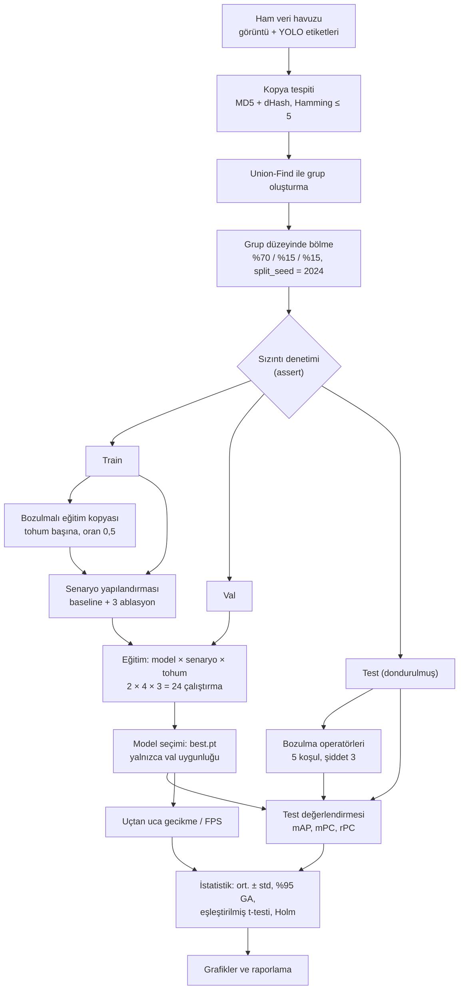
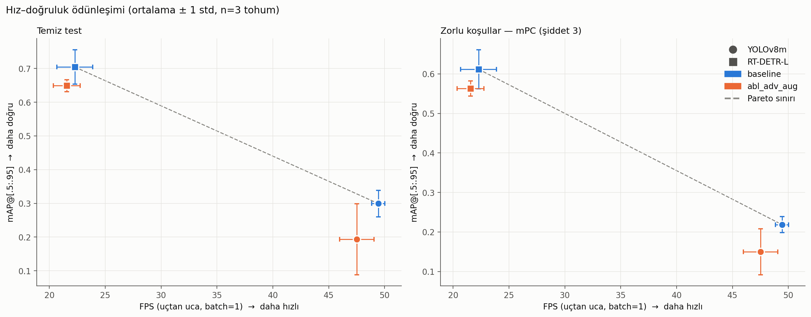
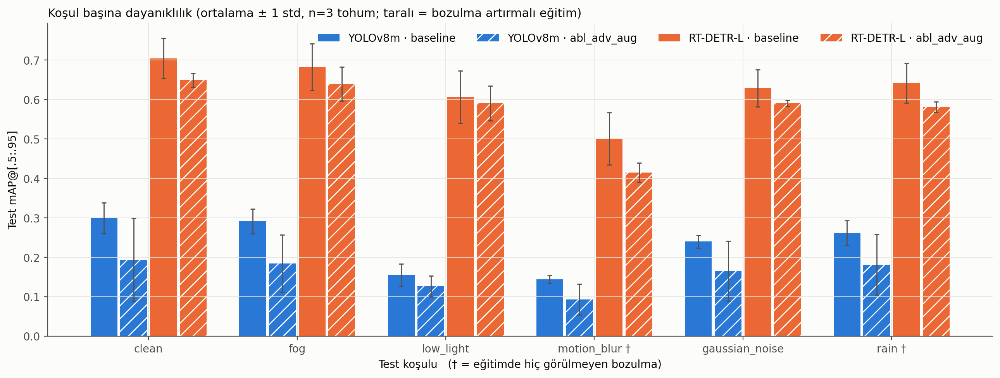
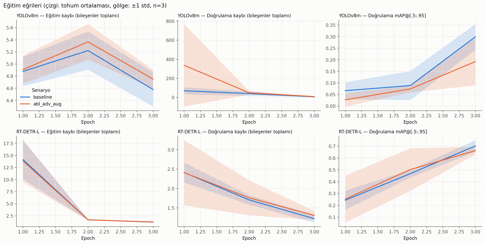

# Zorlu Görüntüleme Koşullarında YOLOv8 ve RT-DETR'nin Hız–Doğruluk Ödünleşimi

*[Yazar Adı Soyadı] · [Bölüm, Üniversite] · [Ders kodu ve adı] · [Tarih]*

## Özet

Gerçek zamanlı nesne tespit sistemleri, yaban hayatı izleme ve otonom sürüş gibi uygulamalarda sıklıkla düşük ışık, sis, yağmur ve hareket bulanıklığı gibi zorlu görüntüleme koşullarıyla karşılaşmaktadır. Bu çalışmada, evrişimsel tek aşamalı bir dedektör olan YOLOv8m ile transformer tabanlı uçtan uca bir dedektör olan RT-DETR-L, bu koşullardaki hız–doğruluk ödünleşimi açısından karşılaştırılmıştır. Veri sızıntısını önlemek için birebir ve yakın kopyalar MD5 ve algısal özet (dHash) ile tespit edilmiş, ayrım grup düzeyinde yapılarak dondurulmuş ve otomatik denetimlerle doğrulanmıştır. Temiz test kümesinden fiziksel ve istatistiksel modellere dayalı beş bozulma türetilmiş; modeller baseline ve bozulma artırmalı eğitim senaryolarında üç farklı rastgele tohumla eğitilmiştir. Sonuçlar ortalama ± standart sapma, eşleştirilmiş t-testleri ve Holm düzeltmesiyle raporlanmıştır. Kısa eğitim bütçeli ön deneylerde (3 epoch) YOLOv8m, Tesla T4 üzerinde 2,2 kat daha yüksek hız (49,4 ± 0,6 FPS) sunarken, RT-DETR-L temiz test kümesinde (0,704 ± 0,051 mAP@[.5:.95]) ve bozulmalar altında (mPC 0,612 ± 0,049) belirgin biçimde daha doğru ve göreli olarak daha dayanıklı bulunmuştur. Hareket bulanıklığı her iki mimari için en zor koşul olmuş, düşük ışık ise YOLOv8m'in performansını yarıya indirmiştir. Sentetik bozulma artırması bu bütçede dayanıklılığı iyileştirmemiştir. Doğruluk farkının büyüklüğünün kısmen yetersiz eğitimden kaynaklandığı tartışılmış ve tam bütçeli doğrulama için tekrarlanabilir bir deney hattı sunulmuştur. Elde edilen bulgular, gecikme bütçesine göre mimari seçimi için nicel bir çerçeve sunmaktadır.

**Anahtar Kelimeler** — Nesne tespiti, YOLO, DETR, dayanıklılık, görüntü bozulmaları, veri sızıntısı, hız–doğruluk ödünleşimi.

## Abstract

Real-time object detectors deployed in wildlife monitoring and autonomous driving frequently operate under adverse imaging conditions such as low light, fog, rain, and motion blur. This study compares a single-stage convolutional detector, YOLOv8m, with an end-to-end transformer-based detector, RT-DETR-L, in terms of the speed–accuracy trade-off under such conditions. To prevent data leakage, exact and near-duplicate images were identified with MD5 and perceptual hashing (dHash), and the dataset was split at the group level, frozen, and verified by automated audits. Five corruptions grounded in physical and statistical image-formation models were derived from the clean test set, and both detectors were trained under baseline and corruption-augmented scenarios with three random seeds. Results are reported as mean ± standard deviation with paired t-tests and Holm correction. In preliminary experiments with a short training budget (three epochs), YOLOv8m was 2.2 times faster on a Tesla T4 GPU (49.4 ± 0.6 FPS), whereas RT-DETR-L was substantially more accurate on clean data (0.704 ± 0.051 mAP@[.5:.95]) and under corruptions (mPC 0.612 ± 0.049) and was relatively more robust. Motion blur was the most challenging condition for both architectures, and low light halved the accuracy of YOLOv8m. Synthetic corruption augmentation did not improve robustness under this budget. The magnitude of the accuracy gap is argued to stem partly from under-training, and a reproducible pipeline is provided for full-budget validation.

***Index Terms*** — Object detection, YOLO, DETR, robustness, image corruptions, data leakage, speed–accuracy trade-off.

## 1. Giriş

Nesne tespiti, bir görüntüdeki nesnelerin hem sınıfını hem de konumunu belirleme görevidir ve gerçek dünyadaki pek çok otonom sistemin algı katmanını oluşturur. Bu çalışmanın motive edici uygulaması **yaban hayatı izlemedir**. Koruma alanlarına yerleştirilen kamera tuzakları her yıl milyonlarca görüntü üretmektedir. Bu görüntülerin elle etiketlenmesi, ekolojik araştırmaların temel darboğazıdır. Derin öğrenme tabanlı otomatik tanımanın bu iş yükünü büyük ölçüde azaltabildiği gösterilmiştir [1]. Kaçak avcılıkla mücadelede kullanılan insansız hava araçları ve sınır gözetim kameraları ise tespitin **cihaz üzerinde ve gerçek zamanlı** yapılmasını gerektirir. Bu sistemlerde kısıtlı hesaplama kapasitesi ve gecikme bütçesi, modelin doğruluğu kadar belirleyicidir.

Bu uygulamalar, kontrollü veri kümelerindeki görüntülerden çok farklı koşullarda çalışır. Kamera tuzaklarının önemli bir kısmı gece, düşük ışıkta ya da kızılötesi aydınlatmayla görüntü alır. Sabah sisi, yağmur ve hareket eden hayvanların ya da hareketli platformun neden olduğu bulanıklık olağandır. Beery ve arkadaşları [2], kamera tuzağı görüntüleri üzerinde eğitilen modellerin yeni konumlara ve koşullara genellemede ciddi biçimde başarısız olduğunu göstermiştir. Benzer bir tablo otonom sürüş için de raporlanmıştır: yaygın dedektörlerin performansı sentetik hava ve görüntü bozulmaları altında temiz koşullardaki değerinin yaklaşık yarısına kadar düşebilmektedir [3]. Bu nedenle, bir dedektörün uygulamaya uygunluğu yalnızca temiz test kümesindeki doğrulukla değil, **zorlu koşullardaki dayanıklılığı ve gecikmesiyle birlikte** değerlendirilmelidir.

Gerçek zamanlı nesne tespitinde uzun süre baskın paradigma, YOLO ailesinin temsil ettiği tek aşamalı evrişimsel dedektörler olmuştur [4]. Bu modeller görüntü üzerinde yoğun bir aday kutu ızgarası tahmin eder ve yinelenen tespitleri Maksimum Olmayanı Bastırma (NMS) ile eler. Güncel sürümlerden YOLOv8, çapasız (anchor-free) başlık ve görev hizalı etiket atamasıyla hız–doğruluk dengesinde güçlü bir referans noktasıdır [5]. Buna karşılık DETR [6], tespiti bir **küme tahmini** problemi olarak ele alır. Transformer kodlayıcı–kod çözücü mimarisi ve Macar eşlemesiyle NMS'ye ihtiyaç duymadan uçtan uca eğitilir. Ancak özgün DETR'nin yavaş yakınsaması ve yüksek hesaplama maliyeti gerçek zamanlı kullanımını sınırlamıştır. RT-DETR [7], verimli bir hibrit kodlayıcı ve IoU farkındalıklı sorgu seçimiyle bu sınırlamayı aşmayı hedeflemiş ve gerçek zamanlı ölçekte YOLO modellerini geçtiğini raporlamıştır.

Bu iki paradigmanın karşılaştırmaları literatürde çoğunlukla **temiz** COCO doğruluğu ve TensorRT ile optimize edilmiş hız üzerinden yapılmaktadır. Oysa iki mimari arasındaki tümevarımsal yanlılık farkı, yani evrişimin yerel dokuya, öz-dikkatin küresel bağlama dayanması, bozulmalara karşı farklı davranış beklentisi doğurur. Görüntü bozulmalarına karşı dayanıklılığın sistematik değerlendirilmesi için ImageNet-C [8] ve nesne tespiti için Michaelis ve arkadaşlarının çalışması [3] standart protokoller önermiştir. Düşük ışık için ExDark gibi gerçek veri kümeleri de mevcuttur [9]. Bununla birlikte, bu karşılaştırmalarda iki metodolojik sorun sıkça göz ardı edilmektedir. Birincisi **istatistiksel güvenilirliktir**: sonuçlar genellikle tek bir eğitim çalıştırmasından raporlanır ve tohumlar arası değişkenlik bilinmez. İkincisi **veri sızıntısıdır**: eğitim ve test kümeleri arasındaki yinelenen ya da neredeyse aynı örnekler, ön-eğitim verisiyle test verisinin örtüşmesi ve test kümesinin model seçiminde kullanılması, raporlanan performansı sistematik olarak şişirir [10]. Makine öğrenmesine dayalı bilimsel çalışmalarda sızıntının yaygın bir tekrarlanabilirlik sorunu olduğu gösterilmiştir [11].

Bu çalışmanın katkıları şunlardır:

- YOLOv8m ve RT-DETR-L'nin, **aynı veri ayrımı, aynı eğitim hattı ve aynı değerlendirme protokolü** altında, temiz koşullarda ve beş zorlu koşulda hız–doğruluk ödünleşimi açısından karşılaştırılması.
- Birebir ve yakın kopyaları grup düzeyinde ayıran, ayrımı donduran ve otomatik denetimlerle doğrulayan **sızıntısız bir veri ayrım protokolü**.
- Sonuçların üç bağımsız tohum üzerinden ortalama ± standart sapma, güven aralıkları, eşleştirilmiş testler ve çoklu karşılaştırma düzeltmesiyle raporlandığı **istatistiksel olarak sorumlu bir değerlendirme**.
- Baseline ve bozulma artırmalı eğitim senaryolarını içeren bir ablasyon çalışması ve modellerin başarısız olduğu koşulları mekanizma düzeyinde inceleyen bir başarısızlık analizi.
- Tüm deneyleri tek bir Jupyter Notebook'tan yeniden üretilebilir kılan açık bir deney hattı.

Bu rapordaki deneysel sonuçların, kısa eğitim bütçeli **ön deneylerden** elde edildiği vurgulanmalıdır (3 epoch, eğitim verisinin %25'i). Sonuçların bu bütçeye bağlı yorumu Bölüm 4'te ayrıntılı olarak tartışılmıştır.

Raporun geri kalanı şu şekilde düzenlenmiştir. Bölüm 2 ilgili çalışmaları özetler. Bölüm 3 yöntemi ve matematiksel modeli tanımlar. Bölüm 4 deneysel sonuçları ve başarısızlık analizini sunar. Bölüm 5 test süreçlerini, veri sızıntısı önlemlerini ve etik değerlendirmeyi ele alır. Bölüm 6 çalışmayı sonuçlandırır.

## 2. İlgili Çalışmalar

**Gerçek zamanlı nesne tespiti.** YOLO [4], tespiti tek bir regresyon problemine indirgeyerek gerçek zamanlı nesne tespitini mümkün kılmıştır. Sonraki sürümler çok ölçekli öznitelik piramitleri, çapasız başlıklar ve dinamik etiket atamasıyla doğruluğu artırmıştır [5]. DETR [6] ise el yapımı bileşenleri (çapalar, NMS) kaldıran küme tabanlı bir yaklaşım getirmiştir. RT-DETR [7], DETR ailesini gerçek zamanlı ölçeğe taşıyan ilk modellerdendir. Bu modellerin büyük çoğunluğu COCO [12] üzerinde ön-eğitilmekte ve karşılaştırılmaktadır.

**Bozulmalara karşı dayanıklılık.** Hendrycks ve Dietterich [8], 15 bozulma türü ve 5 şiddet düzeyinden oluşan ImageNet-C ölçütünü önermiş ve sınıflandırıcıların bozulmalar karşısındaki kırılganlığını ortaya koymuştur. Michaelis ve arkadaşları [3] bu protokolü nesne tespitine uyarlamış, mPC ve rPC ölçütlerini tanımlamış ve stilizasyon tabanlı veri artırmasının dayanıklılığı artırabildiğini göstermiştir. Gerçek dünya koşulları için ExDark [9] gibi veri kümeleri, sentetik bozulmaların gerçek düşük ışık dağılımını ne ölçüde temsil ettiğini sınamaya olanak tanır. Beery ve arkadaşları [2] ise kamera tuzağı uygulamalarında asıl sorunun bozulmalar kadar konum ve çekim koşulu kaynaklı dağılım kayması olduğunu vurgulamıştır.

**Veri sızıntısı ve değerlendirme geçerliliği.** Kaufman ve arkadaşları [10] sızıntıyı, model değerlendirmesinde kullanılamaması gereken bilginin eğitim sürecine karışması olarak tanımlamıştır. Barz ve Denzler [13], CIFAR-100 test görüntülerinin yaklaşık %10'unun eğitim kümesinde yakın kopyası bulunduğunu ve bu kopyaların raporlanan doğruluğu şişirdiğini göstermiştir. Kapoor ve Narayanan [11], sızıntıyı yinelenen örnekler, ön işleme sızıntısı ve test kümesinin yeniden kullanımı gibi türlere ayıran bir sınıflandırma önermiştir. Bu çalışma, söz konusu türlerin her biri için ayrı bir önlem tanımlar ve önlemlerin kapsamını Bölüm 5'te açıkça raporlar.

## 3. Yöntem ve Matematiksel Modelleme

Bu bölümde, tek aşamalı evrişimsel bir dedektör olan YOLOv8 ile transformer tabanlı küme-tahmini (set prediction) dedektörü RT-DETR'nin zorlu görüntüleme koşullarındaki hız–doğruluk ödünleşimini ölçmek için kullanılan yöntem tanımlanmaktadır. Önce deneysel akış verilmekte (3.1), ardından notasyon (3.2), kutu benzerlik ölçüleri (3.3), iki mimarinin kayıp fonksiyonları (3.4–3.5), optimizasyon (3.6), bozulma modeli (3.7), değerlendirme ve istatistiksel çıkarım (3.8–3.9) ve son olarak hesaplama karmaşıklığı (3.10) sunulmaktadır. Aksi belirtilmedikçe katsayılar, kullanılan Ultralytics uygulamasının [5] varsayılan değerleridir.

### 3.1 Metodolojik akış

Deneysel tasarımın akışı Şekil 3.1'de gösterilmiştir.

*Şekil 3.1. Deneysel akış. Test kümesine yalnızca model seçimi tamamlandıktan sonra erişilir; bozulmalar ve veri artırmaları ayrımdan sonra ve yalnızca ilgili bölmenin içinde üretilir.*

Akış dört aşamadan oluşur:

1. **Veri hazırlama ve sızıntı önleme.** Tüm görüntüler tek bir havuzda toplanır; veri kümesinin özgün train/val/test ayrımı kullanılmaz. Birebir kopyalar MD5 özetiyle, yakın kopyalar 64 bitlik *difference hash* (dHash) üzerindeki Hamming mesafesiyle bulunur. Bu ilişkiler Union-Find yapısında birleştirilerek bağlantılı bileşenler (gruplar) elde edilir ve bölme grup düzeyinde yapılır. Böylece bir görüntü ile onun yakın kopyası farklı bölmelere düşemez. Ayrım bir manifest dosyasına yazılarak dondurulur; bölmeler arası ortak özet, ortak grup ya da eşik altı dHash mesafesi bulunursa deney başlatılmaz.
2. **Koşul üretimi.** Temiz test bölmesinden, sabit bir rastgelelik tohumuyla beş bozulmuş test kümesi türetilir. Bozulma artırması ablasyonu için eğitim bölmesinin her tohuma özgü bir bozulmuş kopyası üretilir. Bu kopyada yalnızca üç bozulma türü kullanılır; kalan ikisi eğitimde hiç görülmez.
3. **Eğitim ve model seçimi.** Her (model, senaryo, tohum) üçlüsü bağımsız bir çalıştırmadır. En iyi ağırlıklar yalnızca doğrulama kümesindeki uygunluk ölçütüyle seçilir.
4. **Değerlendirme ve çıkarım.** Seçilen model altı test koşulunda değerlendirilir, uçtan uca gecikmesi ölçülür ve sonuçlar tohumlar üzerinden özetlenerek istatistiksel testlere tabi tutulur.

### 3.2 Problem tanımı ve notasyon

Veri kümesi $\mathcal{D}=\{(x_n, Y_n)\}_{n=1}^{N}$ biçimindedir. $x_n\in[0,255]^{H\times W\times 3}$ bir görüntü, $Y_n=\{(c_j, b_j)\}_{j=1}^{G_n}$ ise o görüntüdeki $G_n$ nesnenin sınıf etiketi $c_j\in\{1,\dots,C\}$ ve kutusu $b_j=(x_c, y_c, w, h)$ çiftlerinden oluşan kümedir. Bir dedektör $f_\theta$, girdiden tahmin kümesi $\hat Y=f_\theta(x)=\{(\hat p_i, \hat b_i)\}_{i=1}^{N_p}$ üretir; $\hat p_i\in[0,1]^{C}$ sınıf olasılıkları, $\hat b_i$ tahmin edilen kutudur. Bu çalışmada $C=4$, girdi çözünürlüğü baseline'da $640\times640$'tır.

Ayrık bölmeler $\mathcal{D}=\mathcal{D}_{tr}\,\dot\cup\,\mathcal{D}_{val}\,\dot\cup\,\mathcal{D}_{te}$ ile gösterilir. $g(\cdot)$, bir görüntüyü ait olduğu kopya grubuna eşleyen fonksiyon olmak üzere sızıntısızlık koşulu şudur:

$$
g(\mathcal{D}_a)\cap g(\mathcal{D}_b)=\varnothing,\qquad \min_{x\in\mathcal{D}_a,\;x'\in\mathcal{D}_b} d_H\big(h(x),h(x')\big) > \tau,\qquad a\neq b \tag{3.1}
$$

Burada $h(\cdot)$ dHash, $d_H$ Hamming mesafesi ve $\tau=5$ bittir.

### 3.3 Kutu benzerlik ölçüleri

İki kutu $B$ (tahmin) ve $B^{gt}$ (gerçek) için Kesişim/Birleşim oranı:

$$
\mathrm{IoU}(B,B^{gt})=\frac{\lvert B\cap B^{gt}\rvert}{\lvert B\cup B^{gt}\rvert} \tag{3.2}
$$

IoU, kutular örtüşmediğinde sıfırdır ve gradyan üretmez. **Genelleştirilmiş IoU** (GIoU) [14], iki kutuyu kapsayan en küçük kutu $C_{enc}$ yardımıyla bu sorunu giderir:

$$
\mathrm{GIoU}=\mathrm{IoU}-\frac{\lvert C_{enc}\setminus(B\cup B^{gt})\rvert}{\lvert C_{enc}\rvert},\qquad \mathrm{GIoU}\in(-1,1] \tag{3.3}
$$

**Tam IoU** (CIoU) [15], merkez uzaklığı ve en-boy oranı uyumunu da cezalandırır:

$$
\mathrm{CIoU}=\mathrm{IoU}-\frac{\rho^{2}(\mathbf{b},\mathbf{b}^{gt})}{c^{2}}-\alpha v \tag{3.4}
$$

$$
v=\frac{4}{\pi^{2}}\left(\arctan\frac{w^{gt}}{h^{gt}}-\arctan\frac{w}{h}\right)^{2},\qquad \alpha=\frac{v}{(1-\mathrm{IoU})+v} \tag{3.5}
$$

$\rho(\cdot)$ kutu merkezleri arasındaki Öklid uzaklığı, $c$ ise kapsayan kutunun köşegen uzunluğudur. Karşılık gelen kayıplar $\mathcal{L}_{\mathrm{GIoU}}=1-\mathrm{GIoU}$ ve $\mathcal{L}_{\mathrm{CIoU}}=1-\mathrm{CIoU}$'dur.

### 3.4 YOLOv8 kayıp fonksiyonu

#### 3.4.1 Yoğun tahmin ve kutu kodlaması

YOLOv8, adımları $s\in\{8,16,32\}$ olan üç öznitelik haritasının her konumunda (çapa noktası) tahmin üretir. Toplam çapa noktası sayısı:

$$
N_a=\sum_{s\in\{8,16,32\}}\frac{H}{s}\cdot\frac{W}{s}=\frac{21\,HW}{1024} \tag{3.6}
$$

Bu değer $640\times640$ için 8400, $480\times480$ için 4725'tir. Her nokta $C$ sınıf logiti ile kutunun dört kenarına olan uzaklıkların ($l,t,r,b$) her biri için $R=16$ kutulu bir ayrık dağılım tahmin eder. Kenar uzaklığı bu dağılımın beklenen değeridir:

$$
\hat d=s\sum_{k=0}^{R-1} k\,\mathrm{softmax}(z)_k \tag{3.7}
$$

#### 3.4.2 Görev hizalı atama (TAL)

Pozitif örnekler sabit çapalarla değil, tahmin kalitesine göre dinamik olarak seçilir. Merkezi $j$ nesnesinin kutusu içinde kalan her $i$ noktası için hizalama ölçütü:

$$
t_{ij}=\hat p_{i,c_j}^{\;\alpha}\cdot \mathrm{IoU}(\hat b_i,b_j)^{\beta},\qquad \alpha=0{,}5,\;\beta=6 \tag{3.8}
$$

Her nesne için en yüksek $t_{ij}$ değerine sahip $k=10$ nokta pozitif kabul edilir. Bir nokta birden fazla nesneye atanırsa en yüksek IoU'lu nesne korunur. Sınıflandırma hedefi ikili değil, normalize edilmiş yumuşak bir skordur:

$$
\hat t_{ij}=t_{ij}\cdot\frac{\max_{i'}\mathrm{IoU}(\hat b_{i'},b_j)}{\max_{i'} t_{i'j}} \tag{3.9}
$$

Normalizasyon sabiti $S=\sum_{i,c}\hat t_{ic}$, pozitif $i$ noktasının ağırlığı $w_i=\sum_c \hat t_{ic}$, pozitif nokta kümesi de $\mathcal{P}$ ile gösterilsin.

#### 3.4.3 Kayıp bileşenleri

**Sınıflandırma (ikili çapraz entropi, yumuşak hedefli):**

$$
\mathcal{L}_{cls}=\frac{1}{S}\sum_{i=1}^{N_a}\sum_{c=1}^{C}-\Big[\hat t_{ic}\log\sigma(z_{ic})+(1-\hat t_{ic})\log\big(1-\sigma(z_{ic})\big)\Big] \tag{3.10}
$$

**Kutu regresyonu (CIoU):**

$$
\mathcal{L}_{box}=\frac{1}{S}\sum_{i\in\mathcal{P}} w_i\big(1-\mathrm{CIoU}(\hat b_i,b_{j(i)})\big) \tag{3.11}
$$

**Dağılım odak kaybı (DFL) [16].** Sürekli hedef uzaklık $y$ iki komşu tam sayı kutusu $y_l\le y<y_{l}+1=y_r$ arasındadır. Bu kayıp, olasılık kütlesini bu iki kutuya doğrusal ağırlıklarla yoğunlaştırır:

$$
\mathrm{DFL}(S_l,S_r)=-\big[(y_r-y)\log S_l+(y-y_l)\log S_r\big] \tag{3.12}
$$

$$
\mathcal{L}_{dfl}=\frac{1}{S}\sum_{i\in\mathcal{P}} w_i\cdot\frac{1}{4}\sum_{e\in\{l,t,r,b\}}\mathrm{DFL}_{i,e} \tag{3.13}
$$

**Toplam kayıp:**

$$
\mathcal{L}_{\mathrm{YOLO}}=B\big(\lambda_{box}\mathcal{L}_{box}+\lambda_{cls}\mathcal{L}_{cls}+\lambda_{dfl}\mathcal{L}_{dfl}\big),\qquad \lambda_{box}=7{,}5,\;\lambda_{cls}=0{,}5,\;\lambda_{dfl}=1{,}5 \tag{3.14}
$$

$B$ mini-yığın boyutudur. Çıkarımda, yoğun $N_a$ tahmin güven eşiğinden sonra Maksimum Olmayanı Bastırma (NMS) ile seyreltilir; bu adım türevlenemez ve eğitim amacının parçası değildir.

### 3.5 DETR ailesi kayıp fonksiyonu

#### 3.5.1 Küme tahmini ve Macar eşlemesi

DETR [6], sabit sayıda $Q$ sorgudan oluşan bir tahmin kümesi $\hat Y=\{\hat y_i\}_{i=1}^{Q}$ üretir ($Q\ge G$; RT-DETR'de $Q=300$). Gerçek küme $Y$, "nesne yok" sınıfı $\varnothing$ ile $Q$ elemana tamamlanır. Kayıp hesaplanmadan önce iki küme arasındaki en düşük maliyetli birebir eşleme Macar algoritmasıyla bulunur:

$$
\hat\sigma=\operatorname*{arg\,min}_{\sigma\in\mathfrak{S}_Q}\sum_{j=1}^{Q}\mathcal{C}_{match}\big(y_j,\hat y_{\sigma(j)}\big) \tag{3.15}
$$

Özgün DETR'de eşleme maliyeti şöyledir:

$$
\mathcal{C}_{match}(y_j,\hat y_i)=-\mathbf{1}_{\{c_j\neq\varnothing\}}\,\hat p_i(c_j)+\mathbf{1}_{\{c_j\neq\varnothing\}}\,\mathcal{L}_{bbox}(b_j,\hat b_i) \tag{3.16}
$$

$$
\mathcal{L}_{bbox}(b,\hat b)=\lambda_{L1}\lVert b-\hat b\rVert_1+\lambda_{giou}\,\mathcal{L}_{\mathrm{GIoU}}(b,\hat b),\qquad\lambda_{L1}=5,\;\lambda_{giou}=2 \tag{3.17}
$$

**Macar kaybı** eşleme sabitlendikten sonra hesaplanır:

$$
\mathcal{L}_{\mathrm{Hung}}(Y,\hat Y)=\sum_{j=1}^{Q}\Big[-w_{c_j}\log\hat p_{\hat\sigma(j)}(c_j)+\mathbf{1}_{\{c_j\neq\varnothing\}}\,\mathcal{L}_{bbox}\big(b_j,\hat b_{\hat\sigma(j)}\big)\Big] \tag{3.18}
$$

Sınıf dengesizliğini gidermek için "nesne yok" sınıfının ağırlığı $w_\varnothing=0{,}1$'dir. Birebir eşleme her nesne için tek bir tahmini ödüllendirdiğinden mimari NMS gerektirmez.

#### 3.5.2 RT-DETR'ye özgü değişiklikler

RT-DETR [7] bu çerçeveyi üç noktada değiştirir.

**(i) Odak tabanlı eşleme maliyeti.** Sınıf maliyeti olasılık yerine odak (focal) biçimindedir ($\alpha_f=0{,}25$, $\gamma=2$):

$$
\mathcal{C}_{cls}(i,j)=\alpha_f(1-\hat p_{ij})^{\gamma}\big(-\log\hat p_{ij}\big)-(1-\alpha_f)\,\hat p_{ij}^{\;\gamma}\big(-\log(1-\hat p_{ij})\big) \tag{3.19}
$$

$$
\mathcal{C}_{match}=1\cdot\mathcal{C}_{cls}+5\cdot\lVert b-\hat b\rVert_1+2\cdot\big(-\mathrm{GIoU}(b,\hat b)\big) \tag{3.20}
$$

**(ii) IoU farkındalıklı sınıflandırma: Varifocal kayıp** (VFL) [17]. Eşleşen sorgunun sınıf hedefi $q=\mathrm{IoU}(b_j,\hat b_{\hat\sigma(j)})$, eşleşmeyenlerde ise $q=0$'dır:

$$
\mathrm{VFL}(p,q)=\begin{cases}-q\big[q\log p+(1-q)\log(1-p)\big], & q>0\\[2pt] -\alpha\,p^{\gamma}\log(1-p), & q=0\end{cases}\qquad \alpha=0{,}75,\;\gamma=2 \tag{3.21}
$$

Böylece sınıf güveni, lokalizasyon kalitesiyle doğrudan ilişkilendirilir.

**(iii) Yardımcı ve gürültü giderme kayıpları.** Kayıp, $D=6$ kod çözücü katmanının her birinin çıktısına ve kodlayıcının sorgu seçimi için önerdiği ilk kutulara ayrı ayrı uygulanır. Ayrıca gerçek kutulara gürültü eklenerek oluşturulan sorgular (contrastive denoising) eşlemesi önceden bilinen ek bir alt problem oluşturur ve Macar eşlemesinin erken epoch'lardaki kararsızlığını azaltır:

$$
\mathcal{L}_{\mathrm{RT\text{-}DETR}}=\sum_{d=0}^{D}\Big[\mathcal{L}^{(d)}_{\mathrm{match}}+\mathcal{L}^{(d)}_{\mathrm{dn}}\Big],\qquad
\mathcal{L}^{(d)}=\lambda_{cls}\mathcal{L}_{\mathrm{VFL}}+\lambda_{L1}\mathcal{L}_{L1}+\lambda_{giou}\mathcal{L}_{\mathrm{GIoU}} \tag{3.22}
$$

Katsayılar $\lambda_{cls}=1$, $\lambda_{L1}=5$ ve $\lambda_{giou}=2$'dir. Kutu terimleri eşleşen nesne sayısına bölünerek normalize edilir.

> **Karşılaştırılabilirlik notu.** Denklem (3.14) ile (3.22) farklı terimlerden ve farklı ölçeklerden oluşur. Bu nedenle iki modelin mutlak kayıp değerleri birbiriyle karşılaştırılamaz; kayıp eğrileri yalnızca her modelin kendi içinde yakınsama tanılaması için kullanılır. Modeller arası karşılaştırma ortak ölçüt olan mAP üzerinden yapılır.

### 3.6 Optimizasyon

#### 3.6.1 Amaç fonksiyonu

Tohum $r$ ile eğitilen bir modelin parametreleri, düzenlileştirilmiş ampirik riskin stokastik minimizasyonuyla elde edilir:

$$
\theta^{*}_{r}\approx\operatorname*{arg\,min}_{\theta}\;\frac{1}{\lvert\mathcal{D}'_{tr}\rvert}\sum_{(x,Y)\in\mathcal{D}'_{tr}}\mathcal{L}\big(f_\theta(\mathcal{A}_r(x)),\,\mathcal{A}_r(Y)\big) \tag{3.23}
$$

$\mathcal{A}_r$, tohuma bağlı stokastik veri artırma (mozaik, HSV, ölçekleme, yatay çevirme) operatörüdür. $\mathcal{D}'_{tr}$ ise senaryoya göre temiz ya da kısmen bozulmuş eğitim kümesidir. Ağırlık bozunumu, kayba eklenmek yerine optimizasyon adımına uygulanır ve yalnızca evrişim/doğrusal katman ağırlıklarına etki eder (yanlılık ve BatchNorm parametrelerine uygulanmaz).

#### 3.6.2 Optimize edici seçimi

Kullanılan uygulamada optimize edici, eğitim bütçesine göre otomatik seçilir. Nominal yığın boyutu $B_{nom}=64$ olmak üzere:

$$
I=\left\lceil\frac{\lvert\mathcal{D}'_{tr}\rvert}{\max(B,B_{nom})}\right\rceil E,\qquad
\text{optimize edici}=\begin{cases}\text{SGD (Nesterov)},\;\eta_0=0{,}01 & I>10^{4}\\ \text{AdamW},\;\eta_0=\dfrac{0{,}002\cdot 5}{4+C} & I\le 10^{4}\end{cases} \tag{3.24}
$$

Bu çalışmanın ölçeğinde ($\lvert\mathcal{D}_{tr}\rvert\approx1050$, $E=80$) $I\approx1{,}4\times10^{3}$ olduğundan **AdamW** seçilir ve $C=4$ için $\eta_0=1{,}25\times10^{-3}$ olur.

**AdamW** [18] güncellemesi, $g_t=\nabla_\theta\mathcal{L}_t$ olmak üzere:

$$
m_t=\beta_1 m_{t-1}+(1-\beta_1)g_t,\qquad v_t=\beta_2 v_{t-1}+(1-\beta_2)g_t^{2} \tag{3.25}
$$

$$
\theta_{t+1}=\theta_t-\eta_t\left(\frac{m_t/(1-\beta_1^{t})}{\sqrt{v_t/(1-\beta_2^{t})}+\epsilon}+\lambda_{wd}\,\theta_t\right),\qquad \beta_1=0{,}9,\;\beta_2=0{,}999 \tag{3.26}
$$

Daha büyük eğitim bütçelerinde devreye giren **Nesterov momentumlu SGD** ($\mu=0{,}937$) ise şöyledir:

$$
v_{t+1}=\mu v_t+\big(g_t+\lambda_{wd}\theta_t\big),\qquad \theta_{t+1}=\theta_t-\eta_t\big(g_t+\lambda_{wd}\theta_t+\mu v_{t+1}\big) \tag{3.27}
$$

#### 3.6.3 Gradyan biriktirme ve ağırlık bozunumu ölçeklemesi

Fiziksel yığın boyutu $B=8$ olduğundan gradyanlar $A=\max(\mathrm{round}(B_{nom}/B),1)=8$ adım boyunca biriktirilir. Efektif yığın boyutu böylece $AB=64$'tür. Ağırlık bozunumu da buna göre ölçeklenir:

$$
\lambda_{wd}=5\times10^{-4}\cdot\frac{A\,B}{B_{nom}}=5\times10^{-4} \tag{3.28}
$$

Her güncellemeden önce gradyan normu kırpılır: $g\leftarrow g\cdot\min\!\big(1,\,10/\lVert g\rVert_2\big)$.

#### 3.6.4 Öğrenme oranı takvimi

$e$ epoch indeksi, $E$ toplam epoch sayısı ve $r_f=0{,}01$ son oran çarpanı olmak üzere doğrusal azalan takvim:

$$
\eta(e)=\eta_0\Big[\Big(1-\frac{e}{E}\Big)(1-r_f)+r_f\Big] \tag{3.29}
$$

İlk $n_w=\max(3\cdot n_b,\,100)$ iterasyonda ($n_b$: epoch başına yığın sayısı) ısınma uygulanır. Bu sürede öğrenme oranı 0'dan $\eta(e)$'ye, momentum ($\beta_1$) ise $0{,}8$'den hedef değerine doğrusal olarak çıkarılır. Son 10 epoch'ta mozaik artırması kapatılır; böylece model test dağılımına daha yakın, bütün görüntülerle ince ayar yapar.

#### 3.6.5 Üstel hareketli ortalama ve model seçimi

Değerlendirmede ham ağırlıklar yerine üstel hareketli ortalamaları (EMA) kullanılır:

$$
\theta^{\mathrm{EMA}}_{t}=d_t\,\theta^{\mathrm{EMA}}_{t-1}+(1-d_t)\,\theta_t,\qquad d_t=0{,}9999\big(1-e^{-t/2000}\big) \tag{3.30}
$$

Her epoch sonunda doğrulama kümesinde bir uygunluk değeri hesaplanır ve en iyi epoch'un ağırlıkları saklanır:

$$
F(e)=0{,}1\cdot\mathrm{mAP}_{50}^{val}(e)+0{,}9\cdot\mathrm{mAP}_{50:95}^{val}(e),\qquad \hat\theta_r=\theta^{\mathrm{EMA}}_{e^{*}},\;\; e^{*}=\operatorname*{arg\,max}_e F(e) \tag{3.31}
$$

Test kümesi bu seçimde hiçbir biçimde kullanılmaz. Karma hassasiyetli (AMP) eğitim, dinamik kayıp ölçekleme ile uygulanır. Tekrarlanabilirlik için Python, NumPy ve PyTorch tohumları sabitlenir, cuDNN deterministik kipte çalıştırılır.

#### 3.6.6 Senaryolar

Her ablasyon, baseline'dan tek bir faktörü değiştirir:

| Senaryo | Değişen faktör | Biçimsel ifade |
|---|---|---|
| baseline | — | $\mathcal{D}'_{tr}=\mathcal{D}_{tr}$, $H=W=640$ |
| abl\_adv\_aug | Bozulma artırması | $\mathcal{D}'_{tr}=\{T_{k,\ell}(x)\text{ olasılık }0{,}5\text{ ile},\;x\text{ aksi halde}\}$, $k\in\mathcal{K}_{tr}$ |
| abl\_imgsz480 | Girdi çözünürlüğü | $H=W=480$ (FLOP oranı $\approx(480/640)^2=0{,}5625$) |
| abl\_no\_mosaic | Mozaik artırması | $\mathcal{A}_r$ içinde mozaik olasılığı $=0$ |

*Tablo 3.1. Baseline ve ablasyon senaryoları.*

### 3.7 Zorlu koşulların modellenmesi

$I\in[0,255]^{H\times W\times3}$ temiz görüntü, $\ell\in\{1,\dots,5\}$ şiddet düzeyi ve $\omega$ görüntüye özgü rastgelelik olmak üzere her bozulma bir $T_{k,\ell}(I;\omega)$ operatörüdür. Rastgelelik, $\omega=\mathrm{MD5}(\text{tohum}\,\|\,\text{dosya adı}\,\|\,k)$ ile belirlenir; böylece bozulmalar çalıştırma sırasından bağımsız ve bit düzeyinde tekrarlanabilirdir. Operatörler fotometrik/optik olduğundan geometriyi değiştirmez: $T_{k,\ell}(Y)=Y$.

**Sis — atmosferik saçılma modeli** (Koschmieder yasası):

$$
T_{fog}(I)=I\odot t+A\,(1-t),\qquad 1-t=\mathrm{clip}\big(a_\ell(0{,}6+0{,}8\,n)\,\delta,\;0,\;0{,}9\big),\quad A=225 \tag{3.32}
$$

$n$ düşük frekanslı normalize gürültü, $\delta$ görüntünün üstüne doğru artan sözde derinlik, $a_\ell\in\{0{,}25,\dots,0{,}65\}$'tir.

**Düşük ışık — gama sıkıştırma ve Poisson–Gauss sensör gürültüsü:**

$$
u=g_\ell\Big(\frac{I}{255}\Big)^{\gamma_\ell},\qquad T_{ll}(I)=255\cdot\mathrm{clip}\big(u+\epsilon_1\sqrt{u}+\epsilon_2,\;0,\;1\big),\quad \epsilon_1\sim\mathcal{N}(0,\sigma_\ell^{2}),\;\epsilon_2\sim\mathcal{N}(0,\sigma_\ell^{2}/4) \tag{3.33}
$$

$\sqrt{u}$ ile ölçeklenen terim sinyale bağlı atış (shot) gürültüsünü, $\epsilon_2$ ise okuma gürültüsünü temsil eder.

**Hareket bulanıklığı — doğrusal nokta yayılım fonksiyonu ile evrişim:**

$$
T_{mb}(I)=I*k_{L_\ell,\phi},\qquad \phi\sim\mathcal{U}(0^\circ,180^\circ),\;\; L_\ell\in\{5,9,13,17,23\} \tag{3.34}
$$

**Gauss gürültüsü:** $T_{gn}(I)=\mathrm{clip}(I+\epsilon)$, $\epsilon\sim\mathcal{N}(0,\sigma_\ell^2)$, $\sigma_\ell\in\{0{,}04,\dots,0{,}13\}\cdot255$.

**Yağmur — çizgisel damla katmanı ile toplamsal model:**

$$
T_{rain}(I)=\mathrm{clip}\big(0{,}85\,I+180\cdot(G_{3\times3}*R_\ell)\big) \tag{3.35}
$$

$R_\ell$, yoğunluğu ve uzunluğu $\ell$ ile artan eğik çizgilerden oluşan ikili maske, $G_{3\times3}$ ise Gauss bulanıklaştırma çekirdeğidir.

Test koşulları $\mathcal{K}=\{fog,\,ll,\,mb,\,gn,\,rain\}$, $\ell=3$ ile üretilir. Bozulma artırmalı eğitimde $\mathcal{K}_{tr}=\{fog,\,ll,\,gn\}$ ve $\ell\sim\mathcal{U}\{1,2,3\}$ kullanılır. Böylece $\mathcal{K}\setminus\mathcal{K}_{tr}=\{mb,\,rain\}$ eğitimde **görülmemiş** bozulmalardır.

### 3.8 Değerlendirme metrikleri

**Ortalama kesinlik.** IoU eşiği $\tau$ ve sınıf $c$ için kesinlik–duyarlılık eğrisi $P_c(R)$'nin monoton zarfı $\tilde P_c(R)=\max_{R'\ge R}P_c(R')$ alınır ve 101 noktada enterpolasyon yapılır (COCO protokolü):

$$
\mathrm{AP}_c^{\tau}=\frac{1}{101}\sum_{R\in\{0,0.01,\dots,1\}}\tilde P_c(R),\qquad
\mathrm{mAP}_{50:95}=\frac{1}{10\,C}\sum_{\tau\in\{0.50,0.55,\dots,0.95\}}\sum_{c=1}^{C}\mathrm{AP}_c^{\tau} \tag{3.36}
$$

**Dayanıklılık** [3]. Bozulmalar üzerinden ortalama performans ve temiz performansa göre oranı:

$$
\mathrm{mPC}=\frac{1}{\lvert\mathcal{K}\rvert}\sum_{k\in\mathcal{K}}\mathrm{mAP}_{50:95}^{(k,\ell=3)},\qquad \mathrm{rPC}=\frac{\mathrm{mPC}}{\mathrm{mAP}_{50:95}^{clean}} \tag{3.37}
$$

**Hız.** Ön işleme, ileri geçiş ve son işlemeyi (YOLO için NMS dahil) kapsayan uçtan uca gecikme, yığın boyutu 1 ile ölçülür. $W=10$ ısınma turu atılır; her ölçümün başında ve sonunda GPU senkronize edilir. $\{t_m\}_{m=1}^{M}$ ($M=200$) gecikme örnekleri olmak üzere:

$$
\mathrm{FPS}=\frac{1000}{\mathrm{median}(t_1,\dots,t_M)\;[\mathrm{ms}]} \tag{3.38}
$$

Medyan, arka plan süreçlerinden kaynaklanan aykırı değerlere karşı dayanıklı olduğu için tercih edilmiştir. Kuyruk davranışı ayrıca 95. yüzdelik gecikme ($t_{p95}$) ile raporlanır.

### 3.9 İstatistiksel çıkarım

Her (model, senaryo) çifti $R=3$ bağımsız tohumla ($r\in\{0,1,2\}$) eğitilir. Veri ayrımı ve bozuk test kümeleri tohumlardan bağımsız olarak sabittir. Dolayısıyla gözlenen varyans yalnızca eğitim stokastikliğini (ağırlık başlatma, veri sırası, artırma) yansıtır. Bir metriğin tohum değerleri $\{m_r\}$ için:

$$
\bar m=\frac{1}{R}\sum_{r=1}^{R}m_r,\qquad s=\sqrt{\frac{1}{R-1}\sum_{r=1}^{R}(m_r-\bar m)^2},\qquad \mathrm{GA}_{95}=\bar m\pm t_{0.975,\,R-1}\frac{s}{\sqrt R} \tag{3.39}
$$

Sonuçlar $\bar m\pm s$ biçiminde raporlanır. $R=3$ için $t_{0.975,2}\approx4{,}303$ olduğundan güven aralıkları geniştir.

Aynı tohum aynı veri sırasını ve artırma örneklemini paylaştığından karşılaştırmalar **eşleştirilmiş** yapılır. $\Delta_r=m^{A}_r-m^{B}_r$ olmak üzere:

$$
t=\frac{\bar\Delta}{s_\Delta/\sqrt R},\qquad H_0:\;\mathbb{E}[\Delta]=0,\qquad \text{sd}=R-1 \tag{3.40}
$$

Yapılan $K$ testin $p$-değerleri küçükten büyüğe sıralanır, $p_{(1)}\le\dots\le p_{(K)}$. Ailesel hata oranını kontrol etmek için Holm–Bonferroni düzeltmesi uygulanır:

$$
\tilde p_{(k)}=\min\Big\{1,\;\max_{j\le k}\big[(K-j+1)\,p_{(j)}\big]\Big\} \tag{3.41}
$$

$R=3$ ile testin istatistiksel gücü düşüktür. Bu nedenle anlamlı bulunmayan bir fark "fark yok" olarak yorumlanmaz; $p$-değerinden önce etki büyüklüğü ($\bar\Delta\pm s_\Delta$) raporlanır.

### 3.10 Hesaplama karmaşıklığı analizi

Notasyon: $H\times W$ girdi çözünürlüğü, $C$ sınıf sayısı, $G$ görüntü başına nesne sayısı, $N_a$ çapa noktası sayısı (3.6), $N'$ güven eşiğini geçen aday sayısı, $Q$ sorgu sayısı, $d$ gizli boyut, $L_5=HW/32^2$ en kaba ölçekteki belirteç (token) sayısı, $D$ kod çözücü katman sayısı, $M_h$ dikkat başı, $K_p$ örnekleme noktası, $N_\ell$ ölçek sayısı.

#### 3.10.1 Çıkarım

**Omurga ve boyun (her iki model).** Sabit bir mimari için evrişim maliyeti $\sum_{l}H_lW_l\,k_l^2\,C^{in}_lC^{out}_l$'dir; bu, piksel sayısında doğrusaldır: $\Theta(HW)$. Çözünürlüğün 640'tan 480'e indirilmesi bu bileşenin maliyetini teorik olarak $\approx\%44$ azaltır.

**YOLOv8 başlığı ve son işleme.** Kod çözme $O\big(N_a(C+4R)\big)$, güven filtresi $O(N_aC)$'dir. NMS ise adayları sıralama ve çift IoU karşılaştırmaları nedeniyle şu maliyete sahiptir:

$$
T_{\mathrm{NMS}}=O\big(N'\log N'\big)+O\big(N'^{\,2}\big)\;\;\text{(en kötü durum)} \tag{3.42}
$$

$N'$ sahnedeki nesne yoğunluğuna ve görüntü içeriğine bağlıdır. Gürültülü görüntülerde artan yanlış pozitifler $N'$'yi, dolayısıyla gecikmeyi büyütebilir. YOLO gecikmesi bu yüzden **veriye bağlıdır**.

**RT-DETR kodlayıcı ve kod çözücü.** Özgün DETR'de tüm belirteçlere uygulanan öz-dikkat $O(L^2d)$ maliyetlidir. RT-DETR, öz-dikkati (AIFI) yalnızca en kaba ölçekte uygular ve diğer ölçekleri evrişimsel kaynaştırmayla (CCFM) birleştirir:

$$
T_{\mathrm{AIFI}}=O\big(L_5^{2}\,d\big)=O\!\Big(\frac{H^2W^2}{32^4}\,d\Big) \tag{3.43}
$$

$640\times640$ için $L_5=400$ belirteç vardır. Üç ölçeğin tamamına ($\approx8400$ belirteç) dikkat uygulanmış olsaydı bu terim yaklaşık $(8400/400)^2=441$ kat büyük olurdu. Kod çözücünün maliyeti:

$$
T_{\mathrm{dec}}=D\cdot O\big(\underbrace{Q^2d}_{\text{öz-dikkat}}+\underbrace{Q\,M_h\,N_\ell\,K_p\,d}_{\text{deforme çapraz dikkat}}+\underbrace{Q\,d\,d_{ff}}_{\text{FFN}}\big) \tag{3.44}
$$

Bu ifade $HW$'den bağımsızdır. Son işleme NMS içermez; $O(QC)$ maliyetli bir top-$k$ seçimidir ve sahne içeriğinden bağımsız, **sabit** sürelidir.

**Asimptotik özet.** İki model de $HW$'de baskın olarak doğrusal ölçeklenir. RT-DETR'de ek olarak $L_5^2\propto(HW)^2$ terimi vardır; pratik çözünürlüklerde bu terimin katsayısı küçük kalır. YOLO'nun son işleme süresi içerikle değişirken RT-DETR'ninki sabittir. Bu fark ortalama gecikmeden çok gecikme varyansında ve $t_{p95}$'te görünür olmalıdır.

#### 3.10.2 Eğitim

| Bileşen | YOLOv8 | RT-DETR |
|---|---|---|
| İleri + geri geçiş | $\Theta(HW)$ | $\Theta(HW)+O(L_5^2d)+O(D\,Q^2d)$ |
| Etiket atama | TAL: $O(G\,N_a)$ IoU + $O(G\,N_a\log k)$ top-$k$ | Maliyet matrisi $O(Q\,G)$ + Macar: $O(Q\,G^2)$, $D+1$ kez |
| Kayıp | $O\big(N_a(C+4R)\big)$ | $O\big((D+1)(Q+N_{dn})\,C\big)$ |
| Son işleme (çıkarım) | NMS: $O(N'^2)$ en kötü | top-$k$: $O(QC)$ |
| Parametre / GFLOPs (640 px) | 25,9 M / 78,9 | 32 M / 110 |

*Tablo 3.2. Görüntü başına zaman karmaşıklığı. $N_{dn}$: gürültü giderme sorgu sayısı. Macar algoritması dikdörtgen ($Q\times G$, $G\le Q$) maliyet matrisinde $O(QG^2)$ çalışır ve CPU üzerinde yürütülür; nesne yoğun sahnelerde eğitim darboğazı olabilir.*

#### 3.10.3 Deney hattı

| Adım | Zaman | Bellek |
|---|---|---|
| MD5 özetleri | $O\big(\sum_n \lvert x_n\rvert_{\text{bayt}}\big)$ | $O(N)$ |
| dHash | $O\big(\sum_n H_nW_n\big)$ (yeniden boyutlandırma) | $O(N)$ |
| Çiftler arası Hamming | $O(N^2)$ 64 bitlik XOR + popcount | $O(b\,N)$, $b=256$ parça boyu |
| Union-Find | $O\big((N+P)\,\alpha(N)\big)$, $P$: kopya çifti sayısı | $O(N)$ |
| Grup düzeyinde bölme | $O(N_g\log N_g)$ | $O(N_g)$ |
| Sızıntı denetimi | $O(N_aN_b)$ her bölme çifti için | $O(b\,N)$ |
| Sis, düşük ışık, gürültü | $O(HW)$ / görüntü | $O(HW)$ |
| Hareket bulanıklığı | $O(HW\,L_\ell^2)$; büyük çekirdekte DFT ile $O(HW\log HW)$ | $O(HW)$ |
| Yağmur | $O(n_d\,\ell_d+HW)$, $n_d$ damla, $\ell_d$ uzunluk | $O(HW)$ |
| İstatistik + Holm | $O(R)$ grup başına, $O(K\log K)$ | ihmal edilebilir |

*Tablo 3.3. Veri hazırlama ve analiz adımlarının karmaşıklığı. $N_g$: grup sayısı.*

$N^2$ terimi yalnızca bir kez (ayrım oluşturulurken) hesaplanır ve $N\approx1500$ için $\approx2{,}25\times10^{6}$ bit işlemiyle saniyeler mertebesindedir.

**Toplam deney maliyeti.** $\mathcal{M}$ model, $\mathcal{S}$ senaryo ve $R$ tohum için:

$$
T_{\mathrm{toplam}}=\sum_{m\in\mathcal{M}}\lvert\mathcal{S}\rvert\,R\Big[E\,\lvert\mathcal{D}'_{tr}\rvert\,c^{tr}_m+E\,\lvert\mathcal{D}_{val}\rvert\,c^{inf}_m+(1+\lvert\mathcal{K}\rvert)\,\lvert\mathcal{D}_{te}\rvert\,c^{inf}_m+(W+M)\,c^{e2e}_m\Big] \tag{3.45}
$$

$c^{tr}_m$, $c^{inf}_m$ ve $c^{e2e}_m$ sırasıyla görüntü başına eğitim, değerlendirme ve uçtan uca çıkarım maliyetleridir. Bu çalışmada $\lvert\mathcal{M}\rvert\,\lvert\mathcal{S}\rvert\,R=2\cdot4\cdot3=24$ eğitim ve $24\cdot6=144$ test değerlendirmesi yapılır. Maliyet, eğitim terimi $E\lvert\mathcal{D}'_{tr}\rvert c^{tr}_m$ tarafından belirlenir.

## 4. Deneysel Sonuçlar ve Tartışma

Bu bölümde, Bölüm 3'te tanımlanan protokolle elde edilen sonuçlar sunulmaktadır. Tüm değerler, aynı dondurulmuş test kümesi üzerinde üç bağımsız eğitim tohumunun ($r\in\{0,1,2\}$) **ortalama ± örneklem standart sapması** olarak verilmiştir. Deneyler tek bir NVIDIA Tesla T4 GPU üzerinde (PyTorch 2.14.1, CUDA 13.0, Ultralytics 8.4.215) yürütülmüştür.

> **Deney bütçesine ilişkin önemli not.** Bu sonuçlar *hızlı doğrulama kipinde* (QUICK_MODE) elde edilmiştir: her model yalnızca **3 epoch** boyunca ve eğitim kümesinin **%25'i** ile eğitilmiştir. Bu kipte yalnızca `baseline` ve `abl_adv_aug` senaryoları çalıştırılmıştır. Bölüm 4.5.1'de gösterildiği gibi, eğitim eğrileri henüz yakınsamamıştır ve YOLOv8m'in eğitimi tamamen öğrenme oranı ısınma evresinde kalmıştır. Bu nedenle aşağıdaki mutlak mAP değerleri ve özellikle iki mimari arasındaki büyük fark, **mimarilerin yakınsamış performansını değil, kısa eğitim bütçesindeki örnek verimliliğini** yansıtır. Kesin karşılaştırma için tam bütçeli deney (80 epoch, verinin tamamı, dört senaryo) gereklidir.

### 4.1 Ana karşılaştırma: baseline ve geliştirilen model

Bu çalışmada zorlu koşullara yönelik geliştirme adayı, **bozulma artırmalı eğitimdir** (`abl_adv_aug`). Bu varyantta eğitim görüntülerinin %50'si sis, düşük ışık ya da Gauss gürültüsüyle bozulmuştur. Tablo 4.1, her iki mimari için baseline ile bu varyantı karşılaştırmaktadır.

| Model | Senaryo | mAP@[.5:.95] temiz | mAP@.5 temiz | mPC | rPC | FPS | Gecikme medyan (ms) | Gecikme p95 (ms) | Param. (M) |
|---|---|---|---|---|---|---|---|---|---|
| YOLOv8m | baseline | 0,299 ± 0,039 | 0,480 ± 0,044 | 0,218 ± 0,020 | 0,733 ± 0,047 | **49,4 ± 0,6** | **20,2 ± 0,2** | 24,5 ± 2,3 | 25,9 |
| YOLOv8m | + bozulma artırması | 0,194 ± 0,105 | 0,346 ± 0,159 | 0,150 ± 0,058 | 0,830 ± 0,194 | 47,5 ± 1,5 | 21,1 ± 0,7 | 24,8 ± 2,2 | 25,9 |
| RT-DETR-L | baseline | **0,704 ± 0,051** | **0,865 ± 0,037** | **0,612 ± 0,049** | **0,868 ± 0,007** | 22,3 ± 1,6 | 45,1 ± 3,4 | 48,7 ± 5,9 | 32,8 |
| RT-DETR-L | + bozulma artırması | 0,649 ± 0,018 | 0,811 ± 0,035 | 0,563 ± 0,019 | 0,868 ± 0,017 | 21,6 ± 1,2 | 46,5 ± 2,5 | 50,4 ± 4,4 | 32,8 |

*Tablo 4.1. Baseline ve bozulma artırmalı modellerin doğruluk ve hız karşılaştırması (ortalama ± std, n = 3 tohum). mPC: beş bozulma üzerinden ortalama mAP@[.5:.95] (şiddet 3); rPC = mPC / temiz mAP. FPS: uçtan uca, batch = 1, FP32, Tesla T4. Her sütundaki en iyi değer kalın yazılmıştır.*

*Şekil 4.1. Temiz test (sol) ve zorlu koşullar (sağ, mPC) için mAP–FPS ödünleşimi. Hata çubukları her iki eksende ±1 std'dir; kesikli çizgi Pareto sınırıdır. Daire: YOLOv8m, kare: RT-DETR-L; mavi: baseline, turuncu: bozulma artırmalı eğitim.*

Tablo 4.1 ve Şekil 4.1'den üç temel bulgu çıkmaktadır:

1. **Hız–doğruluk ödünleşimi belirgindir.** YOLOv8m, RT-DETR-L'den $2{,}22\times$ daha hızlıdır (49,4'e karşı 22,3 FPS). RT-DETR-L ise temiz test kümesinde 0,405, zorlu koşullarda 0,393 mAP puanı daha yüksektir. İki baseline model de Pareto sınırı üzerindedir: hiçbiri diğerine her iki eksende birden üstün değildir. Uygulamanın gecikme bütçesi seçimi belirler. Örneğin 30 FPS altına inilemeyen gerçek zamanlı bir senaryoda, bu donanım ve bu kipte yalnızca YOLOv8m uygundur.
2. **Bozulma artırması beklenen iyileşmeyi sağlamamıştır.** İki mimaride de artırmalı varyant temiz mAP'te (YOLO: −0,106; RT-DETR: −0,055) ve mPC'de (YOLO: −0,069; RT-DETR: −0,049) baseline'ın gerisinde kalmıştır. Hızda anlamlı bir fark olmadığından artırmalı varyantlar her iki grafikte de **Pareto açısından baskılanmıştır**. Yani bu deney bütçesinde "geliştirilmiş" model baseline'ı geçememiştir. Olası nedenler Bölüm 4.5'te tartışılmaktadır.
3. **Göreli dayanıklılıkta da (rPC) RT-DETR-L öndedir.** RT-DETR-L zorlu koşullarda temiz performansının %86,8'ini korurken YOLOv8m %73,3'ünü korumaktadır. RT-DETR-L'nin rPC değeri tohumlar arasında da son derece kararlıdır (std 0,007).

### 4.2 Ablasyon çalışması

Tablo 4.2, her bileşenin baseline'a göre etkisini, aynı tohumlar arasında eşleştirilmiş farklar ($\Delta=\text{varyant}-\text{baseline}$) olarak vermektedir. $p_{Holm}$, toplam 12 testlik aile için Holm–Bonferroni düzeltmeli değerdir.

| Model | Bileşen değişikliği | Δ mAP@[.5:.95] temiz | Δ mPC | Δ FPS | $p$ (mAP / mPC) | $p_{Holm}$ (mAP / mPC) |
|---|---|---|---|---|---|---|
| YOLOv8m | baseline (referans) | 0 | 0 | 0 | — | — |
| YOLOv8m | + bozulma artırması | −0,106 ± 0,102 | −0,069 ± 0,061 | −1,9 ± 1,6 | 0,215 / 0,193 | 0,909 / 0,909 |
| YOLOv8m | girdi 640 → 480 px | *çalıştırılmadı* | *çalıştırılmadı* | *çalıştırılmadı* | — | — |
| YOLOv8m | mozaik kapalı | *çalıştırılmadı* | *çalıştırılmadı* | *çalıştırılmadı* | — | — |
| RT-DETR-L | baseline (referans) | 0 | 0 | 0 | — | — |
| RT-DETR-L | + bozulma artırması | −0,055 ± 0,051 | −0,049 ± 0,037 | −0,7 ± 1,6 | 0,199 / 0,151 | 0,909 / 0,909 |
| RT-DETR-L | girdi 640 → 480 px | *çalıştırılmadı* | *çalıştırılmadı* | *çalıştırılmadı* | — | — |
| RT-DETR-L | mozaik kapalı | *çalıştırılmadı* | *çalıştırılmadı* | *çalıştırılmadı* | — | — |

*Tablo 4.2. Ablasyon çalışması: eşleştirilmiş farklar (ortalama ± std, n = 3). Çözünürlük ve mozaik ablasyonları hızlı doğrulama kipinde etkin değildir; tam bütçeli deneyde doldurulacaktır.*

Bozulma artırmasının etkisi her iki mimaride de negatif yönlüdür, ancak istatistiksel olarak anlamlı değildir ($p_{Holm}=0{,}909$). Farkın standart sapması ortalamasıyla aynı mertebededir. Bu, etkinin yönünün bile tohuma bağlı olduğunu gösterir: YOLOv8m'in 2. tohumunda artırmalı model baseline ile neredeyse aynı skoru almıştır (0,310'a karşı 0,323). FPS üzerindeki Δ'lar da anlamsızdır. Bu beklenen bir sonuçtur, çünkü artırma mimariyi değiştirmez. Bu sonuç ayrıca ölçüm protokolü için bir **sağlama testi** işlevi görür: aynı mimarinin FPS'i arasındaki 1–2 FPS'lik farklar, ölçüm ortamından kaynaklanan gürültü düzeyini gösterir.

Tablo 4.3, mimari karşılaştırmasının istatistiksel sonuçlarını içermektedir. Etki büyüklüğü, eşleştirilmiş Cohen's $d_z=\bar\Delta/s_\Delta$ ile verilmiştir.

| Karşılaştırma (YOLOv8m − RT-DETR-L) | Senaryo | Metrik | Δ ort ± std | $d_z$ | $p$ | $p_{Holm}$ |
|---|---|---|---|---|---|---|
| Mimari | baseline | mAP@[.5:.95] temiz | −0,405 ± 0,057 | −7,0 | 0,0066 | 0,060 |
| Mimari | baseline | mPC | −0,393 ± 0,057 | −6,9 | 0,0069 | 0,060 |
| Mimari | baseline | FPS | +27,2 ± 2,0 | 13,7 | 0,0018 | **0,020** |
| Mimari | bozulma art. | mAP@[.5:.95] temiz | −0,455 ± 0,102 | −4,4 | 0,0164 | 0,115 |
| Mimari | bozulma art. | mPC | −0,413 ± 0,043 | −9,7 | 0,0035 | **0,035** |
| Mimari | bozulma art. | FPS | +26,0 ± 0,7 | 36,6 | 0,0002 | **0,003** |

*Tablo 4.3. Mimari karşılaştırmasının eşleştirilmiş t-testleri. Kalın: Holm düzeltmesi sonrası α = 0,05 düzeyinde anlamlı.*

Tablo 4.3 önemli bir metodolojik noktayı göstermektedir. Baseline'daki 0,405'lik mAP farkı çok büyük bir etkidir ($d_z=-7{,}0$; düzeltmesiz $p=0{,}007$), buna rağmen Holm düzeltmesinden sonra sınırda kalmaktadır ($p_{Holm}=0{,}060$). Bunun nedeni, $n=3$ ile t-dağılımının serbestlik derecesinin yalnızca 2 olması ve 12 testlik düzeltmenin eşiği sertleştirmesidir. Bu nedenle sonuçlar $p$-değerinden çok etki büyüklüğü ve tutarlılık üzerinden yorumlanmalıdır. RT-DETR-L, **her tohumda ve her test koşulunda** YOLOv8m'den yüksek mAP almıştır (Tablo 4.4–4.5).

### 4.3 Tohum düzeyinde sonuçlar

Tablo 4.4, ortalamaların hesaplandığı ham değerleri vermektedir.

| Model | Senaryo | Tohum | mAP@[.5:.95] temiz | mAP@.5 temiz | mPC | rPC | FPS |
|---|---|---|---|---|---|---|---|
| YOLOv8m | baseline | 0 | 0,321 | 0,516 | 0,237 | 0,740 | 49,8 |
| | | 1 | 0,254 | 0,431 | 0,197 | 0,776 | 48,8 |
| | | 2 | 0,323 | 0,493 | 0,221 | 0,684 | 49,8 |
| | | **ort. ± std** | **0,299 ± 0,039** | **0,480 ± 0,044** | **0,218 ± 0,020** | **0,733 ± 0,047** | **49,4 ± 0,6** |
| | | %95 GA | ± 0,097 | ± 0,109 | ± 0,050 | ± 0,116 | ± 1,5 |
| YOLOv8m | + bozulma art. | 0 | 0,105 | 0,200 | 0,111 | 1,054 | 49,2 |
| | | 1 | 0,166 | 0,323 | 0,122 | 0,738 | 47,2 |
| | | 2 | 0,310 | 0,516 | 0,217 | 0,699 | 46,1 |
| | | **ort. ± std** | **0,194 ± 0,105** | **0,346 ± 0,159** | **0,150 ± 0,058** | **0,830 ± 0,194** | **47,5 ± 1,5** |
| | | %95 GA | ± 0,261 | ± 0,396 | ± 0,144 | ± 0,483 | ± 3,8 |
| RT-DETR-L | baseline | 0 | 0,660 | 0,830 | 0,570 | 0,864 | 23,1 |
| | | 1 | 0,694 | 0,862 | 0,600 | 0,864 | 23,3 |
| | | 2 | 0,760 | 0,904 | 0,666 | 0,876 | 20,4 |
| | | **ort. ± std** | **0,704 ± 0,051** | **0,865 ± 0,037** | **0,612 ± 0,049** | **0,868 ± 0,007** | **22,3 ± 1,6** |
| | | %95 GA | ± 0,127 | ± 0,093 | ± 0,122 | ± 0,017 | ± 4,0 |
| RT-DETR-L | + bozulma art. | 0 | 0,659 | 0,848 | 0,561 | 0,851 | 22,9 |
| | | 1 | 0,629 | 0,780 | 0,545 | 0,867 | 20,7 |
| | | 2 | 0,659 | 0,805 | 0,583 | 0,885 | 21,0 |
| | | **ort. ± std** | **0,649 ± 0,018** | **0,811 ± 0,035** | **0,563 ± 0,019** | **0,868 ± 0,017** | **21,6 ± 1,2** |
| | | %95 GA | ± 0,044 | ± 0,086 | ± 0,048 | ± 0,042 | ± 3,0 |

*Tablo 4.4. Tohum düzeyinde sonuçlar ve özet istatistikler. %95 GA yarı genişliği $t_{0.975,2}\,s/\sqrt{3}$ ile hesaplanmıştır.*

Tohumlar arası değişkenlik modelden modele çok farklıdır. Temiz mAP için değişim katsayısı (std/ort.) RT-DETR-L artırmalı varyantta %2,7, YOLOv8m artırmalı varyantta ise **%54'tür**. YOLOv8m'in artırmalı varyantındaki 0,105 ile 0,310 arasındaki aralık, kısa bütçede bu modelin eğitiminin henüz kararlı bir rejime girmediğini göstermektedir (bkz. 4.5.1). FPS'teki tohumlar arası farklar ise modelin ağırlıklarından değil, paylaşımlı bulut GPU'sundaki ölçüm koşullarından kaynaklanır. Örneğin RT-DETR-L baseline 2. tohumun 20,4 FPS'i, aynı mimarinin diğer tohumlarından ~3 FPS düşüktür.

### 4.4 Koşul başına sonuçlar

| Model | Senaryo | Temiz | Sis | Düşük ışık | Hareket bulanıklığı † | Gauss gürültüsü | Yağmur † |
|---|---|---|---|---|---|---|---|
| YOLOv8m | baseline | 0,299 ± 0,039 | 0,291 ± 0,032 | 0,155 ± 0,029 | 0,144 ± 0,010 | 0,240 ± 0,016 | 0,262 ± 0,031 |
| | *korunan oran* | *%100* | *%97,3* | *%51,8* | *%48,2* | *%80,1* | *%87,5* |
| YOLOv8m | + bozulma art. | 0,194 ± 0,105 | 0,184 ± 0,072 | 0,126 ± 0,027 | 0,093 ± 0,039 | 0,165 ± 0,077 | 0,181 ± 0,078 |
| | *korunan oran* | *%100* | *%95,2* | *%65,2* | *%48,2* | *%85,2* | *%93,4* |
| RT-DETR-L | baseline | 0,704 ± 0,051 | 0,683 ± 0,059 | 0,606 ± 0,067 | 0,500 ± 0,066 | 0,628 ± 0,047 | 0,641 ± 0,050 |
| | *korunan oran* | *%100* | *%96,9* | *%86,1* | *%71,0* | *%89,2* | *%91,1* |
| RT-DETR-L | + bozulma art. | 0,649 ± 0,018 | 0,640 ± 0,043 | 0,590 ± 0,044 | 0,415 ± 0,025 | 0,590 ± 0,008 | 0,581 ± 0,013 |
| | *korunan oran* | *%100* | *%98,5* | *%90,9* | *%63,9* | *%90,9* | *%89,5* |

*Tablo 4.5. Koşul başına test mAP@[.5:.95] (ortalama ± std, n = 3, şiddet 3). Korunan oran = koşul ortalaması / temiz ortalama. † Eğitimde hiç görülmeyen bozulma.*

*Şekil 4.2. Koşul başına dayanıklılık. Taralı çubuklar bozulma artırmalı eğitimi gösterir.*

### 4.5 Başarısızlık analizi

Bu bölüm, modellerin hangi koşullarda ve hangi mekanizmayla başarısız olduğunu incelemektedir. Analiz, mevcut çıktıların desteklediği kanıtlarla sınırlıdır. Desteklenmeyen iddialar 4.5.6'da açıkça listelenmiştir.

#### 4.5.1 Eğitim bütçesi kaynaklı başarısızlık: YOLOv8m'in yetersiz eğitimi

Tüm sonuçları etkileyen ilk ve en büyük başarısızlık modu, kısa eğitim bütçesidir. Şekil 4.3 bunu doğrudan göstermektedir.

*Şekil 4.3. Eğitim kaybı, doğrulama kaybı ve doğrulama mAP'i (ortalama ± 1 std, n = 3). Mutlak kayıp değerleri iki model arasında karşılaştırılamaz (Bölüm 3.5).*

- **Yakınsama yoktur.** YOLOv8m'in doğrulama mAP'i son epoch'ta 0,09'dan 0,30'a çıkmıştır; eğri hâlâ dik biçimde yükselmektedir. RT-DETR-L'de de artış sürmektedir (0,47 → 0,70).
- **YOLOv8m tamamen ısınma evresinde eğitilmiştir.** Eğitim kümesinin %25'i yaklaşık 260 görüntüdür ve $B=8$ ile epoch başına ~33, 3 epoch'ta toplam ~99 iterasyon yapılır. Isınma süresi ise $n_w=\max(3\,n_b,\,100)=100$ iterasyondur (Denklem 3.29). Dolayısıyla öğrenme oranı hiçbir zaman hedef değerine ulaşmamıştır. YOLOv8m'in eğitim kaybının 2. epoch'ta *artması* (4,88 → 5,22) bu tabloyla uyumludur: ısınma sırasında artan öğrenme oranı ve kademeli olarak devreye giren gradyan biriktirme, kaybı geçici olarak yükseltir.
- **Bu bulgu mimari karşılaştırmasını doğrudan etkiler.** COCO üzerinde yakınsamış iki model arasındaki fark literatürde birkaç mAP puanı mertebesindedir. Burada gözlenen ~40 puanlık fark ise büyük ölçüde **örnek verimliliği farkından** kaynaklanmaktadır. RT-DETR-L, çok az sayıda güncellemeyle yeni sınıflara çok daha hızlı uyum sağlamıştır. Bu, kendi başına raporlanmaya değer bir bulgudur (az veri ve az hesaplama rejiminde DETR ailesi avantajlıdır). Ancak "RT-DETR-L, YOLOv8m'den 2,4 kat daha doğrudur" biçiminde genellenmemelidir.
- **Erken doğrulama kaybı kararsızlığı.** YOLOv8m'in artırmalı varyantında 1. epoch doğrulama kaybı ortalaması ~340, std'si ~430'dur (baseline: ~70). Kayıp 2. epoch'ta normale dönmüştür. Std'nin ortalamadan büyük olması, büyük olasılıkla tohumlardan birinde ilk epoch'ta oluşan bir kayıp patlamasına işaret eder. Hangi kayıp bileşeninin patladığı, ilgili çalıştırmanın `results.csv` dosyasındaki `val/box_loss`, `val/cls_loss` ve `val/dfl_loss` sütunlarından doğrulanmalıdır.

#### 4.5.2 Düşük ışık: YOLOv8m'in en zayıf olduğu koşul

Düşük ışık, YOLOv8m baseline için temiz performansın yalnızca **%51,8'inin** korunduğu koşuldur. RT-DETR-L için bu oran %86,1'dir. İki ölçüt, başarısızlığın doğasını ayırt etmeye yardımcı olur. mAP@.5 nesnenin *bulunup bulunmadığını*, mAP@[.5:.95] ise kutunun *ne kadar sıkı oturduğunu* ölçer.

| Koşul | YOLOv8m mAP@.5 | YOLOv8m mAP@[.5:.95] / mAP@.5 | RT-DETR-L mAP@.5 | RT-DETR-L mAP@[.5:.95] / mAP@.5 |
|---|---|---|---|---|
| Temiz | 0,480 | 0,62 | 0,865 | 0,81 |
| Sis | 0,470 | 0,62 | 0,849 | 0,80 |
| Düşük ışık | 0,293 | 0,53 | 0,779 | 0,78 |
| Hareket bulanıklığı † | 0,261 | 0,55 | 0,676 | 0,74 |
| Gauss gürültüsü | 0,411 | 0,58 | 0,800 | 0,79 |

*Tablo 4.6. Baseline modellerde tespit (mAP@.5) ve lokalizasyon kalitesi (mAP@[.5:.95] / mAP@.5 oranı). Oran düştükçe, bulunan nesnelerin kutuları daha gevşek oturur.*

Düşük ışıkta YOLOv8m'in mAP@.5'i %39 düşmektedir (0,480 → 0,293). Bu, başarısızlığın yalnızca kutu hassasiyetinde değil, **tespitin kendisinde** olduğunu gösterir: nesnelerin önemli bir kısmı ya hiç bulunamamakta ya da yanlış sınıflandırılmaktadır. Simülasyon modeli (Denklem 3.33) bu davranışı açıklamaya yardımcı olur. Gama sıkıştırması ($\gamma=2{,}2$) ve kazanç düşüşü ($g=0{,}45$) görüntünün dinamik aralığını daraltır ve gölgeli bölgeleri neredeyse sıfıra iter. Ardından eklenen sinyale bağlı gürültü, zaten zayıf olan doku ipuçlarını bastırır. Hayvan sınıfları (bufalo, fil, gergedan, zebra) büyük ölçüde doku ve renk desenleriyle ayırt edildiğinden, bu bilgi kaybı özellikle sınıflandırma kararını zorlaştırır. Örneğin zebra çizgilerinin kontrastı kaybolduğunda zebra ile diğer sınıfları ayırmak güçleşir. **Doğrulama gereken bir hipotez** olarak not edilmelidir: sınıf başına AP ve karışıklık matrisi olmadan hangi sınıfların karıştığı kesin olarak söylenemez.

Sis ise iki model için de neredeyse zararsızdır (%97 korunma). Sis, Denklem 3.32 gereği küresel bir kontrast azalmasıdır ve kenar yapısını korur. Ayrıca eğitimdeki HSV parlaklık/doygunluk artırması, modelleri bu tür küresel fotometrik değişimlere zaten kısmen alıştırmıştır.

#### 4.5.3 Hareket bulanıklığı: iki mimari için de en zor koşul

Hareket bulanıklığı, RT-DETR-L için en büyük kayba yol açan koşuldur (%71,0 korunma). YOLOv8m için de en düşük mutlak skor bu koşuldadır (0,144). Tablo 4.6'daki lokalizasyon oranı, başarısızlığın mekanizmasını göstermektedir. Bulanıklık altında oran her iki modelde de temiz koşula göre ~0,07 puan düşmektedir (YOLO: 0,62 → 0,55; RT-DETR: 0,81 → 0,74). Bu düşüş sis ve gürültüdekinden belirgin biçimde fazladır. Doğrusal nokta yayılım fonksiyonu (Denklem 3.34), nesne sınırlarını bulanıklık yönünde $L=13$ piksele kadar yayar. Model nesneyi çoğu zaman bulmakta, fakat **kutu kenarlarını yanlış yerleştirmektedir**. Bu tür hata yüksek IoU eşiklerinde (0,75–0,95) cezalandırılır.

İkinci bir etken, bu bozulmanın **eğitimde hiç görülmemiş** olmasıdır. Bozulma artırmalı RT-DETR-L'nin bu koşuldaki korunma oranı %71,0'dan **%63,9'a düşmüştür**. Buna karşılık eğitimde görülen düşük ışık (%86,1 → %90,9) ve Gauss gürültüsünde (%89,2 → %90,9) korunma oranı artmıştır. Bu örüntü, bozulma artırmasının **görülen bozulma türlerine özgü** bir dayanıklılık kazandırdığını, görülmeyen bir bozulmaya ise aktarılmadığını, hatta onu kötüleştirebildiğini düşündürmektedir. Olası mekanizma şudur: model, gürültü ve düşük kontrast altında güvenilir kalan düşük frekanslı ipuçlarına yönelmekte, bu ipuçları ise bulanıklıkla birlikte en çok bozulan kenar bilgisiyle çelişmektedir. Etki $n=3$ ile istatistiksel olarak doğrulanamaz; tam bütçeli deneyde test edilmesi gereken bir hipotezdir. YOLOv8m'de bulanıklık için korunma oranı değişmemiştir (%48,2), fakat bu varyantın yüksek varyansı karşılaştırmayı zayıflatmaktadır.

#### 4.5.4 Bozulma artırmasının başarısızlığı ve rPC yanılgısı

Bozulma artırması temiz ve bozuk koşulların **tamamında** mutlak mAP'i düşürmüştür (Tablo 4.5). Bu sonuç için üç tamamlayıcı açıklama vardır:

1. **Etkin temiz veri miktarının yarıya inmesi.** Küme boyutu sabit tutulduğundan, artırmalı varyant yalnızca ~130 temiz görüntü görmüştür. Yakınsamamış bir modelde temiz örneklerin yarısını kaybetmek, dayanıklılık kazanımından daha maliyetlidir.
2. **Görev zorluğunun artması.** Az sayıda güncellemeyle, bozulmuş örnekler öğrenme sinyalini gürültülü hâle getirir. Bu etki, en az güncelleme alan modelde (YOLOv8m) en belirgindir.
3. **Dağılım kayması.** Model, test dağılımının 1/6'sını oluşturan temiz koşul için daha az optimize edilmiştir.

Bu bölümde dikkat edilmesi gereken bir metrik yanılgısı vardır. YOLOv8m'in rPC değeri artırmayla 0,733'ten **0,830'a yükselmiş** görünmektedir. Ancak bu artış dayanıklılığın iyileştiğini göstermez; paydadaki temiz mAP'in daha fazla düştüğünü gösterir. En uç örnek tohum 0'dır: rPC = **1,054**, yani model bozuk görüntülerde temiz görüntülerden daha iyi skor almıştır. Bu, temiz mAP'in 0,105'e çöktüğü, metriklerin gürültü tarafından belirlendiği yetersiz eğitilmiş bir modelin işaretidir. **Sonuç:** rPC, yalnızca temiz performansları benzer modeller arasında anlamlıdır ve her zaman mPC ile birlikte raporlanmalıdır. Bu çalışmada mutlak dayanıklılık ölçütü olarak mPC esas alınmıştır.

#### 4.5.5 Hız tarafındaki başarısızlık modları

- **Kuyruk gecikmesi.** YOLOv8m'de p95/medyan gecikme oranı 1,21 (24,5 / 20,2 ms), RT-DETR-L'de 1,08'dir (48,7 / 45,1 ms). Bu, Bölüm 3.10'daki öngörüyle uyumludur: YOLO'nun NMS süresi aday kutu sayısına bağlıdır ve göreli dalgalanması daha yüksektir; RT-DETR'nin sabit süreli son işlemesi ise daha öngörülebilir bir gecikme üretir. Bununla birlikte mutlak dalgalanma (std) RT-DETR-L'de daha büyüktür. Bu fark büyük olasılıkla paylaşımlı bulut GPU'sundaki çalıştırmalar arası farklardan kaynaklanır. Bu nedenle bulgu *destekleyici* niteliktedir, kanıtlayıcı değildir. Kesin sonuç için NMS süresinin ayrı ölçülmesi gerekir.
- **Gerçek zamanlılık eşiği.** RT-DETR-L, PyTorch FP32 ile T4 üzerinde 30 FPS eşiğinin altında kalmaktadır (22,3 FPS). Bu ölçüm, Python yükünü ve optimize edilmemiş dikkat çekirdeklerini içerir. Yayımlanan TensorRT-FP16 sonuçları her iki model için de çok daha yüksek hızlar bildirmektedir. Dolayısıyla bu bulgu, "dağıtım optimizasyonu yapılmadan" koşuluyla sınırlıdır.

#### 4.5.6 Mevcut verilerle yapılamayan analizler

Başarısızlık analizinin dürüst bir parçası olarak, aşağıdaki iddialar mevcut çıktılarla **desteklenmemektedir** ve bu raporda ileri sürülmemiştir:

- **Küçük nesne performansı.** Değerlendirme, nesne boyutuna göre ayrıştırılmış AP (AP$_S$ / AP$_M$ / AP$_L$; COCO tanımıyla alan $<32^2$, $32^2$–$96^2$, $>96^2$ piksel) üretmemiştir. Bu nedenle modellerin küçük nesnelerde ne kadar başarısız olduğu bu sonuçlardan çıkarılamaz. Veri kümesindeki hayvanların çoğunun kareye göre büyük olduğu göz önüne alınırsa, küçük nesne alt kümesinin istatistiksel olarak yeterli büyüklükte olup olmadığı da ayrıca kontrol edilmelidir.
- **Sınıf düzeyinde hatalar.** Sınıf başına AP ve karışıklık matrisi kaydedilmediğinden, hangi sınıfların birbiriyle karıştığı (örneğin düşük ışıkta bufalo–gergedan) belirlenemez.
- **Hata türü ayrıştırması.** Hataların lokalizasyon, sınıflandırma, yinelenen tespit, arka plan ve kaçırılan nesne türlerine ayrıştırılması (TIDE [19]) yapılmamıştır. Tablo 4.6'daki mAP@.5 / mAP@[.5:.95] ayrımı bu analizin kaba bir yaklaşığıdır.
- **Şiddet eğrisi.** Bozulmalar yalnızca şiddet 3'te test edilmiştir; performansın şiddetle nasıl azaldığı (doğrusal mı, eşik davranışı mı) bilinmemektedir.

### 4.6 Genel tartışma

Bulgular, hızlı doğrulama bütçesinde şu sonuçları desteklemektedir:

1. **Hız ve doğruluk arasında net bir ödünleşim vardır.** YOLOv8m ~2,2 kat daha hızlıdır. RT-DETR-L hem temiz hem zorlu koşullarda tüm tohumlarda daha doğrudur. Doğruluk farkının büyüklüğü, büyük ölçüde YOLOv8m'in yetersiz eğitiminden kaynaklanmaktadır.
2. **RT-DETR-L zorlu koşullara göreli olarak daha dayanıklıdır** (rPC 0,868'e karşı 0,733). Bu fark en çok düşük ışıkta (%86'ya karşı %52) belirgindir. Küresel öz-dikkat mekanizmasının yerel doku kaybını bağlamla telafi edebildiği hipoteziyle uyumludur. Ancak bu fark da kısmen eğitim düzeyindeki farktan etkilenmiş olabilir: daha iyi eğitilmiş bir model genellikle daha dayanıklıdır.
3. **Sentetik bozulma artırması, bu bütçede dayanıklılığı iyileştirmemiştir.** Görülen bozulmalarda göreli korunmayı artırma eğilimi, görülmeyen hareket bulanıklığında ise azaltma eğilimi göstermiştir.
4. **Hareket bulanıklığı her iki mimari için en zor koşuldur** ve başarısızlık ağırlıklı olarak kutu sınırlarının yanlış yerleştirilmesi biçimindedir.

**Sonraki adımlar.** Raporun nihai sürümü için şunlar önerilmektedir:

- Tam bütçeli deney (`QUICK_MODE = False`: 80 epoch, verinin tamamı, dört senaryo). Bu, mimari karşılaştırmasındaki eğitim bütçesi kaynaklı yanlılığı ortadan kaldırır ve çözünürlük ile mozaik ablasyonlarını doldurur.
- Tohum sayısının 5'e çıkarılması.
- Boyuta göre AP, sınıf başına AP, karışıklık matrisi ve TIDE hata ayrıştırması.
- Şiddet 1–5 eğrileri.
- Her koşul için nitel başarısızlık örnekleri (tahmin ve gerçek kutu görselleri).

## 5. Test Süreçleri, Veri Sızıntısının Önlenmesi ve Etik Değerlendirme

### 5.1 Test süreçleri

Deney hattının doğruluğu, sonuçların geçerliliğinin ön koşuludur. Bu nedenle hat, her biri belirli bir hata sınıfını hedefleyen dört katmanlı bir test süreciyle doğrulanmıştır. Testlerin büyük kısmı notebook içinde `assert` ifadeleri olarak uygulanmıştır. Bu sayede bir test başarısız olduğunda deney başlamaz; testler sonradan yapılan bir kontrol olarak kalmaz, hattın parçası olarak çalışır.

| Katman | Test | Başarı ölçütü | Başarısızlıkta davranış |
|---|---|---|---|
| Veri bütünlüğü | Her görüntü için etiket dosyası var mı; sınıf indeksleri $[0,C)$ aralığında mı | Etiketsiz görüntü arka plan olarak açıkça işaretlenir | Eksik etiket boş dosyayla temsil edilir ve sayılır |
| Veri bütünlüğü | Bölmelere göre sınıf dağılımı tablosu | Her sınıf her bölmede temsil edilir | Görsel inceleme; gerekirse yeni `split_seed` |
| Sızıntı denetimi | Bölmeler arası ortak dosya yolu, MD5, grup kimliği | Kesişim kümeleri boş | `AssertionError`, deney durur |
| Sızıntı denetimi | Bölmeler arası en küçük dHash Hamming mesafesi | $\min d_H>\tau=5$ | `AssertionError`, deney durur |
| Türetilmiş küme tutarlılığı | Her bozuk test kümesinin dosya adları temiz test kümesiyle aynı mı | Küme eşitliği | `AssertionError` |
| Türetilmiş küme tutarlılığı | Bozulmaların görsel sağlaması | Her koşul aynı görüntü üzerinde gösterilir | Görsel inceleme |
| Tekrarlanabilirlik | Tohum sabitleme, deterministik cuDNN, dondurulmuş manifest | Aynı tohumla aynı bozulma örneklemi; aynı ayrım | Manifest varsa ayrım yeniden üretilmez |
| Tekrarlanabilirlik | Ortam kaydı (`environment.json`) | Sürümler ve donanım kayıtlı | — |
| Ölçüm geçerliliği | FPS için ısınma, GPU senkronizasyonu, medyan | Aynı mimaride senaryolar arası FPS farkı anlamsız | Tablo 4.2'de doğrulanmıştır ($p_{Holm}=0{,}909$) |
| Ölçüm geçerliliği | Değerlendirme yalnızca `split="test"` ile, yalnızca `best.pt` üzerinden | Eğitim YAML'ında test yolu bulunmaz | Yapısal olarak engellenir |

*Tablo 5.1. Deney hattının test süreci.*

İki test özellikle dikkate değerdir. Birincisi, **eğitim yapılandırma dosyasının test kümesinin yolunu hiç içermemesidir**. Bu tasarım, eğitim sırasında test verisine erişimi bir kural olarak değil, yapısal bir imkânsızlık olarak garanti eder. İkincisi, **FPS ölçümünün kendi kendini doğrulamasıdır**. Bozulma artırması mimariyi değiştirmediği için, aynı mimarinin iki senaryosu arasındaki FPS farkının sıfırdan ayırt edilememesi gerekir. Tablo 4.2'de bu beklenti doğrulanmıştır. Bu sonuç, ölçüm protokolünün sistematik bir yanlılık içermediğini ve gözlenen 1–2 FPS'lik değişimin ortam gürültüsü düzeyinde olduğunu gösterir.

Bu test sürecinin kapsamadığı iki alan vardır. Birincisi, mAP hesaplaması kütüphanenin kendi uygulamasına bırakılmış ve bağımsız bir uygulamayla (örneğin `pycocotools`) çapraz doğrulanmamıştır. İkincisi, bozulma fonksiyonları için piksel düzeyinde birim testleri yazılmamış, doğrulama görsel incelemeyle yapılmıştır.

### 5.2 Veri sızıntısının önlenmesi

Kapoor ve Narayanan'ın [11] sınıflandırması temel alınarak, bu çalışma için geçerli altı sızıntı türü belirlenmiştir. Tablo 5.2, her tür için alınan önlemi ve önlemin **gerçekte ne ölçüde doğrulandığını** göstermektedir.

| Sızıntı türü | Risk | Alınan önlem | Durum |
|---|---|---|---|
| **S1.** Bölmeler arası birebir kopya | Aynı görüntünün farklı adla hem eğitim hem testte bulunması | MD5 özeti ile gruplama | Doğrulandı (denetim: 0 ortak MD5) |
| **S2.** Bölmeler arası yakın kopya | Yeniden boyutlandırılmış, sıkıştırılmış sürümler [13] | dHash + Hamming ≤ 5, Union-Find gruplama | Doğrulandı (denetim: $\min d_H>5$) |
| **S3.** Ön işleme / artırma sızıntısı | Bozulma ve artırmaların bölmeden önce uygulanması | Tüm bozulmalar ayrımdan sonra, yalnızca ilgili bölmeden türetildi | Yapısal olarak garanti edildi |
| **S4.** Test kümesinin model seçiminde kullanılması | Epoch ve hiperparametre seçiminin test performansına göre yapılması | `best.pt` yalnızca val uygunluğuyla seçildi; hiperparametreler kütüphane varsayılanları | Yapısal olarak garanti edildi |
| **S5.** Sahne / çekim dizisi sızıntısı | Aynı sahneden ardışık karelerin farklı bölmelere düşmesi [2] | İsteğe bağlı `group_regex` ile sahne gruplama | **Kısmen.** Bu veri kümesinde sahne bilgisi bulunmadığından kullanılmadı |
| **S6.** Ön-eğitim sızıntısı | Test görüntülerinin COCO ön-eğitim verisinde bulunması | COCO'dan türetilmemiş bir veri kümesi seçildi | **Kısmen.** COCO ile görüntü düzeyinde örtüşme kontrol edilmedi |

*Tablo 5.2. Sızıntı türleri, önlemler ve doğrulama durumu.*

Tabloda "kısmen" olarak işaretlenen iki risk ayrıca açıklanmalıdır.

**S5 — Sahne sızıntısı.** dHash, yalnızca neredeyse aynı görüntüleri yakalar. Aynı sahnenin kısa aralıklarla çekilmiş farklı kareleri, örneğin bir hayvan sürüsünün ardışık fotoğrafları, 5 bitten fazla farklılık gösterebilir ve farklı bölmelere düşebilir. Kamera tuzağı verilerinde bu risk özellikle yüksektir; Beery ve arkadaşları [2], kamera konumuna göre ayrım yapılmadığında genelleme performansının ciddi biçimde abartıldığını göstermiştir. Kullanılan veri kümesi kamera ya da konum bilgisi içermediği için bu çalışmada konum tabanlı ayrım yapılamamıştır. Ayrıca dHash yatay çevirmeye karşı değişmez değildir; bir görüntünün aynalanmış kopyası tespit edilemez. Bu risk, çevrilmiş görüntünün özetinin de hesaplanmasıyla kolayca giderilebilir.

**S6 — Ön-eğitim sızıntısı.** İki model de COCO [12] üzerinde ön-eğitilmiş ağırlıklarla başlatılmıştır. COCO'nun 80 sınıfı arasında *fil* ve *zebra* da bulunmaktadır. Kullanılan veri kümesi COCO'dan türetilmemiştir, ancak web kaynaklı görüntülerden oluştuğu için bazı test görüntülerinin COCO eğitim kümesinde de yer alma olasılığı sıfır değildir. Bu olasılık, test görüntülerinin dHash özetlerinin COCO train2017 içindeki fil ve zebra görüntüleriyle karşılaştırılmasıyla test edilebilir. Bu kontrol bu çalışmada yapılmamıştır ve bir sınırlılık olarak kabul edilmektedir.

**Test kümesinin "tüketilmesi".** Bu rapordaki test sonuçları görüldükten sonra senaryo, hiperparametre ya da model seçiminde yapılacak her değişiklik, test kümesini dolaylı olarak model seçim sürecine katar. Bu nedenle tam bütçeli deneyde yalnızca önceden tanımlanmış yapılandırma (`QUICK_MODE = False`) değiştirilmeli, başka bir ayar test sonuçlarına bakılarak yapılmamalıdır. Bu kurala uyulamazsa yeni ve hiç kullanılmamış bir test ayrımı oluşturulmalı ya da sonuçlar açıkça "keşif amaçlı" olarak raporlanmalıdır.

### 5.3 Etik ve veri lisansı değerlendirmesi

#### 5.3.1 Lisanslar ve kullanım koşulları

Tablo 5.3, çalışmada kullanılan yazılım, model ağırlığı ve verilerin lisans durumunu özetlemektedir.

| Bileşen | Lisans | Bu çalışma için sonuç |
|---|---|---|
| Ultralytics kütüphanesi (YOLOv8, RT-DETR uygulaması) [5] | AGPL-3.0 | Akademik kullanım serbesttir. Kütüphaneyi kullanan kod dağıtılır ya da ağ hizmeti olarak sunulursa kaynak kodunun AGPL-3.0 uyumlu bir lisansla paylaşılması gerekir. Ticari kullanım için Ultralytics'in kurumsal lisansı gerekir. |
| YOLOv8m ve RT-DETR-L ön-eğitimli ağırlıkları | Ultralytics dağıtımı, AGPL-3.0 | Yukarıdakiyle aynı. Özgün RT-DETR uygulaması ayrıca Apache-2.0 lisanslıdır. |
| COCO (ön-eğitim verisi) [12] | Etiketler CC BY 4.0; görüntüler Flickr kullanım koşullarına tabi | Ağırlıklar dolaylı olarak bu veriden türetilmiştir; atıf yapılmıştır. |
| African Wildlife veri kümesi | **Teslimden önce doğrulanmalıdır** | Ultralytics tarafından dağıtılmaktadır. Görüntülerin özgün kaynağı ve lisansı, veri kümesinin yayım sayfasından doğrulanmalı ve buraya yazılmalıdır. Web kaynaklı görüntüler ayrı telif haklarına tabi olabilir. Bu nedenle görüntüler raporda ve sunumda yalnızca akademik alıntı sınırları içinde kullanılmalı ve yeniden dağıtılmamalıdır. |
| PyTorch, NumPy, OpenCV, SciPy, Matplotlib | BSD / Apache-2.0 / benzeri izin verici lisanslar | Kısıtlama yoktur. |
| Bu çalışmanın kodu | Ultralytics'e bağımlı olduğu için AGPL-3.0 uyumlu olmalıdır | Kod paylaşılacaksa depoya bir `LICENSE` dosyası eklenmelidir. |

*Tablo 5.3. Kullanılan bileşenlerin lisans durumu.*

Veri kümesinin belgelenmesi için *Datasheets for Datasets* [20] çerçevesi önerilir. Bu çerçeve veri kümesinin kaynağını, toplama sürecini, onay durumunu ve bilinen yanlılıklarını tek bir belgede toplar. Bu raporun ekine kısa bir veri sayfası eklenmesi önerilmektedir.

#### 5.3.2 Hassas bilgi: nesli tehlike altındaki türlerin konumu

Veri kümesindeki sınıflardan **gergedan**, kaçak avcılığın en yoğun hedef aldığı türlerdendir; kara gergedan kritik tehlike altındadır. Doğa fotoğrafları ve kamera tuzağı görüntüleri sıklıkla EXIF meta verisinde GPS koordinatı taşır. Bu tür verilerin yayımlanması, hayvanların konumunu kaçak avcılara açık edebilir. Deney hattı görüntüleri `shutil.copy2` ile kopyalamakta ve bu nedenle meta veriyi korumaktadır. Bu nedenle:

- Görüntüler paylaşılmadan, sunulmadan ya da yayımlanmadan önce EXIF meta verisi (özellikle GPS alanları) temizlenmelidir.
- Gerçek bir kamera tuzağı veri kümesiyle çalışılırsa, kamera konumları rapor ve kod deposunda yer almamalıdır.

#### 5.3.3 Temsil ve yanlılık

Kullanılan görüntüler web kaynaklıdır. Bu tür fotoğraflar, nesnenin genellikle kare merkezinde, büyük ve gündüz ışığında çekildiği bir **fotoğrafçı yanlılığı** taşır. Gerçek kamera tuzağı görüntülerinde ise hayvanlar sıklıkla kısmen görünür, küçük, gece kızılötesi ışıkla ya da hareket hâlinde görüntülenir. Ayrıca bu çalışmadaki zorlu koşullar **sentetiktir** (Bölüm 3.7) ve gerçek düşük ışık ya da sis dağılımının yalnızca bir yaklaşığıdır. Bu nedenle:

- Raporlanan dayanıklılık sonuçları, gerçek saha koşullarına doğrudan genellenmemelidir.
- Sahada kullanım düşünülüyorsa, sonuçlar gerçek zorlu koşul verileriyle (ör. ExDark [9]) ve konum bazında ayrılmış kamera tuzağı verileriyle [2] doğrulanmalıdır.

#### 5.3.4 Sorumlu kullanım ve çift kullanım

Bu çalışmadaki sınıflar yalnızca hayvan türlerinden oluşur ve insan tespiti içermez. Bununla birlikte, aynı teknik hat değiştirilmeden insan tespiti ve gözetim amacıyla kullanılabilir. Kaçak avcılıkla mücadele gibi meşru uygulamalar da insanların izlenmesini içerebilir. Bu kullanımlar mahremiyet, orantılılık ve yerel topluluklar üzerindeki etkiler açısından ayrıca değerlendirilmelidir.

Tespit hatalarının maliyeti de asimetriktir. Koruma uygulamasında kaçırılan bir tespit (yanlış negatif), gereksiz bir alarmdan (yanlış pozitif) genellikle daha pahalıdır. Bölüm 4.5'te gösterildiği gibi modeller düşük ışık ve hareket bulanıklığında önemli ölçüde başarısız olmaktadır. Bu nedenle bu modellere dayalı bir sistem, kararların **insan denetiminde** verildiği bir karar destek aracı olarak tasarlanmalıdır.

#### 5.3.5 Çevresel maliyet

Derin öğrenme deneylerinin enerji tüketimi ve karbon ayak izi raporlanmalıdır [21], [22]. Tüketilen enerji yaklaşık olarak

$$
E\;[\mathrm{kWh}]=P_{GPU}\,[\mathrm{kW}]\times t\,[\mathrm{h}]\times \mathrm{PUE} \tag{5.1}
$$

ile tahmin edilebilir. Burada $P_{GPU}$ GPU'nun güç tüketimi (Tesla T4 için en fazla 70 W), $t$ toplam GPU süresi ve PUE veri merkezinin güç kullanım verimliliğidir. Örnek olarak, toplam 24 GPU-saatlik bir deney, $\mathrm{PUE}=1{,}1$ varsayımıyla en fazla yaklaşık $0{,}07\times24\times1{,}1\approx1{,}85$ kWh enerji tüketir. Gerçek değer, her çalıştırmanın süresi kaydedilerek hesaplanmalı ve nihai raporda verilmelidir. Bu çalışmada aynı ayrımın ve bozulmuş test kümelerinin tüm çalıştırmalar arasında yeniden kullanılması ve tamamlanmış çalıştırmaların atlanması, gereksiz hesaplamayı azaltan tasarım tercihleridir.

#### 5.3.6 Bilimsel dürüstlük

- Çalıştırılan **tüm** tohumlar ve senaryolar raporlanmıştır. En iyi tohum seçilmemiş, olumsuz sonuçlar (bozulma artırmasının başarısızlığı) gizlenmemiştir.
- Çalıştırılmayan ablasyonlar tablolarda boş bırakılmış, tahmini değerle doldurulmamıştır.
- Ön deney niteliğindeki sonuçlar özet, giriş ve sonuç bölümlerinde açıkça bu şekilde nitelendirilmiştir.
- Desteklenmeyen iddialar (ör. küçük nesne performansı) Bölüm 4.5.6'da açıkça listelenmiştir.
- **[Kurumunuzun kuralına göre doldurun:]** Bu raporun hazırlanmasında yapay zekâ destekli araçlar kod ve metin taslağı için kullanılmıştır; tüm sonuçlar, sayılar ve iddialar yazar(lar) tarafından doğrulanmıştır.

## 6. Sonuç

Bu çalışmada YOLOv8m ve RT-DETR-L, sızıntısız bir veri ayrımı, beş zorlu görüntüleme koşulu ve üç tohumlu istatistiksel bir protokolle hız–doğruluk ödünleşimi açısından karşılaştırılmıştır. Kısa eğitim bütçeli ön deneylerde YOLOv8m yaklaşık 2,2 kat daha hızlı olmuştur. RT-DETR-L ise tüm tohumlarda ve tüm koşullarda daha doğru ve göreli olarak daha dayanıklı bulunmuştur. İki model de hız–doğruluk Pareto sınırı üzerinde yer almıştır; dolayısıyla mimari seçimi uygulamanın gecikme bütçesine bağlıdır. Hareket bulanıklığı iki mimari için de en zor koşul olmuş, başarısızlık ağırlıklı olarak kutu sınırlarının yanlış yerleştirilmesi biçiminde ortaya çıkmıştır. Sentetik bozulma artırması bu bütçede dayanıklılığı iyileştirmemiş, eğitimde görülmeyen bozulmalarda ise olumsuz yönde bir eğilim göstermiştir.

Doğruluk farkının büyüklüğünün önemli ölçüde yetersiz eğitimden kaynaklandığı değerlendirildiğinden, bu bulgular kesin bir mimari üstünlük iddiası olarak değil, az veri ve az hesaplama rejimindeki davranışın bir ölçümü olarak yorumlanmalıdır. Gelecek çalışmalar şunları içermelidir:

- Tam bütçeli eğitim ve en az beş tohum.
- Çözünürlük ve mozaik ablasyonlarının tamamlanması.
- Boyuta ve sınıfa göre ayrıştırılmış hata analizi [19].
- Gerçek zorlu koşul veri kümeleriyle [9] ve konum bazında ayrılmış kamera tuzağı verileriyle [2] doğrulama.
- TensorRT ile optimize edilmiş dağıtım senaryosunda hız ölçümü.

## Kaynakça

[1] M. S. Norouzzadeh, A. Nguyen, M. Kosmala, A. Swanson, M. S. Palmer, C. Packer, and J. Clune, "Automatically identifying, counting, and describing wild animals in camera-trap images with deep learning," *Proc. Nat. Acad. Sci. USA*, vol. 115, no. 25, pp. E5716–E5725, Jun. 2018.

[2] S. Beery, G. Van Horn, and P. Perona, "Recognition in terra incognita," in *Proc. Eur. Conf. Comput. Vis. (ECCV)*, Munich, Germany, 2018, pp. 456–473.

[3] C. Michaelis, B. Mitzkus, R. Geirhos, E. Rusak, O. Bringmann, A. S. Ecker, M. Bethge, and W. Brendel, "Benchmarking robustness in object detection: Autonomous driving when winter is coming," 2019, *arXiv:1907.07484*.

[4] J. Redmon, S. Divvala, R. Girshick, and A. Farhadi, "You only look once: Unified, real-time object detection," in *Proc. IEEE Conf. Comput. Vis. Pattern Recognit. (CVPR)*, Las Vegas, NV, USA, 2016, pp. 779–788.

[5] G. Jocher, A. Chaurasia, and J. Qiu, "Ultralytics YOLOv8," version 8.0.0, 2023. [Online]. Available: https://github.com/ultralytics/ultralytics

[6] N. Carion, F. Massa, G. Synnaeve, N. Usunier, A. Kirillov, and S. Zagoruyko, "End-to-end object detection with transformers," in *Proc. Eur. Conf. Comput. Vis. (ECCV)*, 2020, pp. 213–229.

[7] Y. Zhao, W. Lv, S. Xu, J. Wei, G. Wang, Q. Dang, Y. Liu, and J. Chen, "DETRs beat YOLOs on real-time object detection," in *Proc. IEEE/CVF Conf. Comput. Vis. Pattern Recognit. (CVPR)*, Seattle, WA, USA, 2024, pp. 16965–16974.

[8] D. Hendrycks and T. Dietterich, "Benchmarking neural network robustness to common corruptions and perturbations," in *Proc. Int. Conf. Learn. Represent. (ICLR)*, New Orleans, LA, USA, 2019.

[9] Y. P. Loh and C. S. Chan, "Getting to know low-light images with the Exclusively Dark dataset," *Comput. Vis. Image Understand.*, vol. 178, pp. 30–42, Jan. 2019.

[10] S. Kaufman, S. Rosset, C. Perlich, and O. Stitelman, "Leakage in data mining: Formulation, detection, and avoidance," *ACM Trans. Knowl. Discov. Data*, vol. 6, no. 4, Dec. 2012, Art. no. 15.

[11] S. Kapoor and A. Narayanan, "Leakage and the reproducibility crisis in machine-learning-based science," *Patterns*, vol. 4, no. 9, Sep. 2023, Art. no. 100804.

[12] T.-Y. Lin, M. Maire, S. Belongie, J. Hays, P. Perona, D. Ramanan, P. Dollár, and C. L. Zitnick, "Microsoft COCO: Common objects in context," in *Proc. Eur. Conf. Comput. Vis. (ECCV)*, Zurich, Switzerland, 2014, pp. 740–755.

[13] B. Barz and J. Denzler, "Do we train on test data? Purging CIFAR of near-duplicates," *J. Imaging*, vol. 6, no. 6, Jun. 2020, Art. no. 41.

[14] H. Rezatofighi, N. Tsoi, J. Gwak, A. Sadeghian, I. Reid, and S. Savarese, "Generalized intersection over union: A metric and a loss for bounding box regression," in *Proc. IEEE/CVF Conf. Comput. Vis. Pattern Recognit. (CVPR)*, Long Beach, CA, USA, 2019, pp. 658–666.

[15] Z. Zheng, P. Wang, W. Liu, J. Li, R. Ye, and D. Ren, "Distance-IoU loss: Faster and better learning for bounding box regression," in *Proc. AAAI Conf. Artif. Intell.*, vol. 34, no. 7, 2020, pp. 12993–13000.

[16] X. Li, W. Wang, L. Wu, S. Chen, X. Hu, J. Li, J. Tang, and J. Yang, "Generalized focal loss: Learning qualified and distributed bounding boxes for dense object detection," in *Proc. Adv. Neural Inf. Process. Syst. (NeurIPS)*, vol. 33, 2020, pp. 21002–21012.

[17] H. Zhang, Y. Wang, F. Dayoub, and N. Sünderhauf, "VarifocalNet: An IoU-aware dense object detector," in *Proc. IEEE/CVF Conf. Comput. Vis. Pattern Recognit. (CVPR)*, 2021, pp. 8514–8523.

[18] I. Loshchilov and F. Hutter, "Decoupled weight decay regularization," in *Proc. Int. Conf. Learn. Represent. (ICLR)*, New Orleans, LA, USA, 2019.

[19] D. Bolya, S. Foley, J. Hays, and J. Hoffman, "TIDE: A general toolbox for identifying object detection errors," in *Proc. Eur. Conf. Comput. Vis. (ECCV)*, 2020, pp. 558–573.

[20] T. Gebru, J. Morgenstern, B. Vecchione, J. W. Vaughan, H. Wallach, H. Daumé III, and K. Crawford, "Datasheets for datasets," *Commun. ACM*, vol. 64, no. 12, pp. 86–92, Dec. 2021.

[21] E. Strubell, A. Ganesh, and A. McCallum, "Energy and policy considerations for deep learning in NLP," in *Proc. 57th Annu. Meeting Assoc. Comput. Linguistics (ACL)*, Florence, Italy, 2019, pp. 3645–3650.

[22] A. Lacoste, A. Luccioni, V. Schmidt, and T. Dandres, "Quantifying the carbon emissions of machine learning," 2019, *arXiv:1910.09700*.
