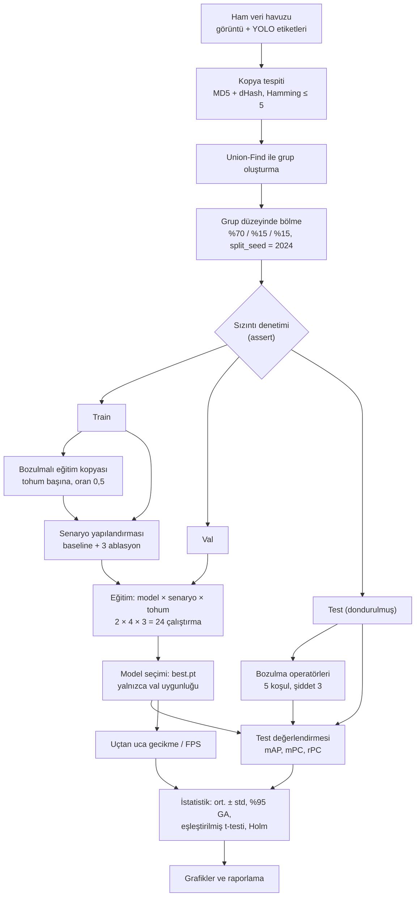

# 3. Yöntem ve Matematiksel Modelleme

Bu bölümde, tek aşamalı evrişimsel bir dedektör olan YOLOv8 ile transformer tabanlı küme-tahmini (set prediction) dedektörü RT-DETR'nin zorlu görüntüleme koşullarındaki hız–doğruluk ödünleşimini ölçmek için kullanılan yöntem tanımlanmaktadır. Önce deneysel akış verilmekte (3.1), ardından notasyon (3.2), kutu benzerlik ölçüleri (3.3), iki mimarinin kayıp fonksiyonları (3.4–3.5), optimizasyon (3.6), bozulma modeli (3.7), değerlendirme ve istatistiksel çıkarım (3.8–3.9) ve son olarak hesaplama karmaşıklığı (3.10) sunulmaktadır. Aksi belirtilmedikçe katsayılar, kullanılan Ultralytics uygulamasının [5] varsayılan değerleridir.

## 3.1 Metodolojik akış

Deneysel tasarımın akışı Şekil 3.1'de gösterilmiştir.

*Şekil 3.1. Deneysel akış. Test kümesine yalnızca model seçimi tamamlandıktan sonra erişilir; bozulmalar ve veri artırmaları ayrımdan sonra ve yalnızca ilgili bölmenin içinde üretilir.*

Akış dört aşamadan oluşur:

1. **Veri hazırlama ve sızıntı önleme.** Tüm görüntüler tek bir havuzda toplanır; veri kümesinin özgün train/val/test ayrımı kullanılmaz. Birebir kopyalar MD5 özetiyle, yakın kopyalar 64 bitlik *difference hash* (dHash) üzerindeki Hamming mesafesiyle bulunur. Bu ilişkiler Union-Find yapısında birleştirilerek bağlantılı bileşenler (gruplar) elde edilir ve bölme grup düzeyinde yapılır. Böylece bir görüntü ile onun yakın kopyası farklı bölmelere düşemez. Ayrım bir manifest dosyasına yazılarak dondurulur; bölmeler arası ortak özet, ortak grup ya da eşik altı dHash mesafesi bulunursa deney başlatılmaz.
2. **Koşul üretimi.** Temiz test bölmesinden, sabit bir rastgelelik tohumuyla beş bozulmuş test kümesi türetilir. Bozulma artırması ablasyonu için eğitim bölmesinin her tohuma özgü bir bozulmuş kopyası üretilir. Bu kopyada yalnızca üç bozulma türü kullanılır; kalan ikisi eğitimde hiç görülmez.
3. **Eğitim ve model seçimi.** Her (model, senaryo, tohum) üçlüsü bağımsız bir çalıştırmadır. En iyi ağırlıklar yalnızca doğrulama kümesindeki uygunluk ölçütüyle seçilir.
4. **Değerlendirme ve çıkarım.** Seçilen model altı test koşulunda değerlendirilir, uçtan uca gecikmesi ölçülür ve sonuçlar tohumlar üzerinden özetlenerek istatistiksel testlere tabi tutulur.

## 3.2 Problem tanımı ve notasyon

Veri kümesi $\mathcal{D}=\{(x_n, Y_n)\}_{n=1}^{N}$ biçimindedir. $x_n\in[0,255]^{H\times W\times 3}$ bir görüntü, $Y_n=\{(c_j, b_j)\}_{j=1}^{G_n}$ ise o görüntüdeki $G_n$ nesnenin sınıf etiketi $c_j\in\{1,\dots,C\}$ ve kutusu $b_j=(x_c, y_c, w, h)$ çiftlerinden oluşan kümedir. Bir dedektör $f_\theta$, girdiden tahmin kümesi $\hat Y=f_\theta(x)=\{(\hat p_i, \hat b_i)\}_{i=1}^{N_p}$ üretir; $\hat p_i\in[0,1]^{C}$ sınıf olasılıkları, $\hat b_i$ tahmin edilen kutudur. Bu çalışmada $C=4$, girdi çözünürlüğü baseline'da $640\times640$'tır.

Ayrık bölmeler $\mathcal{D}=\mathcal{D}_{tr}\,\dot\cup\,\mathcal{D}_{val}\,\dot\cup\,\mathcal{D}_{te}$ ile gösterilir. $g(\cdot)$, bir görüntüyü ait olduğu kopya grubuna eşleyen fonksiyon olmak üzere sızıntısızlık koşulu şudur:

$$
g(\mathcal{D}_a)\cap g(\mathcal{D}_b)=\varnothing,\qquad \min_{x\in\mathcal{D}_a,\;x'\in\mathcal{D}_b} d_H\big(h(x),h(x')\big) > \tau,\qquad a\neq b \tag{3.1}
$$

Burada $h(\cdot)$ dHash, $d_H$ Hamming mesafesi ve $\tau=5$ bittir.

## 3.3 Kutu benzerlik ölçüleri

İki kutu $B$ (tahmin) ve $B^{gt}$ (gerçek) için Kesişim/Birleşim oranı:

$$
\mathrm{IoU}(B,B^{gt})=\frac{\lvert B\cap B^{gt}\rvert}{\lvert B\cup B^{gt}\rvert} \tag{3.2}
$$

IoU, kutular örtüşmediğinde sıfırdır ve gradyan üretmez. **Genelleştirilmiş IoU** (GIoU) [14], iki kutuyu kapsayan en küçük kutu $C_{enc}$ yardımıyla bu sorunu giderir:

$$
\mathrm{GIoU}=\mathrm{IoU}-\frac{\lvert C_{enc}\setminus(B\cup B^{gt})\rvert}{\lvert C_{enc}\rvert},\qquad \mathrm{GIoU}\in(-1,1] \tag{3.3}
$$

**Tam IoU** (CIoU) [15], merkez uzaklığı ve en-boy oranı uyumunu da cezalandırır:

$$
\mathrm{CIoU}=\mathrm{IoU}-\frac{\rho^{2}(\mathbf{b},\mathbf{b}^{gt})}{c^{2}}-\alpha v \tag{3.4}
$$

$$
v=\frac{4}{\pi^{2}}\left(\arctan\frac{w^{gt}}{h^{gt}}-\arctan\frac{w}{h}\right)^{2},\qquad \alpha=\frac{v}{(1-\mathrm{IoU})+v} \tag{3.5}
$$

$\rho(\cdot)$ kutu merkezleri arasındaki Öklid uzaklığı, $c$ ise kapsayan kutunun köşegen uzunluğudur. Karşılık gelen kayıplar $\mathcal{L}_{\mathrm{GIoU}}=1-\mathrm{GIoU}$ ve $\mathcal{L}_{\mathrm{CIoU}}=1-\mathrm{CIoU}$'dur.

## 3.4 YOLOv8 kayıp fonksiyonu

### 3.4.1 Yoğun tahmin ve kutu kodlaması

YOLOv8, adımları $s\in\{8,16,32\}$ olan üç öznitelik haritasının her konumunda (çapa noktası) tahmin üretir. Toplam çapa noktası sayısı:

$$
N_a=\sum_{s\in\{8,16,32\}}\frac{H}{s}\cdot\frac{W}{s}=\frac{21\,HW}{1024} \tag{3.6}
$$

Bu değer $640\times640$ için 8400, $480\times480$ için 4725'tir. Her nokta $C$ sınıf logiti ile kutunun dört kenarına olan uzaklıkların ($l,t,r,b$) her biri için $R=16$ kutulu bir ayrık dağılım tahmin eder. Kenar uzaklığı bu dağılımın beklenen değeridir:

$$
\hat d=s\sum_{k=0}^{R-1} k\,\mathrm{softmax}(z)_k \tag{3.7}
$$

### 3.4.2 Görev hizalı atama (TAL)

Pozitif örnekler sabit çapalarla değil, tahmin kalitesine göre dinamik olarak seçilir. Merkezi $j$ nesnesinin kutusu içinde kalan her $i$ noktası için hizalama ölçütü:

$$
t_{ij}=\hat p_{i,c_j}^{\;\alpha}\cdot \mathrm{IoU}(\hat b_i,b_j)^{\beta},\qquad \alpha=0{,}5,\;\beta=6 \tag{3.8}
$$

Her nesne için en yüksek $t_{ij}$ değerine sahip $k=10$ nokta pozitif kabul edilir. Bir nokta birden fazla nesneye atanırsa en yüksek IoU'lu nesne korunur. Sınıflandırma hedefi ikili değil, normalize edilmiş yumuşak bir skordur:

$$
\hat t_{ij}=t_{ij}\cdot\frac{\max_{i'}\mathrm{IoU}(\hat b_{i'},b_j)}{\max_{i'} t_{i'j}} \tag{3.9}
$$

Normalizasyon sabiti $S=\sum_{i,c}\hat t_{ic}$, pozitif $i$ noktasının ağırlığı $w_i=\sum_c \hat t_{ic}$, pozitif nokta kümesi de $\mathcal{P}$ ile gösterilsin.

### 3.4.3 Kayıp bileşenleri

**Sınıflandırma (ikili çapraz entropi, yumuşak hedefli):**

$$
\mathcal{L}_{cls}=\frac{1}{S}\sum_{i=1}^{N_a}\sum_{c=1}^{C}-\Big[\hat t_{ic}\log\sigma(z_{ic})+(1-\hat t_{ic})\log\big(1-\sigma(z_{ic})\big)\Big] \tag{3.10}
$$

**Kutu regresyonu (CIoU):**

$$
\mathcal{L}_{box}=\frac{1}{S}\sum_{i\in\mathcal{P}} w_i\big(1-\mathrm{CIoU}(\hat b_i,b_{j(i)})\big) \tag{3.11}
$$

**Dağılım odak kaybı (DFL) [16].** Sürekli hedef uzaklık $y$ iki komşu tam sayı kutusu $y_l\le y<y_{l}+1=y_r$ arasındadır. Bu kayıp, olasılık kütlesini bu iki kutuya doğrusal ağırlıklarla yoğunlaştırır:

$$
\mathrm{DFL}(S_l,S_r)=-\big[(y_r-y)\log S_l+(y-y_l)\log S_r\big] \tag{3.12}
$$

$$
\mathcal{L}_{dfl}=\frac{1}{S}\sum_{i\in\mathcal{P}} w_i\cdot\frac{1}{4}\sum_{e\in\{l,t,r,b\}}\mathrm{DFL}_{i,e} \tag{3.13}
$$

**Toplam kayıp:**

$$
\mathcal{L}_{\mathrm{YOLO}}=B\big(\lambda_{box}\mathcal{L}_{box}+\lambda_{cls}\mathcal{L}_{cls}+\lambda_{dfl}\mathcal{L}_{dfl}\big),\qquad \lambda_{box}=7{,}5,\;\lambda_{cls}=0{,}5,\;\lambda_{dfl}=1{,}5 \tag{3.14}
$$

$B$ mini-yığın boyutudur. Çıkarımda, yoğun $N_a$ tahmin güven eşiğinden sonra Maksimum Olmayanı Bastırma (NMS) ile seyreltilir; bu adım türevlenemez ve eğitim amacının parçası değildir.

## 3.5 DETR ailesi kayıp fonksiyonu

### 3.5.1 Küme tahmini ve Macar eşlemesi

DETR [6], sabit sayıda $Q$ sorgudan oluşan bir tahmin kümesi $\hat Y=\{\hat y_i\}_{i=1}^{Q}$ üretir ($Q\ge G$; RT-DETR'de $Q=300$). Gerçek küme $Y$, "nesne yok" sınıfı $\varnothing$ ile $Q$ elemana tamamlanır. Kayıp hesaplanmadan önce iki küme arasındaki en düşük maliyetli birebir eşleme Macar algoritmasıyla bulunur:

$$
\hat\sigma=\operatorname*{arg\,min}_{\sigma\in\mathfrak{S}_Q}\sum_{j=1}^{Q}\mathcal{C}_{match}\big(y_j,\hat y_{\sigma(j)}\big) \tag{3.15}
$$

Özgün DETR'de eşleme maliyeti şöyledir:

$$
\mathcal{C}_{match}(y_j,\hat y_i)=-\mathbf{1}_{\{c_j\neq\varnothing\}}\,\hat p_i(c_j)+\mathbf{1}_{\{c_j\neq\varnothing\}}\,\mathcal{L}_{bbox}(b_j,\hat b_i) \tag{3.16}
$$

$$
\mathcal{L}_{bbox}(b,\hat b)=\lambda_{L1}\lVert b-\hat b\rVert_1+\lambda_{giou}\,\mathcal{L}_{\mathrm{GIoU}}(b,\hat b),\qquad\lambda_{L1}=5,\;\lambda_{giou}=2 \tag{3.17}
$$

**Macar kaybı** eşleme sabitlendikten sonra hesaplanır:

$$
\mathcal{L}_{\mathrm{Hung}}(Y,\hat Y)=\sum_{j=1}^{Q}\Big[-w_{c_j}\log\hat p_{\hat\sigma(j)}(c_j)+\mathbf{1}_{\{c_j\neq\varnothing\}}\,\mathcal{L}_{bbox}\big(b_j,\hat b_{\hat\sigma(j)}\big)\Big] \tag{3.18}
$$

Sınıf dengesizliğini gidermek için "nesne yok" sınıfının ağırlığı $w_\varnothing=0{,}1$'dir. Birebir eşleme her nesne için tek bir tahmini ödüllendirdiğinden mimari NMS gerektirmez.

### 3.5.2 RT-DETR'ye özgü değişiklikler

RT-DETR [7] bu çerçeveyi üç noktada değiştirir.

**(i) Odak tabanlı eşleme maliyeti.** Sınıf maliyeti olasılık yerine odak (focal) biçimindedir ($\alpha_f=0{,}25$, $\gamma=2$):

$$
\mathcal{C}_{cls}(i,j)=\alpha_f(1-\hat p_{ij})^{\gamma}\big(-\log\hat p_{ij}\big)-(1-\alpha_f)\,\hat p_{ij}^{\;\gamma}\big(-\log(1-\hat p_{ij})\big) \tag{3.19}
$$

$$
\mathcal{C}_{match}=1\cdot\mathcal{C}_{cls}+5\cdot\lVert b-\hat b\rVert_1+2\cdot\big(-\mathrm{GIoU}(b,\hat b)\big) \tag{3.20}
$$

**(ii) IoU farkındalıklı sınıflandırma: Varifocal kayıp** (VFL) [17]. Eşleşen sorgunun sınıf hedefi $q=\mathrm{IoU}(b_j,\hat b_{\hat\sigma(j)})$, eşleşmeyenlerde ise $q=0$'dır:

$$
\mathrm{VFL}(p,q)=\begin{cases}-q\big[q\log p+(1-q)\log(1-p)\big], & q>0\\[2pt] -\alpha\,p^{\gamma}\log(1-p), & q=0\end{cases}\qquad \alpha=0{,}75,\;\gamma=2 \tag{3.21}
$$

Böylece sınıf güveni, lokalizasyon kalitesiyle doğrudan ilişkilendirilir.

**(iii) Yardımcı ve gürültü giderme kayıpları.** Kayıp, $D=6$ kod çözücü katmanının her birinin çıktısına ve kodlayıcının sorgu seçimi için önerdiği ilk kutulara ayrı ayrı uygulanır. Ayrıca gerçek kutulara gürültü eklenerek oluşturulan sorgular (contrastive denoising) eşlemesi önceden bilinen ek bir alt problem oluşturur ve Macar eşlemesinin erken epoch'lardaki kararsızlığını azaltır:

$$
\mathcal{L}_{\mathrm{RT\text{-}DETR}}=\sum_{d=0}^{D}\Big[\mathcal{L}^{(d)}_{\mathrm{match}}+\mathcal{L}^{(d)}_{\mathrm{dn}}\Big],\qquad
\mathcal{L}^{(d)}=\lambda_{cls}\mathcal{L}_{\mathrm{VFL}}+\lambda_{L1}\mathcal{L}_{L1}+\lambda_{giou}\mathcal{L}_{\mathrm{GIoU}} \tag{3.22}
$$

Katsayılar $\lambda_{cls}=1$, $\lambda_{L1}=5$ ve $\lambda_{giou}=2$'dir. Kutu terimleri eşleşen nesne sayısına bölünerek normalize edilir.

> **Karşılaştırılabilirlik notu.** Denklem (3.14) ile (3.22) farklı terimlerden ve farklı ölçeklerden oluşur. Bu nedenle iki modelin mutlak kayıp değerleri birbiriyle karşılaştırılamaz; kayıp eğrileri yalnızca her modelin kendi içinde yakınsama tanılaması için kullanılır. Modeller arası karşılaştırma ortak ölçüt olan mAP üzerinden yapılır.

## 3.6 Optimizasyon

### 3.6.1 Amaç fonksiyonu

Tohum $r$ ile eğitilen bir modelin parametreleri, düzenlileştirilmiş ampirik riskin stokastik minimizasyonuyla elde edilir:

$$
\theta^{*}_{r}\approx\operatorname*{arg\,min}_{\theta}\;\frac{1}{\lvert\mathcal{D}'_{tr}\rvert}\sum_{(x,Y)\in\mathcal{D}'_{tr}}\mathcal{L}\big(f_\theta(\mathcal{A}_r(x)),\,\mathcal{A}_r(Y)\big) \tag{3.23}
$$

$\mathcal{A}_r$, tohuma bağlı stokastik veri artırma (mozaik, HSV, ölçekleme, yatay çevirme) operatörüdür. $\mathcal{D}'_{tr}$ ise senaryoya göre temiz ya da kısmen bozulmuş eğitim kümesidir. Ağırlık bozunumu, kayba eklenmek yerine optimizasyon adımına uygulanır ve yalnızca evrişim/doğrusal katman ağırlıklarına etki eder (yanlılık ve BatchNorm parametrelerine uygulanmaz).

### 3.6.2 Optimize edici seçimi

Kullanılan uygulamada optimize edici, eğitim bütçesine göre otomatik seçilir. Nominal yığın boyutu $B_{nom}=64$ olmak üzere:

$$
I=\left\lceil\frac{\lvert\mathcal{D}'_{tr}\rvert}{\max(B,B_{nom})}\right\rceil E,\qquad
\text{optimize edici}=\begin{cases}\text{SGD (Nesterov)},\;\eta_0=0{,}01 & I>10^{4}\\ \text{AdamW},\;\eta_0=\dfrac{0{,}002\cdot 5}{4+C} & I\le 10^{4}\end{cases} \tag{3.24}
$$

Bu çalışmanın ölçeğinde ($\lvert\mathcal{D}_{tr}\rvert\approx1050$, $E=80$) $I\approx1{,}4\times10^{3}$ olduğundan **AdamW** seçilir ve $C=4$ için $\eta_0=1{,}25\times10^{-3}$ olur.

**AdamW** [18] güncellemesi, $g_t=\nabla_\theta\mathcal{L}_t$ olmak üzere:

$$
m_t=\beta_1 m_{t-1}+(1-\beta_1)g_t,\qquad v_t=\beta_2 v_{t-1}+(1-\beta_2)g_t^{2} \tag{3.25}
$$

$$
\theta_{t+1}=\theta_t-\eta_t\left(\frac{m_t/(1-\beta_1^{t})}{\sqrt{v_t/(1-\beta_2^{t})}+\epsilon}+\lambda_{wd}\,\theta_t\right),\qquad \beta_1=0{,}9,\;\beta_2=0{,}999 \tag{3.26}
$$

Daha büyük eğitim bütçelerinde devreye giren **Nesterov momentumlu SGD** ($\mu=0{,}937$) ise şöyledir:

$$
v_{t+1}=\mu v_t+\big(g_t+\lambda_{wd}\theta_t\big),\qquad \theta_{t+1}=\theta_t-\eta_t\big(g_t+\lambda_{wd}\theta_t+\mu v_{t+1}\big) \tag{3.27}
$$

### 3.6.3 Gradyan biriktirme ve ağırlık bozunumu ölçeklemesi

Fiziksel yığın boyutu $B=8$ olduğundan gradyanlar $A=\max(\mathrm{round}(B_{nom}/B),1)=8$ adım boyunca biriktirilir. Efektif yığın boyutu böylece $AB=64$'tür. Ağırlık bozunumu da buna göre ölçeklenir:

$$
\lambda_{wd}=5\times10^{-4}\cdot\frac{A\,B}{B_{nom}}=5\times10^{-4} \tag{3.28}
$$

Her güncellemeden önce gradyan normu kırpılır: $g\leftarrow g\cdot\min\!\big(1,\,10/\lVert g\rVert_2\big)$.

### 3.6.4 Öğrenme oranı takvimi

$e$ epoch indeksi, $E$ toplam epoch sayısı ve $r_f=0{,}01$ son oran çarpanı olmak üzere doğrusal azalan takvim:

$$
\eta(e)=\eta_0\Big[\Big(1-\frac{e}{E}\Big)(1-r_f)+r_f\Big] \tag{3.29}
$$

İlk $n_w=\max(3\cdot n_b,\,100)$ iterasyonda ($n_b$: epoch başına yığın sayısı) ısınma uygulanır. Bu sürede öğrenme oranı 0'dan $\eta(e)$'ye, momentum ($\beta_1$) ise $0{,}8$'den hedef değerine doğrusal olarak çıkarılır. Son 10 epoch'ta mozaik artırması kapatılır; böylece model test dağılımına daha yakın, bütün görüntülerle ince ayar yapar.

### 3.6.5 Üstel hareketli ortalama ve model seçimi

Değerlendirmede ham ağırlıklar yerine üstel hareketli ortalamaları (EMA) kullanılır:

$$
\theta^{\mathrm{EMA}}_{t}=d_t\,\theta^{\mathrm{EMA}}_{t-1}+(1-d_t)\,\theta_t,\qquad d_t=0{,}9999\big(1-e^{-t/2000}\big) \tag{3.30}
$$

Her epoch sonunda doğrulama kümesinde bir uygunluk değeri hesaplanır ve en iyi epoch'un ağırlıkları saklanır:

$$
F(e)=0{,}1\cdot\mathrm{mAP}_{50}^{val}(e)+0{,}9\cdot\mathrm{mAP}_{50:95}^{val}(e),\qquad \hat\theta_r=\theta^{\mathrm{EMA}}_{e^{*}},\;\; e^{*}=\operatorname*{arg\,max}_e F(e) \tag{3.31}
$$

Test kümesi bu seçimde hiçbir biçimde kullanılmaz. Karma hassasiyetli (AMP) eğitim, dinamik kayıp ölçekleme ile uygulanır. Tekrarlanabilirlik için Python, NumPy ve PyTorch tohumları sabitlenir, cuDNN deterministik kipte çalıştırılır.

### 3.6.6 Senaryolar

Her ablasyon, baseline'dan tek bir faktörü değiştirir:

| Senaryo | Değişen faktör | Biçimsel ifade |
|---|---|---|
| baseline | — | $\mathcal{D}'_{tr}=\mathcal{D}_{tr}$, $H=W=640$ |
| abl\_adv\_aug | Bozulma artırması | $\mathcal{D}'_{tr}=\{T_{k,\ell}(x)\text{ olasılık }0{,}5\text{ ile},\;x\text{ aksi halde}\}$, $k\in\mathcal{K}_{tr}$ |
| abl\_imgsz480 | Girdi çözünürlüğü | $H=W=480$ (FLOP oranı $\approx(480/640)^2=0{,}5625$) |
| abl\_no\_mosaic | Mozaik artırması | $\mathcal{A}_r$ içinde mozaik olasılığı $=0$ |

*Tablo 3.1. Baseline ve ablasyon senaryoları.*

## 3.7 Zorlu koşulların modellenmesi

$I\in[0,255]^{H\times W\times3}$ temiz görüntü, $\ell\in\{1,\dots,5\}$ şiddet düzeyi ve $\omega$ görüntüye özgü rastgelelik olmak üzere her bozulma bir $T_{k,\ell}(I;\omega)$ operatörüdür. Rastgelelik, $\omega=\mathrm{MD5}(\text{tohum}\,\|\,\text{dosya adı}\,\|\,k)$ ile belirlenir; böylece bozulmalar çalıştırma sırasından bağımsız ve bit düzeyinde tekrarlanabilirdir. Operatörler fotometrik/optik olduğundan geometriyi değiştirmez: $T_{k,\ell}(Y)=Y$.

**Sis — atmosferik saçılma modeli** (Koschmieder yasası):

$$
T_{fog}(I)=I\odot t+A\,(1-t),\qquad 1-t=\mathrm{clip}\big(a_\ell(0{,}6+0{,}8\,n)\,\delta,\;0,\;0{,}9\big),\quad A=225 \tag{3.32}
$$

$n$ düşük frekanslı normalize gürültü, $\delta$ görüntünün üstüne doğru artan sözde derinlik, $a_\ell\in\{0{,}25,\dots,0{,}65\}$'tir.

**Düşük ışık — gama sıkıştırma ve Poisson–Gauss sensör gürültüsü:**

$$
u=g_\ell\Big(\frac{I}{255}\Big)^{\gamma_\ell},\qquad T_{ll}(I)=255\cdot\mathrm{clip}\big(u+\epsilon_1\sqrt{u}+\epsilon_2,\;0,\;1\big),\quad \epsilon_1\sim\mathcal{N}(0,\sigma_\ell^{2}),\;\epsilon_2\sim\mathcal{N}(0,\sigma_\ell^{2}/4) \tag{3.33}
$$

$\sqrt{u}$ ile ölçeklenen terim sinyale bağlı atış (shot) gürültüsünü, $\epsilon_2$ ise okuma gürültüsünü temsil eder.

**Hareket bulanıklığı — doğrusal nokta yayılım fonksiyonu ile evrişim:**

$$
T_{mb}(I)=I*k_{L_\ell,\phi},\qquad \phi\sim\mathcal{U}(0^\circ,180^\circ),\;\; L_\ell\in\{5,9,13,17,23\} \tag{3.34}
$$

**Gauss gürültüsü:** $T_{gn}(I)=\mathrm{clip}(I+\epsilon)$, $\epsilon\sim\mathcal{N}(0,\sigma_\ell^2)$, $\sigma_\ell\in\{0{,}04,\dots,0{,}13\}\cdot255$.

**Yağmur — çizgisel damla katmanı ile toplamsal model:**

$$
T_{rain}(I)=\mathrm{clip}\big(0{,}85\,I+180\cdot(G_{3\times3}*R_\ell)\big) \tag{3.35}
$$

$R_\ell$, yoğunluğu ve uzunluğu $\ell$ ile artan eğik çizgilerden oluşan ikili maske, $G_{3\times3}$ ise Gauss bulanıklaştırma çekirdeğidir.

Test koşulları $\mathcal{K}=\{fog,\,ll,\,mb,\,gn,\,rain\}$, $\ell=3$ ile üretilir. Bozulma artırmalı eğitimde $\mathcal{K}_{tr}=\{fog,\,ll,\,gn\}$ ve $\ell\sim\mathcal{U}\{1,2,3\}$ kullanılır. Böylece $\mathcal{K}\setminus\mathcal{K}_{tr}=\{mb,\,rain\}$ eğitimde **görülmemiş** bozulmalardır.

## 3.8 Değerlendirme metrikleri

**Ortalama kesinlik.** IoU eşiği $\tau$ ve sınıf $c$ için kesinlik–duyarlılık eğrisi $P_c(R)$'nin monoton zarfı $\tilde P_c(R)=\max_{R'\ge R}P_c(R')$ alınır ve 101 noktada enterpolasyon yapılır (COCO protokolü):

$$
\mathrm{AP}_c^{\tau}=\frac{1}{101}\sum_{R\in\{0,0.01,\dots,1\}}\tilde P_c(R),\qquad
\mathrm{mAP}_{50:95}=\frac{1}{10\,C}\sum_{\tau\in\{0.50,0.55,\dots,0.95\}}\sum_{c=1}^{C}\mathrm{AP}_c^{\tau} \tag{3.36}
$$

**Dayanıklılık** [3]. Bozulmalar üzerinden ortalama performans ve temiz performansa göre oranı:

$$
\mathrm{mPC}=\frac{1}{\lvert\mathcal{K}\rvert}\sum_{k\in\mathcal{K}}\mathrm{mAP}_{50:95}^{(k,\ell=3)},\qquad \mathrm{rPC}=\frac{\mathrm{mPC}}{\mathrm{mAP}_{50:95}^{clean}} \tag{3.37}
$$

**Hız.** Ön işleme, ileri geçiş ve son işlemeyi (YOLO için NMS dahil) kapsayan uçtan uca gecikme, yığın boyutu 1 ile ölçülür. $W=10$ ısınma turu atılır; her ölçümün başında ve sonunda GPU senkronize edilir. $\{t_m\}_{m=1}^{M}$ ($M=200$) gecikme örnekleri olmak üzere:

$$
\mathrm{FPS}=\frac{1000}{\mathrm{median}(t_1,\dots,t_M)\;[\mathrm{ms}]} \tag{3.38}
$$

Medyan, arka plan süreçlerinden kaynaklanan aykırı değerlere karşı dayanıklı olduğu için tercih edilmiştir. Kuyruk davranışı ayrıca 95. yüzdelik gecikme ($t_{p95}$) ile raporlanır.

## 3.9 İstatistiksel çıkarım

Her (model, senaryo) çifti $R=3$ bağımsız tohumla ($r\in\{0,1,2\}$) eğitilir. Veri ayrımı ve bozuk test kümeleri tohumlardan bağımsız olarak sabittir. Dolayısıyla gözlenen varyans yalnızca eğitim stokastikliğini (ağırlık başlatma, veri sırası, artırma) yansıtır. Bir metriğin tohum değerleri $\{m_r\}$ için:

$$
\bar m=\frac{1}{R}\sum_{r=1}^{R}m_r,\qquad s=\sqrt{\frac{1}{R-1}\sum_{r=1}^{R}(m_r-\bar m)^2},\qquad \mathrm{GA}_{95}=\bar m\pm t_{0.975,\,R-1}\frac{s}{\sqrt R} \tag{3.39}
$$

Sonuçlar $\bar m\pm s$ biçiminde raporlanır. $R=3$ için $t_{0.975,2}\approx4{,}303$ olduğundan güven aralıkları geniştir.

Aynı tohum aynı veri sırasını ve artırma örneklemini paylaştığından karşılaştırmalar **eşleştirilmiş** yapılır. $\Delta_r=m^{A}_r-m^{B}_r$ olmak üzere:

$$
t=\frac{\bar\Delta}{s_\Delta/\sqrt R},\qquad H_0:\;\mathbb{E}[\Delta]=0,\qquad \text{sd}=R-1 \tag{3.40}
$$

Yapılan $K$ testin $p$-değerleri küçükten büyüğe sıralanır, $p_{(1)}\le\dots\le p_{(K)}$. Ailesel hata oranını kontrol etmek için Holm–Bonferroni düzeltmesi uygulanır:

$$
\tilde p_{(k)}=\min\Big\{1,\;\max_{j\le k}\big[(K-j+1)\,p_{(j)}\big]\Big\} \tag{3.41}
$$

$R=3$ ile testin istatistiksel gücü düşüktür. Bu nedenle anlamlı bulunmayan bir fark "fark yok" olarak yorumlanmaz; $p$-değerinden önce etki büyüklüğü ($\bar\Delta\pm s_\Delta$) raporlanır.

## 3.10 Hesaplama karmaşıklığı analizi

Notasyon: $H\times W$ girdi çözünürlüğü, $C$ sınıf sayısı, $G$ görüntü başına nesne sayısı, $N_a$ çapa noktası sayısı (3.6), $N'$ güven eşiğini geçen aday sayısı, $Q$ sorgu sayısı, $d$ gizli boyut, $L_5=HW/32^2$ en kaba ölçekteki belirteç (token) sayısı, $D$ kod çözücü katman sayısı, $M_h$ dikkat başı, $K_p$ örnekleme noktası, $N_\ell$ ölçek sayısı.

### 3.10.1 Çıkarım

**Omurga ve boyun (her iki model).** Sabit bir mimari için evrişim maliyeti $\sum_{l}H_lW_l\,k_l^2\,C^{in}_lC^{out}_l$'dir; bu, piksel sayısında doğrusaldır: $\Theta(HW)$. Çözünürlüğün 640'tan 480'e indirilmesi bu bileşenin maliyetini teorik olarak $\approx\%44$ azaltır.

**YOLOv8 başlığı ve son işleme.** Kod çözme $O\big(N_a(C+4R)\big)$, güven filtresi $O(N_aC)$'dir. NMS ise adayları sıralama ve çift IoU karşılaştırmaları nedeniyle şu maliyete sahiptir:

$$
T_{\mathrm{NMS}}=O\big(N'\log N'\big)+O\big(N'^{\,2}\big)\;\;\text{(en kötü durum)} \tag{3.42}
$$

$N'$ sahnedeki nesne yoğunluğuna ve görüntü içeriğine bağlıdır. Gürültülü görüntülerde artan yanlış pozitifler $N'$'yi, dolayısıyla gecikmeyi büyütebilir. YOLO gecikmesi bu yüzden **veriye bağlıdır**.

**RT-DETR kodlayıcı ve kod çözücü.** Özgün DETR'de tüm belirteçlere uygulanan öz-dikkat $O(L^2d)$ maliyetlidir. RT-DETR, öz-dikkati (AIFI) yalnızca en kaba ölçekte uygular ve diğer ölçekleri evrişimsel kaynaştırmayla (CCFM) birleştirir:

$$
T_{\mathrm{AIFI}}=O\big(L_5^{2}\,d\big)=O\!\Big(\frac{H^2W^2}{32^4}\,d\Big) \tag{3.43}
$$

$640\times640$ için $L_5=400$ belirteç vardır. Üç ölçeğin tamamına ($\approx8400$ belirteç) dikkat uygulanmış olsaydı bu terim yaklaşık $(8400/400)^2=441$ kat büyük olurdu. Kod çözücünün maliyeti:

$$
T_{\mathrm{dec}}=D\cdot O\big(\underbrace{Q^2d}_{\text{öz-dikkat}}+\underbrace{Q\,M_h\,N_\ell\,K_p\,d}_{\text{deforme çapraz dikkat}}+\underbrace{Q\,d\,d_{ff}}_{\text{FFN}}\big) \tag{3.44}
$$

Bu ifade $HW$'den bağımsızdır. Son işleme NMS içermez; $O(QC)$ maliyetli bir top-$k$ seçimidir ve sahne içeriğinden bağımsız, **sabit** sürelidir.

**Asimptotik özet.** İki model de $HW$'de baskın olarak doğrusal ölçeklenir. RT-DETR'de ek olarak $L_5^2\propto(HW)^2$ terimi vardır; pratik çözünürlüklerde bu terimin katsayısı küçük kalır. YOLO'nun son işleme süresi içerikle değişirken RT-DETR'ninki sabittir. Bu fark ortalama gecikmeden çok gecikme varyansında ve $t_{p95}$'te görünür olmalıdır.

### 3.10.2 Eğitim

| Bileşen | YOLOv8 | RT-DETR |
|---|---|---|
| İleri + geri geçiş | $\Theta(HW)$ | $\Theta(HW)+O(L_5^2d)+O(D\,Q^2d)$ |
| Etiket atama | TAL: $O(G\,N_a)$ IoU + $O(G\,N_a\log k)$ top-$k$ | Maliyet matrisi $O(Q\,G)$ + Macar: $O(Q\,G^2)$, $D+1$ kez |
| Kayıp | $O\big(N_a(C+4R)\big)$ | $O\big((D+1)(Q+N_{dn})\,C\big)$ |
| Son işleme (çıkarım) | NMS: $O(N'^2)$ en kötü | top-$k$: $O(QC)$ |
| Parametre / GFLOPs (640 px) | 25,9 M / 78,9 | 32 M / 110 |

*Tablo 3.2. Görüntü başına zaman karmaşıklığı. $N_{dn}$: gürültü giderme sorgu sayısı. Macar algoritması dikdörtgen ($Q\times G$, $G\le Q$) maliyet matrisinde $O(QG^2)$ çalışır ve CPU üzerinde yürütülür; nesne yoğun sahnelerde eğitim darboğazı olabilir.*

### 3.10.3 Deney hattı

| Adım | Zaman | Bellek |
|---|---|---|
| MD5 özetleri | $O\big(\sum_n \lvert x_n\rvert_{\text{bayt}}\big)$ | $O(N)$ |
| dHash | $O\big(\sum_n H_nW_n\big)$ (yeniden boyutlandırma) | $O(N)$ |
| Çiftler arası Hamming | $O(N^2)$ 64 bitlik XOR + popcount | $O(b\,N)$, $b=256$ parça boyu |
| Union-Find | $O\big((N+P)\,\alpha(N)\big)$, $P$: kopya çifti sayısı | $O(N)$ |
| Grup düzeyinde bölme | $O(N_g\log N_g)$ | $O(N_g)$ |
| Sızıntı denetimi | $O(N_aN_b)$ her bölme çifti için | $O(b\,N)$ |
| Sis, düşük ışık, gürültü | $O(HW)$ / görüntü | $O(HW)$ |
| Hareket bulanıklığı | $O(HW\,L_\ell^2)$; büyük çekirdekte DFT ile $O(HW\log HW)$ | $O(HW)$ |
| Yağmur | $O(n_d\,\ell_d+HW)$, $n_d$ damla, $\ell_d$ uzunluk | $O(HW)$ |
| İstatistik + Holm | $O(R)$ grup başına, $O(K\log K)$ | ihmal edilebilir |

*Tablo 3.3. Veri hazırlama ve analiz adımlarının karmaşıklığı. $N_g$: grup sayısı.*

$N^2$ terimi yalnızca bir kez (ayrım oluşturulurken) hesaplanır ve $N\approx1500$ için $\approx2{,}25\times10^{6}$ bit işlemiyle saniyeler mertebesindedir.

**Toplam deney maliyeti.** $\mathcal{M}$ model, $\mathcal{S}$ senaryo ve $R$ tohum için:

$$
T_{\mathrm{toplam}}=\sum_{m\in\mathcal{M}}\lvert\mathcal{S}\rvert\,R\Big[E\,\lvert\mathcal{D}'_{tr}\rvert\,c^{tr}_m+E\,\lvert\mathcal{D}_{val}\rvert\,c^{inf}_m+(1+\lvert\mathcal{K}\rvert)\,\lvert\mathcal{D}_{te}\rvert\,c^{inf}_m+(W+M)\,c^{e2e}_m\Big] \tag{3.45}
$$

$c^{tr}_m$, $c^{inf}_m$ ve $c^{e2e}_m$ sırasıyla görüntü başına eğitim, değerlendirme ve uçtan uca çıkarım maliyetleridir. Bu çalışmada $\lvert\mathcal{M}\rvert\,\lvert\mathcal{S}\rvert\,R=2\cdot4\cdot3=24$ eğitim ve $24\cdot6=144$ test değerlendirmesi yapılır. Maliyet, eğitim terimi $E\lvert\mathcal{D}'_{tr}\rvert c^{tr}_m$ tarafından belirlenir.
